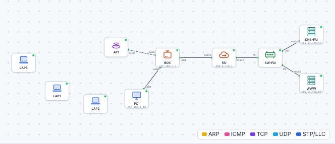
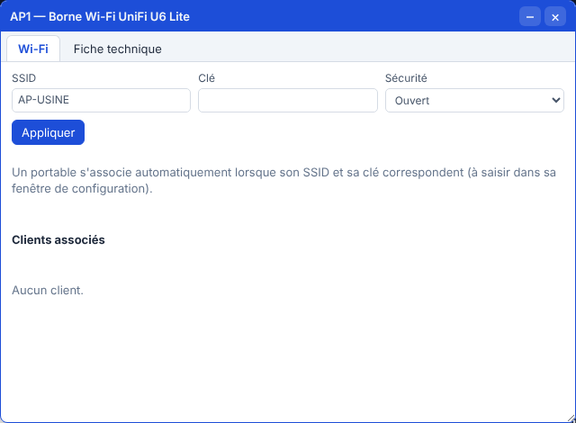
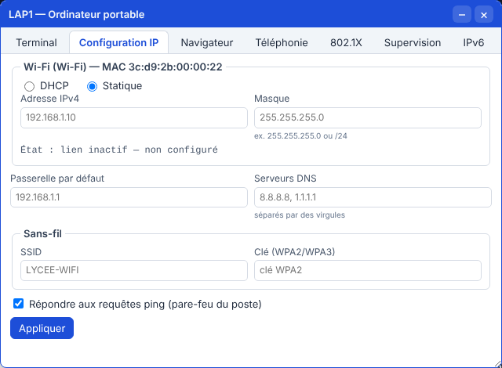

# 🛠️ TP – Installer et sécuriser un Wi-Fi

*Bac Pro CIEL – Seconde – E31 – S14 – binôme, on **échange les rôles** à chaque partie*

> [!NOTE]
> **Mission.** Un atelier vient de recevoir une **borne Wi-Fi neuve**, encore dans sa configuration d'usine (nom générique, **aucune sécurité**). Tu **cartographies** les Wi-Fi existants, tu **sécurises** la borne, tu **connectes** des appareils, tu **mesures** la couverture et tu **contrôles** l'installation avec une grille.
>
> **Temps prévu :** 3 h 20. **Prérequis :** [cours S14](01-cours.md) lu (§1 à §4).

**Binôme :** ____________ / ____________

---

> [!NOTE]
> **Comment ce TP fonctionne.** Les **commandes et réglages sont donnés** quand on ne peut pas les deviner : ton travail est de les **comprendre** (que fait chaque ligne, pourquoi, comment je le vérifie). Écris tes réponses aux ❓ **avant** de tester. Le **bilan final** nourrit ton **passeport d'autonomie**.

## Partie A – Cartographier les Wi-Fi de la salle (≈ 35 min)

Avec l'**application d'analyse** de ton smartphone (WiFiman, Wi-Fi Analyzer, NetSpot…), relève **5 réseaux** visibles. *(Ne note aucun mot de passe.)*

| SSID | Bande (2,4 / 5 GHz) | Canal | Signal (dBm) | Sécurité (WPA2 / WPA3 / ouvert) |
|---|---|---|---|---|
| | | | | |
| | | | | |
| | | | | |
| | | | | |
| | | | | |

✅ **Point de contrôle :** tu repères **le réseau le plus fort** et **le plus faible**.
❓ **Combien** de réseaux utilisent le même canal en 2,4 GHz ? Qu'est-ce que ça provoque ? ______________________
❓ **Y a-t-il un réseau « ouvert » ?** Pourquoi est-ce risqué ? ______________________

Aide

Plusieurs réseaux sur le **même canal** se partagent la bande : tout le monde ralentit. Un réseau **ouvert** n'est pas chiffré : n'importe qui peut observer ou se faire passer pour lui.

**🔁 Échange des rôles.**

---

## Partie B – Sécuriser la borne et connecter les portables (≈ 55 min, simulateur)

1. Ouvre le [simulateur](../../simulateur/simulateur-reseau.html), puis charge [`s14-wifi.json`](tp/s14-wifi.json).

2. **Constat de départ.** Double-clique sur **AP1** (la borne) :

| Réglage de la borne | Valeur actuelle | Verdict (OK / à corriger) |
|---|---|---|
| SSID | | |
| Sécurité | | |
| Clé | | |

3. **Sécurise la borne :**
   - SSID : `ATELIER-CIEL`
   - Sécurité : **WPA2**
   - Clé : **ta phrase de passe** (≥ 12 caractères) → **note-la ici :** ____________________
   - Clique sur **Appliquer**.

4. **Connecte LAP1 et LAP2** : fenêtre du portable → **Configuration IP** → section **Wi-Fi** : coche **DHCP** ; plus bas, **SSID** + **clé** (les mêmes que la borne) → **Appliquer**.

5. **Vérifie** sur chaque portable : `ipconfig`

| Portable | Adresse IP Wi-Fi | Passerelle | Associé à la borne ? |
|---|---|---|---|
| LAP1 | | | |
| LAP2 | | | |

6. Teste : `ping 203.0.113.1` (Internet) depuis LAP1, et `ping` vers le PC1 (filaire) depuis LAP2.

✅ **Point de contrôle :** les deux portables ont une adresse et joignent Internet **et** le PC filaire.
❓ **Pourquoi** les portables en Wi-Fi reçoivent-ils une adresse **du même réseau** que le PC filaire ? ______________________

Aide

La borne **relie** le Wi-Fi au **même réseau local** que le câble. C'est la **box** qui distribue les adresses à tous (S12).

### B2. Une mauvaise clé

Configure **LAP3** avec le bon SSID mais une **fausse clé**. Observe : `ipconfig` sur LAP3.

| Observation sur LAP3 | |
|---|---|
| Adresse IP Wi-Fi | |
| État de la carte Wi-Fi | |

❓ **Pourquoi** LAP3 n'a-t-il **même pas** d'adresse IP ? ______________________
❓ **À quelle étape** du schéma « 3 étapes » (cours §1) l'échec a-t-il lieu ? ______________________

Aide

Avec une clé fausse, la **connexion à la borne échoue** (étape 2) : on n'arrive jamais à l'étape 3 (DHCP). Ce n'est **pas** un problème d'adressage.

7. **Remets** la bonne clé sur LAP3 : il doit obtenir une adresse.

**🔁 Échange des rôles.**

---

## Partie C – Contrôler une vraie borne (≈ 50 min)

*Sur la borne ou la box de TP remise à zéro.* Utilise la [grille de contrôle](03-grille-controle.md) : tu règles, tu testes, tu notes.

1. Accède à l'interface d'administration (adresse = passerelle du PC, comme en S12).
2. **Change le mot de passe administrateur.**
3. Règle **SSID**, **WPA2** (ou WPA3) et **clé forte**.
4. **Désactive le WPS.**
5. Si la borne le permet : **crée un réseau invité** (SSID `ATELIER-INVITES`) **isolé** du réseau interne.
6. Connecte **ton smartphone** au Wi-Fi interne, puis au Wi-Fi invité.
7. **Teste** : accès à Internet (les deux réseaux) ; accès à l'imprimante ou à un PC du réseau interne (seulement depuis l'interne).

✅ **Point de contrôle :** la grille est complète, **tous** les tests sont ✅.

> [!NOTE]
> **Sans matériel réel**, fais les étapes de la partie B et complète la grille **à partir du simulateur** pour ce qui est simulé (SSID, sécurité, clé) ; l'enseignant montre le reste (WPS, invité) sur une borne.

---

## Partie D – Couverture et bons réflexes (≈ 40 min)

### D1. Mesurer la couverture

Place la borne au centre de la salle. Mesure le **signal** (dBm) à **4 endroits** :

| Point de mesure | Distance approx. à la borne | Obstacle (mur, armoire…) | Signal (dBm) | Verdict (≥ -67 ?) |
|---|---|---|---|---|
| 1 | | | | |
| 2 | | | | |
| 3 | | | | |
| 4 | | | | |

❓ **Où** est le point faible ? Que proposes-tu (déplacer la borne, ajouter une borne, changer de bande) ? ______________________

### D2. Les bons réflexes

Indique **Vrai** ou **Faux**, et **corrige** si faux :

| Affirmation | V / F | Correction |
|---|---|---|
| « Mon Wi-Fi a une clé : je n'ai pas besoin de changer le mot de passe de la borne » | | |
| « Je peux utiliser `12345678` : personne ne le devinera » | | |
| « Pour un Wi-Fi invité, je donne l'accès aux imprimantes de l'entreprise » | | |
| « Le WPS est pratique, je le laisse activé » | | |
| « Une mise à jour de la borne, c'est inutile si ça marche » | | |
| « Je peux tester la clé du voisin juste pour voir » | | |

---

## 📒 Mon bilan pour le passeport d'autonomie (écrit)

| Question | Ma réponse |
|---|---|
| Une **décision** que j'ai prise, et **pourquoi** | |
| Ce qui m'a **surpris** ou ne s'est pas passé comme prévu | |
| Ce que je saurais **refaire seul(e)**, sans fiche | |
| Ma **preuve** (capture, sortie de commande) | |

> [!TIP]
> **Niveau 3 « Autonome » du passeport** : je règle un Wi-Fi **avec la fiche** et j'**explique** pourquoi on choisit WPA2/WPA3.

## 🏁 Bilan

### Oral (2 min par élève)

1. Pourquoi sécuriser un Wi-Fi avec WPA2/WPA3 ?
2. Un portable ne se connecte pas : quelles causes possibles, dans l'ordre ?
3. À quoi sert un réseau invité ?

| Mon auto-évaluation | 😟 | 🙂 | 😀 |
|---|---|---|---|
| Je sais configurer SSID, WPA2 et une clé forte | | | |
| Je sais connecter un portable et un smartphone | | | |
| Je sais mesurer le signal et lire des dBm | | | |
| Je sais expliquer le réseau invité et le WPS | | | |

## 🔍 Dépannage

| Symptôme | Cause probable | Que faire |
|---|---|---|
| Le portable ne se connecte pas | Mauvaise clé / mauvais SSID / mauvaise sécurité | Vérifier SSID et clé (majuscules !) |
| Connecté mais pas d'adresse | DHCP en panne | Revoir S12 |
| Connecté, adresse OK, pas Internet | Passerelle / DNS | Revoir S12–S13 |
| Wi-Fi lent | Canal encombré, trop loin, 2,4 GHz saturé | Changer de canal / de bande / de place |
| Impossible de se connecter à l'admin de la borne | Mauvaise adresse ou mot de passe oublié | Bouton *reset* avec l'enseignant |

> [!TIP]
> **Passeport d'autonomie :** lignes « Configurer et sécuriser une borne Wi-Fi » et « Connecter un poste en Wi-Fi » → *vu en guidé* ✔.

➡️ **Mission en entreprise :** relever le **nom** du Wi-Fi de l'entreprise et son **type de sécurité** (interne / invités). **Ne jamais relever les mots de passe.**
