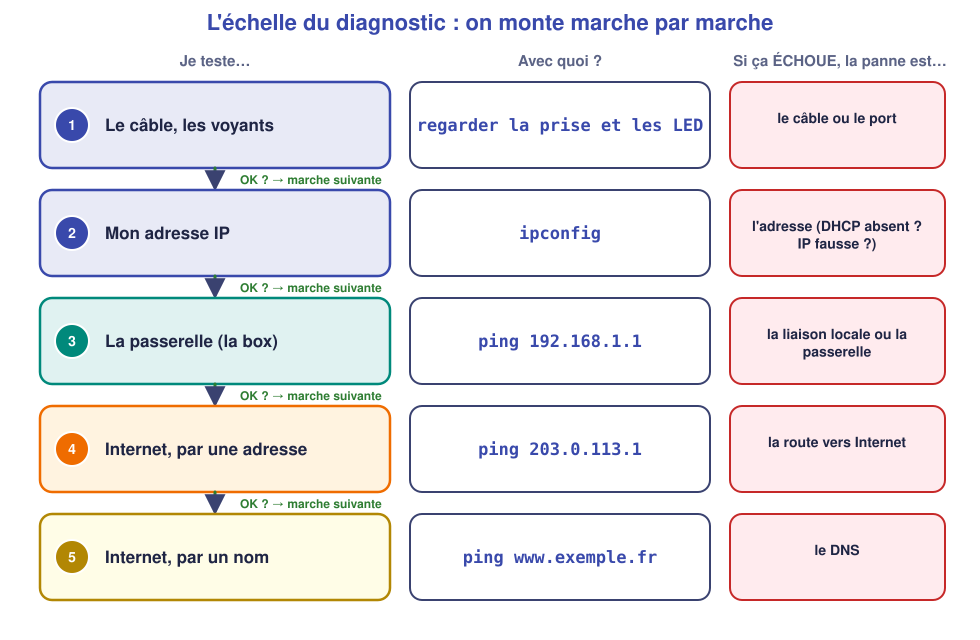
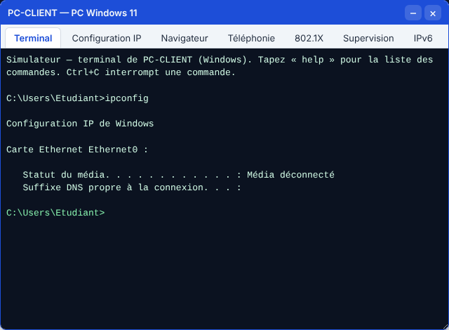
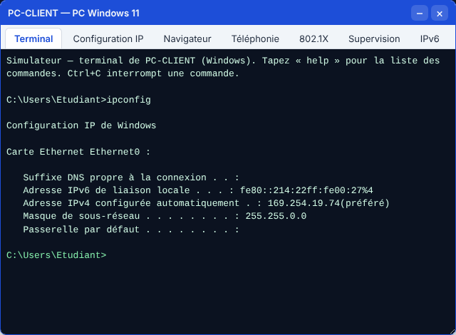
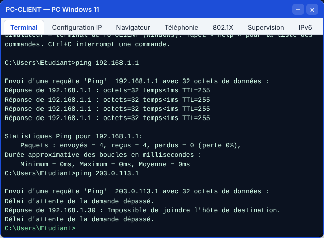
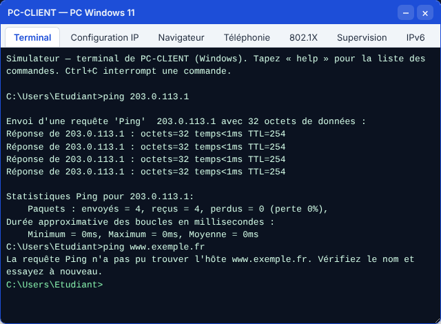

# 📖 Cours – Dépanner : l'échelle du diagnostic

*Bac Pro CIEL – Seconde – E31 – S15*

> [!IMPORTANT]
> **Une idée à la fois.** Réponds à la question **avant** de déplier la réponse.

## 🎯 À la fin de ce cours, tu sauras

- [ ] suivre **toujours le même ordre** pour chercher une panne ;
- [ ] relier un **symptôme** à sa **cause probable** ;
- [ ] **corriger**, puis **vérifier** que tout marche ;
- [ ] **écrire** une fiche d'intervention compréhensible par un collègue.

---

## 1. Pourquoi une méthode ?

### 🤔 Avant de lire : à ton avis ?

Un collègue te dit : « Je n'arrive plus à ouvrir un site web. » Tu changes le câble, tu redémarres le PC, tu réinstalles le navigateur… et ça ne marche toujours pas. **Qu'est-ce qui ne va pas dans cette façon de faire ?**

Voir la réponse

Tu **essaies au hasard** : tu perds du temps, tu peux casser autre chose et tu ne sais pas **pourquoi** ça marche (ou pas). Un technicien **teste dans un ordre précis** et ne change **qu'une chose à la fois**.

### 💡 L'idée

Pour ouvrir un site, **toute une chaîne** doit marcher : le câble, l'adresse IP, la box, la route vers Internet, le DNS. Si un maillon casse, **tout ce qui est après est cassé aussi**. On teste donc **du plus proche au plus lointain** : le **premier test qui échoue** désigne la panne.

> [!TIP]
> **Retiens :** on monte l'échelle **marche par marche**. On ne passe à la marche suivante que si la précédente est **OK**.

### ✅ Vérifie que tu as compris

Le `ping 192.168.1.1` répond, mais `ping 203.0.113.1` ne répond pas. **Quelle marche a échoué ? Quelle est la panne probable ?**

Voir la réponse

La marche **4** (Internet par une adresse). La box répond, donc le câble et l'adresse sont corrects : la panne est **entre le poste et Internet**, typiquement la **passerelle** mal réglée sur le poste (ou la box sans Internet).

---

## 2. Lire les indices

### 2.1 Les voyants et la commande `ipconfig`

*Statut du média : **Média déconnecté*** → le poste ne « sent » aucun câble. On vérifie la prise, le câble, le port du switch.

*Adresse en **169.254.x.x*** → le poste n'a **trouvé aucun serveur DHCP** (S12) : il s'est donné une adresse tout seul. Le DHCP est injoignable : câble entre switch et box, box éteinte, DHCP désactivé.

### 2.2 La commande `ping`

| Réponse du `ping` | Ce que ça veut dire |
|---|---|
| `Réponse de …` | La machine répond : le chemin fonctionne |
| `Délai d'attente de la demande dépassé` | Pas de réponse : la machine est éteinte, absente ou le chemin est coupé |
| `Impossible de joindre l'hôte de destination` | Mon poste **ne sait pas par où envoyer** (mauvais réseau, mauvaise passerelle) |
| `échec général` | Mon poste n'a **pas de configuration utilisable** (pas d'IP, câble débranché) |
| `La requête Ping n'a pas pu trouver l'hôte` | Le **nom** n'a pas été résolu : problème de **DNS** |

*Ici : la box répond (`Réponse de 192.168.1.1`) mais Internet non → **marche 4**.*

*Ici : `203.0.113.1` répond, mais pas `www.exemple.fr` → **marche 5 : le DNS**.*

### ✅ Vérifie que tu as compris

Un poste affiche `Adresse IPv4 : 192.168.10.30` alors que le réseau de l'atelier est `192.168.1.0/24`. **Quel réglage faut-il changer ?**

Voir la réponse

L'**adresse IP** : elle est dans **un autre réseau** (S11). Le plus simple : repasser le poste en **DHCP** pour que la box lui donne une bonne adresse (S12).

---

## 3. La fiche d'intervention

Un bon technicien **écrit** ce qu'il fait : le collègue qui reprend la panne sait ce qui a été testé, et toi tu t'en souviens dans six mois.

| Rubrique | Exemple |
|---|---|
| **Symptôme** (ce que dit l'utilisateur) | « Je n'ai plus Internet » |
| **Tests faits** (dans l'ordre) | Câble OK, `ipconfig` : 192.168.1.30, `ping` box OK, `ping 203.0.113.1` KO |
| **Cause trouvée** | Passerelle du poste = `192.168.1.2` (fausse) |
| **Correction** | Passerelle remise à `192.168.1.1` |
| **Vérification** | `ping 203.0.113.1` OK, site ouvert |

> [!WARNING]
> **Ne dis jamais « c'est réparé » sans avoir vérifié** : refais le test qui échouait **et** le test final (ouvrir un site).

---

## 📌 Vocabulaire

| Mot | Définition |
|---|---|
| **Diagnostic** | Chercher la cause d'une panne par des tests |
| **Symptôme** | Ce qu'on constate (« pas d'Internet ») |
| **Cause** | Ce qui est réellement en panne |
| **Passerelle** | L'adresse de la box vers Internet |
| **169.254.x.x** | Adresse « de secours » quand le DHCP ne répond pas |

## 🏁 Retiens l'essentiel

- [ ] Je teste **dans l'ordre**, du plus proche au plus lointain.
- [ ] Je ne change qu'**une chose à la fois** puis je **reteste**.
- [ ] Je **note** mes tests et la cause sur une fiche.
- [ ] Je **vérifie** à la fin que le problème d'origine a disparu.

➡️ **Suite :** [le TP](02-tp.md).
