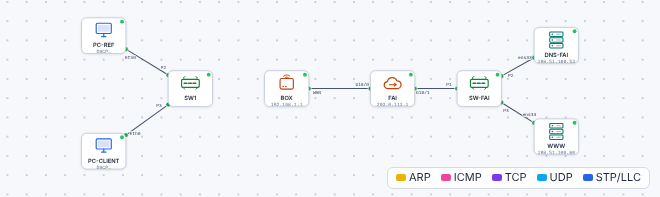

# 🛠️ TP – Dépanner un poste qui n'a plus Internet

*Bac Pro CIEL – Seconde – E31 – S15 – binôme, on **échange les rôles** à chaque panne*

> [!NOTE]
> **Mission.** Un client appelle : « **Mon poste n'a plus Internet.** » Tu reçois cinq fois le même appel, mais **la cause est différente à chaque fois**. Pour chaque panne : tu **cherches** avec l'échelle du diagnostic, tu **corriges**, tu **vérifies** et tu **remplis une fiche d'intervention**.
>
> **Temps prévu :** 2 h 20. **Prérequis :** [cours S15](01-cours.md) lu.

**Binôme :** ____________ / ____________

## Les règles du jeu

1. Ouvre le [simulateur](../../simulateur/simulateur-reseau.html), puis charge **la panne demandée** (`tp/s15-panne-N.json`).
2. Le poste en panne s'appelle **`PC-CLIENT`**. `PC-REF` est un poste qui marche : tu peux comparer.
3. **Ne regarde pas la cause dans la liste des pannes !** Cherche avec l'échelle.
4. **Une seule modification à la fois**, puis tu reteste.

> [!TIP]
> **Où cliquer ?** Double-clique sur `PC-CLIENT` : l'onglet **Terminal** (commandes `ipconfig`, `ping`), l'onglet **Configuration IP** (réglages), l'onglet **Navigateur** (test final).

---

## Panne n° 1 – Guidée (≈ 20 min)

📂 Charge [`s15-panne-1.json`](tp/s15-panne-1.json).

1. **Symptôme à reproduire :** dans l'onglet *Navigateur*, ouvre `http://www.exemple.fr`. Que se passe-t-il ? ______________________
2. **Marche 1 : le câble.** Observe le schéma : `PC-CLIENT` est-il relié au switch (`SW1`) ? ______________________
3. **Marche 2 : `ipconfig`.** Tape `ipconfig` dans le Terminal. Que lis-tu ? ______________________

✅ **Point de contrôle :** tu as lu *Média déconnecté* (ou une absence d'adresse).

4. **Cause trouvée :** ______________________
5. **Corrige :** relie `PC-CLIENT` à un port libre du switch (clique sur la prise du poste, puis sur le port du switch).
6. **Vérifie :** `ipconfig` (adresse `192.168.1.x`), `ping 192.168.1.1`, `ping 203.0.113.1`, puis le site `www.exemple.fr` dans le navigateur.

✅ **Point de contrôle :** le site s'affiche.

Aide

Une adresse en `192.168.1.x` n'apparaît que si le poste est **branché** et que le DHCP répond. Après avoir branché, attends quelques secondes avant de retester.

📝 **Remplis la [fiche d'intervention](03-fiche-intervention.md) n° 1.**

**🔁 Échange des rôles.**

---

## Panne n° 2 – Guidée (≈ 25 min)

📂 Charge [`s15-panne-2.json`](tp/s15-panne-2.json).

1. Teste dans l'ordre : câble (relié ?), `ipconfig`, `ping 192.168.1.1`.
2. Note ce que tu lis :

| Test | Résultat |
|---|---|
| Adresse IPv4 du poste | |
| Masque | |
| `ping 192.168.1.1` | |

3. **Compare avec `PC-REF`** (qui marche) : son adresse est ______________________
4. ❓ **Pourquoi `PC-CLIENT` ne peut-il pas joindre la box ?** ______________________

Aide

Compare le **réseau** de `PC-CLIENT` (début de l'adresse, masque) avec celui de la box `192.168.1.1/24` : S11, *« se voient-ils ? »*. Les 3 premiers nombres doivent être identiques en `/24`.

5. **Corrige** (onglet *Configuration IP*) : repasse en **DHCP**. **Vérifie** comme pour la panne 1.

✅ **Point de contrôle :** le site s'affiche et tu peux expliquer **en une phrase** pourquoi ça ne marchait pas.

📝 **Fiche d'intervention n° 2.**

**🔁 Échange des rôles.**

---

## Pannes n° 3, 4, 5 – En autonomie (≈ 15 min chacune)

Pour chaque panne, charge le fichier, **cherche avec l'échelle**, corrige, vérifie et **remplis une fiche**.

| Panne | Fichier | Fiche |
|---|---|---|
| 3 | [`s15-panne-3.json`](tp/s15-panne-3.json) | n° 3 |
| 4 | [`s15-panne-4.json`](tp/s15-panne-4.json) | n° 4 |
| 5 | [`s15-panne-5.json`](tp/s15-panne-5.json) | n° 5 |

> [!TIP]
> **Tu bloques ?** Reprends l'échelle : où est le **premier test qui échoue** ? C'est là que se trouve la panne.

Aide panne 3 (si tu bloques depuis 10 minutes)

La box répond mais Internet non : regarde dans `ipconfig` la ligne **Passerelle par défaut**. Est-elle égale à l'adresse de la box ?

Aide panne 4

`ping 203.0.113.1` fonctionne mais `ping www.exemple.fr` non : le problème est la **traduction du nom**. Regarde le **serveur DNS** dans *Configuration IP* ; la box (`192.168.1.1`) fait relais DNS.

Aide panne 5

Regarde **les deux** postes : si `PC-REF` aussi est en `169.254.x.x`, la panne n'est pas sur `PC-CLIENT`. Qui est censé donner les adresses ? Comment ses messages arrivent-ils jusqu'aux postes ?

**🔁 Échange des rôles à chaque panne.**

---

## Contrôle individuel – la panne inconnue (≈ 20 min)

Le professeur te donne **un numéro de panne** (tiré au sort). **Seul**, avec une fiche vierge :

- [ ] j'applique l'échelle **sans aide** ;
- [ ] je note mes tests **dans l'ordre** ;
- [ ] je corrige et je **vérifie** (site ouvert) ;
- [ ] je remets ma fiche au professeur.

---

## Bonus – la panne Wi-Fi

📂 Charge [`../S14-wifi/tp/s14-wifi.json`](../S14-wifi/tp/s14-wifi.json) : le portable `LAP3` ne se connecte pas au Wi-Fi. **Cherche pourquoi** (S14 : SSID, clé, sécurité) et **corrige**.

---

## 🏁 Bilan

### Oral (2 min par élève)

1. Quel est ton **premier test** quand quelqu'un te dit « je n'ai plus Internet » ? Pourquoi ?
2. Un poste est en `169.254.x.x` : que cherches-tu ?
3. `ping` d'une adresse OK mais pas d'un nom : quelle cause ?

| Mon auto-évaluation | 😟 | 🙂 | 😀 |
|---|---|---|---|
| Je suis l'échelle dans l'ordre | | | |
| Je lis `ipconfig` et `ping` | | | |
| Je relie un symptôme à sa cause | | | |
| Je remplis une fiche d'intervention | | | |

## 🔍 Dépannage (du TP lui-même)

| Symptôme | Cause probable | Que faire |
|---|---|---|
| Rien ne s'affiche après une correction | Le DHCP met quelques secondes | Attendre 10 s, relancer `ipconfig /renew` |
| `ping` ne répond jamais, même vers la box | Le fichier n'est pas bien chargé | Recharge le fichier de la panne |
| Le site `www.exemple.fr` ne s'ouvre pas alors que tout répond | URL mal tapée ou DNS | Taper `http://www.exemple.fr` ; tester `nslookup www.exemple.fr` |

> [!TIP]
> **Passeport d'autonomie :** ligne « Dépanner un problème simple avec la méthode » → *guidé* ✔ (*autonome* après le contrôle réussi).

---

## 🧩 Remédiation (≈ 40 min, individuelle)

1. **Relis ton Passeport d'autonomie** ([`ressources/passeport-autonomie.md`](../../ressources/passeport-autonomie.md)).
2. **Choisis la ligne la plus faible** (celle où tu hésites encore).
3. **Reprends la séance correspondante** : refais le point de contrôle qui t'avait posé problème (S10 câblage, S11 adresses, S12 DHCP, S13 DNS, S14 Wi-Fi).
4. Note ici **ce que tu as repris** : ______________________ et **ce qui reste fragile** : ______________________

➡️ **Mission en entreprise :** noter **une panne** vécue (symptôme, cause, solution) sur une fiche d'intervention.
