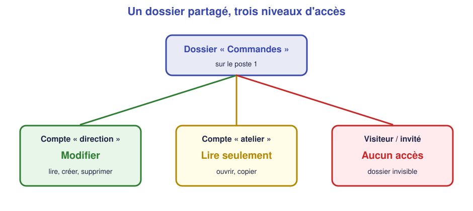

# 📖 Cours – Du besoin au réseau installé

*Bac Pro CIEL – Seconde – E31 – S16*

> [!IMPORTANT]
> **Une idée à la fois.** Réponds à la question **avant** de déplier la réponse.

## 🎯 À la fin de ce cours, tu sauras

- [ ] transformer un **besoin** en **exigence technique** ;
- [ ] construire un **plan d'adressage** sans conflit ;
- [ ] **calculer** la longueur d'un câble ;
- [ ] expliquer la différence entre **partage** et **droits**.

---

## 1. Du besoin au schéma

### 🤔 Avant de lire : à ton avis ?

Le client dit : « Je veux que tout le monde imprime. » Est-ce que cela suffit pour installer l'imprimante ? **Quelles questions poses-tu ?**

Voir la réponse

Non. Il faut savoir : **combien** de postes, **où** est l'imprimante, **quelle adresse** elle aura (fixe ou DHCP ?), **qui** a le droit d'imprimer, **sur quel réseau**. Un besoin devient une **exigence** quand on peut la **tester** (« depuis les 4 postes, `ping 192.168.1.150` répond »).

### 💡 L'idée

On suit toujours la même démarche : **lire → dessiner → adresser → câbler → configurer → tester**.

| Étape | Livrable |
|---|---|
| Lire le cahier des charges | Liste des besoins (B1, B2…) |
| Dessiner | **Schéma réseau** : équipements + liens |
| Adresser | **Plan d'adressage** (tableau) |
| Câbler | Liste des câbles avec longueurs |
| Configurer | Réglages (DHCP, IP fixe, Wi-Fi) |
| Tester | **Fiche de recette** |

> [!NOTE]
> **Pourquoi la borne Wi-Fi invité est-elle branchée sur la box et non sur le switch ?** Sur une vraie box, le réseau **invité** est **isolé** du réseau interne : la box laisse les invités sortir sur Internet mais leur interdit les postes et l'imprimante. Une borne reliée **directement à la box** reste du côté « invité ».

Règles du schéma : **un équipement = un rectangle ou un symbole**, **un lien = un trait**, **toujours un nom** sur chaque équipement, **les adresses notées** à côté.

### ✅ Vérifie que tu as compris

Dans le projet, **combien de liens câblés** y a-t-il en tout ? *(4 postes, 1 imprimante, 1 borne Wi-Fi, 1 box, 1 switch)*

Voir la réponse

**7 liens** : 4 postes + 1 imprimante vers le **switch** = 5, plus **switch → box** = 6, plus **borne → box** = 7. Le **lien de la box vers Internet** (prise du fournisseur) fait un 8ᵉ, mais il existe déjà.

---

## 2. Le plan d'adressage

### 🤔 Avant de lire : à ton avis ?

Deux appareils reçoivent **la même adresse IP** sur le même réseau. Que se passe-t-il, d'après toi ?

Voir la réponse

C'est un **conflit d'adresses** : les deux appareils se « disputent » l'adresse, et **aucun des deux** ne marche correctement (comme deux maisons avec le même numéro de rue). On l'évite en **notant** toutes les adresses dans un **plan d'adressage**.

### 💡 L'idée

On **découpe** le réseau `192.168.1.0/24` en zones (S11) :

| Zone | Plage | Pour qui ? |
|---|---|---|
| Passerelle | `192.168.1.1` | La box |
| Équipements fixes | `192.168.1.2` à `192.168.1.9` | Switch, borne (si administrables) |
| **Plage DHCP** | `192.168.1.10` à `192.168.1.100` | Les postes (automatique) |
| Périphériques fixes | `192.168.1.101` à `192.168.1.199` | **Imprimante** (`.150`), serveur |
| Réserve | `192.168.1.200` à `192.168.1.254` | Évolutions |

> [!TIP]
> **Règle d'or :** une adresse **fixe** se choisit **toujours en dehors** de la plage DHCP, sinon le DHCP pourrait la donner à un poste.

### ✅ Vérifie que tu as compris

Peux-tu donner l'adresse `192.168.1.50` à l'imprimante ? Pourquoi ?

Voir la réponse

**Non** : `.50` est **dans la plage DHCP** (.10 à .100). Un poste pourrait recevoir cette même adresse. On choisit `192.168.1.150`.

### 📏 Calculer une longueur de câble

Un câble ne va pas « en ligne droite » : il longe les murs ou passe au plafond.

**Longueur = montée + trajet horizontal + descente + marge**

*Exemple :* poste à 6 m du coin technique ; plafond technique à 2,5 m de haut ; prise à 0,5 m du sol → **2 + 6 + 2 + marge de 10 %** ≈ **11 m** (on prend un câble de 15 m, le plus proche disponible).

---

## 3. Partager sans tout ouvrir

### 🤔 Avant de lire : à ton avis ?

Tu partages un dossier « Commandes » avec « tout le monde ». Est-ce que **tout le monde** doit pouvoir **supprimer** des commandes ?

Voir la réponse

Non. **Partager** ne veut pas dire **autoriser tout**. On donne à chacun **le minimum nécessaire** (*principe du moindre privilège*) : modifier pour ceux qui gèrent, **lire** pour ceux qui consultent, **rien** pour les autres.

### 💡 L'idée

Sur Windows en **groupe de travail** (pas de serveur), le poste 1 héberge le dossier. Chacun se connecte avec **un compte** ; le dossier a **deux niveaux de protection** :

1. **Le partage** : qui peut *entrer* par le réseau ?
2. **Les droits (sécurité)** : que peut-on *faire* dedans ?

Le résultat est **le plus restrictif** des deux.

| Droit | Permet de… |
|---|---|
| **Lecture** | Ouvrir, copier |
| **Modification** | Lire, créer, modifier, supprimer |
| **Aucun** | Ne même pas voir le dossier |

### ✅ Vérifie que tu as compris

Un salarié de l'atelier (droit **lecture**) essaie d'effacer un fichier. Que se passe-t-il ?

Voir la réponse

Windows **refuse** (« Accès refusé »). Il peut ouvrir et copier, pas supprimer.

---

## 📌 Vocabulaire

| Mot | Définition |
|---|---|
| **Cahier des charges** | Le document qui dit ce que le client veut |
| **Plan d'adressage** | Tableau de toutes les adresses IP du réseau |
| **Plage DHCP** | Les adresses données automatiquement |
| **Groupe de travail** | Réseau Windows sans serveur (chaque poste a ses comptes) |
| **Droit** | Ce qu'un compte a le droit de faire |
| **Recette** | Les tests qui prouvent que tout marche |

## 🏁 Retiens l'essentiel

- [ ] Un besoin **se teste**.
- [ ] Une adresse fixe se choisit **hors plage DHCP**.
- [ ] Un câble = hauteur + trajet + marge.
- [ ] **Moindre privilège** : chacun a seulement les droits utiles.

➡️ **Suite :** [le cahier des charges](03-cahier-des-charges.md), puis [le TP](02-tp.md).
