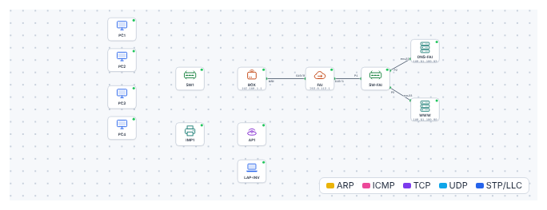

# 🛠️ TP – Installer l'atelier (projet A1, partie 1)

*Bac Pro CIEL – Seconde – E31 – S16 – binôme*

> [!NOTE]
> **Mission.** Tu es technicien chez un prestataire informatique. *Menuiserie Durand* t'a confié l'installation de son réseau. Tu as le [cahier des charges](03-cahier-des-charges.md). Aujourd'hui : **concevoir**, **maquetter** dans le simulateur, puis **partager** dossier et imprimante. La **recette** et la **démonstration** suivent en S17 et S18.
>
> **Temps prévu :** 3 h 30. **Prérequis :** [cours S16](01-cours.md) lu.

**Binôme :** ____________ / ____________

---

## Étape A – Le schéma réseau (≈ 30 min)

Sur une feuille (ou un logiciel de dessin), dessine le **schéma réseau** :

- les **équipements** : box, switch, 4 postes, imprimante, borne Wi-Fi, Internet ;
- les **liens** (traits) entre eux ;
- le **nom** de chaque équipement.

✅ **Point de contrôle :** ton schéma a **7 liens câblés** entre équipements de l'atelier (+ le lien vers Internet). Chaque équipement porte un nom.

❓ **Pourquoi la borne Wi-Fi est-elle branchée sur la box et non sur le switch ?** *(Réponse dans le [cours](01-cours.md) : isolation du réseau invité.)* ______________________

---

## Étape B – Plan d'adressage et câbles (≈ 30 min)

### B1. Le plan d'adressage

| Équipement | Nom | Adresse IP | Masque | Passerelle | Fixe / DHCP |
|---|---|---|---|---|---|
| Box | BOX | 192.168.1.1 | /24 | – | Fixe |
| Poste 1 | PC1 | | /24 | 192.168.1.1 | DHCP |
| Poste 2 | PC2 | | /24 | 192.168.1.1 | DHCP |
| Poste 3 | PC3 | | /24 | 192.168.1.1 | DHCP |
| Poste 4 | PC4 | | /24 | 192.168.1.1 | DHCP |
| Imprimante | IMP1 | | /24 | 192.168.1.1 | |
| Borne Wi-Fi | AP1 | | /24 | | |

*(Remplis les adresses des postes **après** la maquette : le DHCP les donne.)*

❓ **Quelle adresse donnes-tu à l'imprimante ? Pourquoi hors plage DHCP ?** ______________________

### B2. Les longueurs de câbles

Avec le [plan du local](03-cahier-des-charges.md), calcule la longueur de câble **du coin technique** vers chaque équipement (méthode du [cours](01-cours.md) §2).

| Lien | Distance au sol | Montée + descente | Marge 10 % | **Longueur** | Câble choisi |
|---|---|---|---|---|---|
| Switch → Poste 1 | | | | | |
| Switch → Poste 4 | | | | | |
| Switch → Imprimante | | | | | |

✅ **Point de contrôle :** aucune longueur ne dépasse **90 m** et tu as arrondi **au câble standard** supérieur (2, 3, 5, 10, 15, 20 m).

---

## Étape C – La maquette dans le simulateur (≈ 45 min)

1. Ouvre le [simulateur](../../simulateur/simulateur-reseau.html), puis charge [`projet-a1-depart.json`](tp/projet-a1-depart.json).

2. **Câble** les équipements **selon ton schéma** :
   - `SW1` (port 1) ↔ `BOX` (LAN 1) ; `PC1` à `PC4` sur les ports 2 à 5 de `SW1` ; `IMP1` sur le port 6.
   - `AP1` sur `BOX` (LAN 2).
3. **Configure** :
   - Les 4 postes : **DHCP** (onglet *Configuration IP*).
   - `IMP1` : adresse **fixe** `192.168.1.150`, masque `/24`, passerelle `192.168.1.1`.
   - `AP1` : SSID `ATELIER-INVITES`, sécurité **WPA2**, clé **solide de ton choix**.
   - `LAP-INV` (portable invité) : se connecter à `ATELIER-INVITES`.
4. **Teste** (marche par marche, comme en [S15](../S15-depannage-n1/01-cours.md)) :

| Test | Résultat attendu | Fait ✔ |
|---|---|---|
| Chaque poste a une adresse `192.168.1.x` | oui | |
| `PC1` : `ping 192.168.1.150` | 4 réponses | |
| `PC4` : `ping 192.168.1.150` | 4 réponses | |
| `PC3` : ouvrir `http://www.exemple.fr` | page affichée | |
| `LAP-INV` : adresse `192.168.1.x` | oui | |
| `LAP-INV` : ouvrir `http://www.exemple.fr` | page affichée | |

✅ **Point de contrôle :** les 6 tests sont ✔. **Sinon :** applique l'échelle du diagnostic (S15).

> [!WARNING]
> **Limite du simulateur.** Le simulateur ne sépare pas le réseau invité du réseau interne : ici, `LAP-INV` pourrait atteindre l'imprimante. **Sur la vraie box**, le réseau invité est isolé. Note-le dans ton dossier.

---

## Étape D – Partager un dossier et l'imprimante (≈ 45 min, postes réels)

Suis la [fiche guidée : partage Windows](04-fiche-partage-windows.md) :

- [ ] créer les comptes `direction` et `atelier` ;
- [ ] créer et **partager** le dossier `Commandes` ;
- [ ] régler les **droits** : direction = modifier, atelier = lire ;
- [ ] **ajouter l'imprimante** réseau sur un poste (par son adresse IP) ;
- [ ] **tester** avec chaque compte.

✅ **Point de contrôle :** avec le compte `atelier`, **je lis mais je ne peux pas effacer** ; avec `direction`, **je peux modifier**.

---

## Étape E – Le dossier avance (≈ 15 min)

Dans ton dossier (à garder pour S17), glisse :

- [ ] le **schéma** (étape A) ;
- [ ] le **plan d'adressage** complété (étape B) ;
- [ ] la **liste des câbles** (étape B2) ;
- [ ] les **réglages** de la maquette (étape C).

---

## 🏁 Grille d'avancement (fin de séance)

| Jalon | Fait | À reprendre |
|---|---|---|
| Schéma complet et nommé | | |
| Plan d'adressage sans conflit | | |
| Longueurs de câbles justifiées | | |
| Maquette : 6 tests ✔ | | |
| Partage de dossier + droits testés | | |
| Imprimante ajoutée sur un poste | | |

| Mon auto-évaluation | 😟 | 🙂 | 😀 |
|---|---|---|---|
| Je sais lire un cahier des charges | | | |
| Je sais construire un plan d'adressage | | | |
| Je sais câbler et configurer la maquette | | | |
| Je sais régler des droits de partage | | | |

## 🔍 Dépannage

| Symptôme | Cause probable | Que faire |
|---|---|---|
| Un poste en `169.254.x.x` | Câble / DHCP | Vérifier `SW1`↔`BOX`, câble du poste |
| `ping` de l'imprimante KO | IP fixe fausse | Revoir adresse et masque d'`IMP1` |
| `LAP-INV` ne se connecte pas | SSID ou clé | Vérifier orthographe et majuscules |
| Dossier invisible depuis un autre poste | Découverte du réseau désactivée | Voir la [fiche de partage](04-fiche-partage-windows.md) |

> [!TIP]
> **Passeport d'autonomie :** ligne « Réaliser un petit réseau complet et le documenter » → *guidé* ✔ (à valider en S18).

➡️ **Mission en entreprise :** compléter le schéma et le tableau d'adressage.
