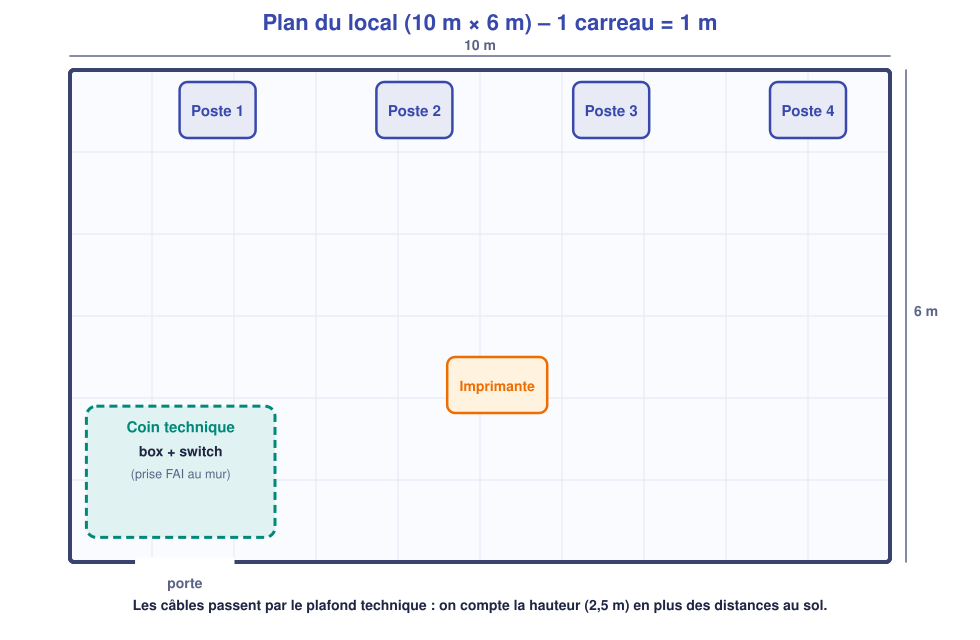

# 📄 Cahier des charges – Projet A1 : l'atelier « Menuiserie Durand »

## Le client

*Menuiserie Durand* ouvre un petit atelier de **10 m × 6 m**. Elle emploie **deux personnes au bureau** et en accueille **deux autres** à des postes partagés. Le gérant veut **un réseau simple, sûr et propre**, installé **avant lundi**.

## Ce qui doit exister

| N° | Besoin exprimé par le client | Exigence technique |
|---|---|---|
| B1 | « Les 4 postes doivent aller sur Internet. » | 4 postes filaires, adresses **automatiques** (DHCP) |
| B2 | « Tout le monde imprime sur la même imprimante. » | Imprimante réseau en **adresse fixe `192.168.1.150`**, hors plage DHCP |
| B3 | « Je veux échanger des fichiers entre nous, sans clé USB. » | **Dossier partagé** « Commandes » sur le poste 1 |
| B4 | « Seuls moi et ma collègue modifions les commandes ; l'atelier lit seulement. » | **Droits** : direction = modifier ; atelier = lire ; autres = aucun accès |
| B5 | « Les clients et fournisseurs veulent du Wi-Fi, mais pas sur mes fichiers. » | **Wi-Fi invité** distinct, WPA2, **sans accès** aux postes et à l'imprimante |
| B6 | « Je veux un document pour comprendre et pour dépanner. » | **Dossier** : schéma, plan d'adressage, tests, fiche de recette |

## Les contraintes

- **Un seul réseau `192.168.1.0/24`**, box en `192.168.1.1` (passerelle et DNS).
- **Plage DHCP : `192.168.1.10` à `192.168.1.100`.** Les équipements fixes sont **en dehors** de la plage.
- **Câblage cuivre**, catégorie 6 ; longueur maximale d'un lien : **90 m** (jamais atteint ici).
- **Les câbles passent par le plafond technique** (2,5 m de haut).
- Coin technique en bas à gauche du plan (box + switch), prise du fournisseur d'accès au mur.

## Le plan du local

## Ce que le client récupère à la fin (S17)

- [ ] Le réseau **installé et testé**.
- [ ] Le **schéma réseau** et le **plan d'adressage**.
- [ ] La **fiche de recette** (tests faits, résultats).
- [ ] Une **démonstration orale** de 5 minutes (S18).
