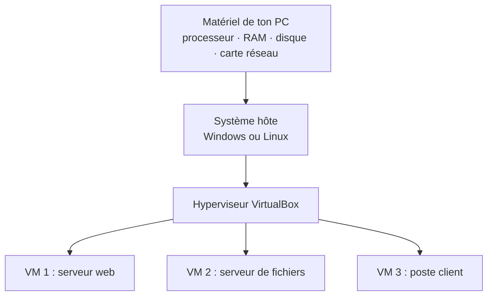
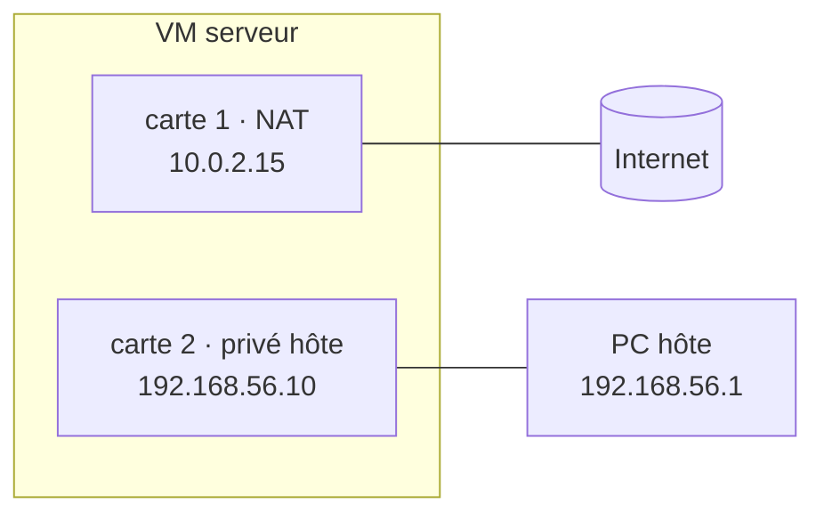

# 📖 Cours – Virtualisation, Linux serveur et diagnostic de base

*Parcours serveurs – module 0 – à lire avant tout autre module*

## 🎯 À la fin de ce cours, tu sauras

- [ ] expliquer ce qu'est une **machine virtuelle**, ce qu'elle **consomme** et pourquoi on la **sauvegarde** ;
- [ ] choisir et justifier le **mode réseau** de chaque carte d'une VM ;
- [ ] t'orienter sur un **serveur Linux** (arborescence, droits, paquets, services, journaux) ;
- [ ] appliquer la **[méthode de dépannage](../methode-depannage.md)** sur des pannes simples.

---

## 1. Pourquoi des machines virtuelles ?

En entreprise, installer un serveur sur une machine physique par service coûte cher et gaspille des ressources. La **virtualisation** fait tourner **plusieurs systèmes isolés sur une seule machine**. Pour un technicien, c'est aussi **l'outil idéal pour apprendre** : on peut casser, restaurer, recommencer.



| Notion | Explication |
|---|---|
| **Hôte** (*host*) | ton PC réel |
| **Invité** (*guest*) | la machine virtuelle |
| **Hyperviseur** (*hypervisor*) | le logiciel qui crée les VM et leur prête des ressources |
| **Type 2** | s'installe **dans** un système existant (VirtualBox, VMware Workstation) |
| **Type 1** | s'installe **directement** sur le matériel (Proxmox, ESXi, Hyper-V) : usage production |

### Ce qu'une VM consomme

| Ressource | Règle pratique | Si on en met trop… | Si on en met trop peu… |
|---|---|---|---|
| **RAM** | juste ce qu'il faut (serveur Linux sans bureau : 1 Go) | l'**hôte** swappe et devient lent | la VM ralentit, des services sont tués (*Out of memory*) |
| **Processeurs** | 1 à 2 | gêne les autres VM | lenteurs |
| **Disque** | 10 Go suffisent pour un serveur de TP | le disque de l'hôte se remplit | la VM n'a plus de place (`No space left on device`) |

> [!WARNING]
> **Disque « dynamique »** : le fichier de la VM grossit à l'usage. Il peut **saturer le disque de ton PC** sans que la VM ne soit pleine. À surveiller sur un PC partagé.

### Instantané, clone, export : trois choses différentes

| Outil | Ce que c'est | Sert à | Piège |
|---|---|---|---|
| **Instantané** (*snapshot*) | état de la VM à un instant, stocké **à côté** de la VM | revenir en arrière avant une manipulation risquée | **pas une sauvegarde** (même dossier, même disque) ; une chaîne trop longue ralentit la VM |
| **Clone** | copie complète de la VM | dupliquer un serveur « propre » | deux VM identiques → même nom, même identifiant réseau : à changer |
| **Export** (OVA) | fichier unique de la VM | **vraie sauvegarde**, transfert | volumineux |

> [!TIP]
> **Prends un instantané juste après l'installation propre** : c'est ton « point zéro » pour recommencer un TP.

## 2. Le réseau d'une VM

Chaque VM possède des **cartes réseau virtuelles** (jusqu'à 4). Le **mode** de chaque carte décide **qui peut parler à qui**.

| Mode | La VM peut… | Les autres peuvent… | Quand l'utiliser |
|---|---|---|---|
| **NAT** | sortir sur Internet (le PC hôte « masque » la VM) | **ne pas** joindre la VM | mises à jour, installation de paquets |
| **Réseau privé hôte** (*host-only*) | parler au PC hôte et aux VM du même réseau | seulement le PC hôte et ces VM | **administrer et tester ses serveurs** |
| **Réseau interne** | parler aux VM du même réseau interne | seulement ces VM | isoler un laboratoire (sans l'hôte) |
| **Accès par pont** (*bridge*) | apparaître comme un vrai poste du réseau réel | tout le réseau | *à éviter au lycée* : la VM devient visible (et vulnérable) |

**Notre montage de référence :**



- **Carte 1 en NAT** : pour que le serveur télécharge ses paquets (`apt`).
- **Carte 2 en privé hôte** : pour que **toi** (le PC) atteignes le serveur. Le NAT ne le permet pas : c'est la raison d'être de la deuxième carte.

> [!NOTE]
> Les adresses de VirtualBox sont **prévisibles** : `10.0.2.15` pour une carte en NAT et le réseau `192.168.56.0/24` par défaut en privé hôte. Si tes adresses sont différentes, **lis `ip a`** plutôt que de supposer.

## 3. Le serveur Linux en 10 réflexes

Un serveur n'a généralement **pas d'écran graphique** : on l'administre en ligne de commande, souvent **à distance** (SSH).

### 3.1 L'arborescence

| Dossier | Contient | Exemple |
|---|---|---|
| `/etc` | **configuration** (fichiers texte) | `/etc/hostname` |
| `/var/log` | **journaux** | `/var/log/syslog` |
| `/var/www` | sites web | `/var/www/html` |
| `/home` | dossiers personnels | `/home/eleve1` |
| `/srv` | données servies par la machine | `/srv/partage` |
| `/usr/sbin` | programmes d'administration | `/usr/sbin/apache2` |

### 3.2 Utilisateurs, groupes et droits

Chaque fichier a un **propriétaire**, un **groupe** et des droits pour **lui, le groupe, les autres**.

```text
-rw-r----- 1 root www-data 612 oct. 13 10:02 secret.conf
│└┬┘└┬┘└┬┘   │    │
│ │  │  │    │    └ groupe propriétaire
│ │  │  │    └ utilisateur propriétaire
│ │  │  └ droits des « autres »     (---)
│ │  └ droits du groupe              (r--)
│ └ droits du propriétaire           (rw-)
└ type (- fichier, d dossier)
```

| Droit | Fichier | Dossier |
|---|---|---|
| `r` (4) | lire | **lister** le contenu |
| `w` (2) | modifier | créer / supprimer dedans |
| `x` (1) | exécuter | **traverser** (entrer dedans) |

Les **services ne tournent pas en administrateur** : Apache et Nginx tournent sous le compte `www-data`. **Si ce compte n'a pas le droit de lire un fichier, le site renvoie une erreur 403** (nous le verrons).

> [!WARNING]
> **Piège n°1 des débutants :** `chmod 777` « pour que ça marche ». Cela **règle le symptôme** en ouvrant la porte à tout le monde. On cherche **quel compte** a besoin de **quel droit**, et on donne uniquement celui-là.

### 3.3 Paquets

`apt` installe un logiciel **et ses dépendances** depuis des **dépôts** officiels (serveurs de paquets).

| Commande | Effet | Pourquoi |
|---|---|---|
| `sudo apt update` | **met à jour la liste** des paquets disponibles | sans cela, `apt` ne connaît que l'ancienne liste |
| `sudo apt install nom` | installe | |
| `apt show nom` | décrit le paquet | savoir ce qu'on installe |
| `sudo apt upgrade` | met à jour les paquets installés | **correctifs de sécurité** |
| `dpkg -L nom` | liste les fichiers installés | savoir **où** sont la config et les programmes |

### 3.4 Services

Un **service** est un programme qui tourne en arrière-plan (un *démon*). Sur les Linux modernes, `systemd` les pilote :

| Commande | Effet |
|---|---|
| `systemctl status nom` | **état** + dernières lignes du journal |
| `sudo systemctl start / stop / restart nom` | démarrer / arrêter / redémarrer (**coupe** les connexions) |
| `sudo systemctl reload nom` | recharger la configuration **sans couper** |
| `sudo systemctl enable nom` | démarrer **au démarrage** de la machine |
| `systemctl is-active nom`, `is-enabled nom` | tests rapides |

> [!NOTE]
> **`start` ≠ `enable`.** `start` démarre maintenant ; `enable` démarre à chaque redémarrage. Un service « démarré mais pas activé » **disparaît au prochain redémarrage** : panne classique du lundi matin.

### 3.5 Journaux

| Besoin | Commande |
|---|---|
| Journal d'un service | `journalctl -u nom -n 50 --no-pager` |
| Suivre en direct | `sudo tail -f /var/log/…` ou `journalctl -u nom -f` |
| Chercher un mot | `grep -i erreur fichier` |
| Messages récents du système | `journalctl -p err -b` |

### 3.6 Réseau

| Question | Commande |
|---|---|
| Quelles adresses ? | `ip a` (`ip -br a` pour résumer) |
| Quelle passerelle ? | `ip r` (ligne `default via …`) |
| Joint-on telle machine ? | `ping -c 2 adresse` |
| Qui écoute sur quel port ? | `sudo ss -tlnp` |
| Que répond un service web ? | `curl -I http://adresse` |

### 3.7 Espace disque et mémoire

`df -h` (espace par disque), `du -sh /var/log` (taille d'un dossier), `free -h` (mémoire). **Un disque plein est une panne fréquente et silencieuse** : plus de journaux, plus d'écriture en base, services qui échouent « sans raison ».

## 4. Premier dépannage guidé

> [!EXAMPLE] Cas d'école : « Je ne joins plus ma VM depuis mon PC »
> 1. **Symptôme :** `ssh` expire. 2. **Délimiter :** la VM tourne ? depuis la console VirtualBox, `ip -br a`. 3. **Hypothèse simple :** la carte 2 n'a pas d'adresse. 4. **Test :** `ip -br a` montre l'interface **DOWN** ou sans IPv4. 5. **Correction :** `sudo ip link set <interface> up` puis relancer le client DHCP ; ou corriger la configuration réseau. 6. **Vérification :** `ping` depuis le PC. 7. **Journal de bord.**

---

## 🧠 Quiz de fin

**1.** Pourquoi une VM de serveur a-t-elle souvent deux cartes réseau ?

<details markdown="1"><summary>Voir la réponse</summary>

Une carte en **NAT** pour sortir sur Internet (mises à jour) et une carte en **réseau privé hôte** pour que le PC puisse joindre le serveur, ce que le NAT n'autorise pas.

</details>

**2.** Un instantané est-il une sauvegarde ? Justifie.

<details markdown="1"><summary>Voir la réponse</summary>

**Non** : il est stocké à côté de la VM, sur le même disque. Si le disque ou le fichier de la VM est perdu, l'instantané l'est aussi. Une vraie sauvegarde est une **copie ailleurs** (export).

</details>

**3.** Apache renvoie une erreur 403 sur un fichier que tu viens de créer en tant que `root` avec les droits `600`. Pourquoi ?

<details markdown="1"><summary>Voir la réponse</summary>

Apache tourne sous `www-data`, qui n'est ni propriétaire ni dans le groupe : les droits `600` ne lui donnent **aucun accès**. Il faut lui donner un droit de lecture (propriétaire/groupe/droits adaptés), pas `777`.

</details>

**4.** Quelle différence entre `restart` et `reload` ?

<details markdown="1"><summary>Voir la réponse</summary>

`restart` **arrête puis relance** le service (connexions coupées). `reload` **recharge la configuration sans interruption**.

</details>

**5.** Tu viens de démarrer un service avec `systemctl start`. Après un redémarrage de la machine, il n'est plus là. Pourquoi ?

<details markdown="1"><summary>Voir la réponse</summary>

Il n'a pas été **activé** (`systemctl enable`) pour démarrer au boot.

</details>

**6.** `apt install` ne trouve pas un paquet récent. Première action ?

<details markdown="1"><summary>Voir la réponse</summary>

`sudo apt update` pour **rafraîchir la liste** des paquets (et vérifier que la carte NAT donne accès à Internet).

</details>

➡️ Suite : [le TP du module](02-tp.md).
