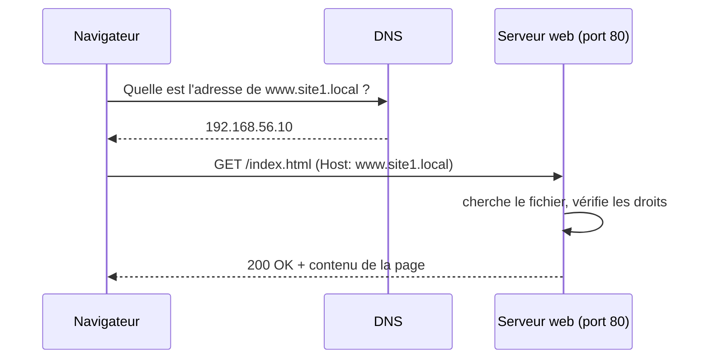

# 📖 Cours – Le serveur web : comprendre, installer, sécuriser, dépanner

*Parcours serveurs – module 1 – prérequis : [module 0](../m0-virtualbox/01-cours.md)*

## 🎯 À la fin de ce cours, tu sauras

- [ ] décrire ce qui se passe **entre le navigateur et le serveur** quand on ouvre une page ;
- [ ] expliquer le rôle de chaque brique : **serveur web, PHP, base de données** ;
- [ ] installer, configurer des **sites virtuels**, et **justifier** chaque commande ;
- [ ] lire les **journaux** et interpréter les codes **403, 404, 500, 502** ;
- [ ] **diagnostiquer** une panne avec la [méthode](../methode-depannage.md).

---

## 1. Ce qui se passe quand on ouvre une page



| Étape | Ce qui peut tomber en panne |
|---|---|
| **1. Résolution du nom** | pas de DNS, mauvais enregistrement, fichier `hosts` oublié → *nom introuvable* |
| **2. Connexion TCP au port 80** | service arrêté (*connection refused*), pare-feu (*timeout*) |
| **3. Requête HTTP** | mauvais site virtuel, mauvais chemin → **404** |
| **4. Accès au fichier** | droits insuffisants → **403** |
| **5. Exécution (PHP, base)** | erreur de code, base injoignable → **500** |
| **6. Serveur en amont** (reverse proxy) | l'application derrière est arrêtée → **502** |

> [!NOTE]
> **HTTP** est un dialogue **texte** « requête / réponse ». Tu peux le lire avec `curl -v`. Chaque réponse commence par un **code d'état**.

| Famille | Sens | Exemples |
|---|---|---|
| **2xx** | succès | `200 OK` |
| **3xx** | redirection | `301` (déplacé définitivement), `302` |
| **4xx** | **erreur du client** : requête ou droits | `403` (interdit), `404` (introuvable), `401` (authentification requise) |
| **5xx** | **erreur du serveur** | `500` (erreur interne), `502` (passerelle : le service en amont ne répond pas), `503` (indisponible) |

## 2. Les briques et leurs rôles

| Brique | Rôle | Pourquoi séparée ? |
|---|---|---|
| **Serveur web** (Apache, Nginx) | reçoit les requêtes HTTP, renvoie fichiers ou transmet à une application | gère de nombreuses connexions, les droits, les journaux |
| **PHP** | exécute le code des pages dynamiques | le serveur web seul ne sait que servir des fichiers |
| **Base de données** (MariaDB) | stocke les données de l'application | persistance, requêtes, droits fins |

**Apache ou Nginx ?**

| | Apache | Nginx |
|---|---|---|
| Modèle | un processus/thread par connexion (modules) | **événementiel**, très économe |
| Config | `.htaccess` possible par dossier | un seul ensemble de fichiers centraux |
| PHP | module intégré (`libapache2-mod-php`) | **externe** (`php-fpm`) |
| Usage courant | hébergement mutualisé, applications classiques | fort trafic, **reverse proxy**, fichiers statiques |

> [!TIP]
> **Reverse proxy** : le serveur web **reçoit** la requête et la **transmet** à une application qui écoute ailleurs (par exemple sur le port 3000). Si cette application est arrêtée, il répond **502**.

## 3. Installer en comprenant

```bash
sudo apt update
sudo apt install -y apache2
```

| Commande | Ce qu'elle fait | Pourquoi |
|---|---|---|
| `apt update` | rafraîchit la liste des paquets | sinon on installe une version ancienne ou rien |
| `apt install -y apache2` | installe Apache **et** ses dépendances ; crée l'utilisateur `www-data`, les dossiers, le service | `-y` répond « oui » aux confirmations |
| `systemctl status apache2` | contrôle que le service tourne | **toujours vérifier** après installation |
| `sudo ss -tlnp \| grep :80` | confirme que le port **80** est à l'écoute | un service « actif » peut écouter sur un autre port |

**Où est quoi sur Debian/Ubuntu (à connaître) :**

| Chemin | Contenu |
|---|---|
| `/var/www/html` | site par défaut |
| `/etc/apache2/apache2.conf` | configuration générale |
| `/etc/apache2/sites-available/` | **sites définis** (fichiers `.conf`) |
| `/etc/apache2/sites-enabled/` | **sites actifs** (liens vers `sites-available`) |
| `/var/log/apache2/access.log` | **qui** demande **quoi**, avec le code de réponse |
| `/var/log/apache2/error.log` | **pourquoi** ça échoue |

Même principe côté Nginx : `/etc/nginx/sites-available/` et `sites-enabled/`, journaux dans `/var/log/nginx/`.

> [!NOTE]
> **Pourquoi `sites-available` + `sites-enabled` ?** On **prépare** un site sans l'activer, puis on l'active ou le désactive en créant ou supprimant un lien (`a2ensite`, `a2dissite`), sans toucher au fichier.

## 4. Configurer des sites virtuels

Un même serveur peut héberger **plusieurs sites** sur la même adresse IP et le même port. Il distingue les sites grâce à l'en-tête **`Host`** envoyé par le navigateur (**hôte virtuel par nom**).

```apache
# /etc/apache2/sites-available/site1.conf
<VirtualHost *:80>
    ServerName site1.local
    DocumentRoot /var/www/site1
    ErrorLog  ${APACHE_LOG_DIR}/site1-error.log
    CustomLog ${APACHE_LOG_DIR}/site1-access.log combined
</VirtualHost>
```

| Directive | Rôle |
|---|---|
| `ServerName` | le nom du site (comparé à l'en-tête `Host`) |
| `DocumentRoot` | le dossier des pages |
| `ErrorLog` / `CustomLog` | journaux **séparés par site** (utile pour dépanner) |

Activation, **test puis rechargement** (jamais l'inverse) :

```bash
sudo mkdir -p /var/www/site1
echo "<h1>site1</h1>" | sudo tee /var/www/site1/index.html
sudo a2ensite site1
sudo apache2ctl configtest      # doit afficher « Syntax OK »
sudo systemctl reload apache2
```

Pour que ton navigateur trouve `site1.local`, on utilise un **fichier `hosts`** (une mini-table DNS locale) **sur le PC** :

| Système | Fichier | Ligne à ajouter |
|---|---|---|
| Windows | `C:\Windows\System32\drivers\etc\hosts` (éditeur en administrateur) | `192.168.56.10  site1.local` |
| Linux | `/etc/hosts` | idem |

Test sans modifier `hosts` : `curl -H "Host: site1.local" http://192.168.56.10/`

> [!WARNING]
> **Message `AH00558 … Could not reliably determine the server's fully qualified domain name`** : ce n'est **pas une erreur**, c'est un avertissement : Apache ne connaît pas son propre nom. On l'élimine en déclarant `ServerName localhost` dans un fichier de `conf-available` puis `sudo a2enconf` ; on apprend ainsi qu'**un avertissement non traité masque les vraies erreurs**.

### Sous Nginx

```nginx
# /etc/nginx/sites-available/site1
server {
    listen 80;
    server_name site1.local;
    root /var/www/site1;
    index index.html;
    location / { try_files $uri $uri/ =404; }
}
```

```bash
sudo ln -s /etc/nginx/sites-available/site1 /etc/nginx/sites-enabled/
sudo nginx -t                   # test de configuration
sudo systemctl reload nginx
```

> [!WARNING]
> Un **site par défaut** reste actif (`default`) et capte toute requête dont le nom ne correspond à aucun site. Si tu obtiens « la page par défaut » au lieu de ton site, **c'est le premier réflexe à vérifier** : le nom (`Host`) envoyé correspond-il à un `ServerName` ?

## 5. Les droits : la cause n°1 des erreurs 403

Le serveur web tourne sous **`www-data`**. Pour servir un fichier, `www-data` doit pouvoir **traverser tous les dossiers du chemin** (`x`) et **lire le fichier** (`r`).

```bash
namei -l /var/www/site1/index.html     # affiche les droits de CHAQUE dossier du chemin
```

| Bonne pratique | Pourquoi |
|---|---|
| fichiers `644`, dossiers `755` | tout le monde lit, seul le propriétaire modifie |
| propriétaire = l'administrateur du site, **pas** `www-data` | un site compromis ne pourra pas **se réécrire** |
| jamais `chmod 777` | tout le monde peut modifier ; faille immédiate |
| écriture réservée aux dossiers d'**envoi** (uploads) | on limite la surface |

## 6. La pile LAMP : PHP et MariaDB

```bash
sudo apt install -y mariadb-server php libapache2-mod-php php-mysql
```

| Paquet | Rôle |
|---|---|
| `mariadb-server` | la base de données |
| `php` + `libapache2-mod-php` | PHP exécuté **par Apache** |
| `php-mysql` | le pont PHP ↔ MariaDB |

**Une base de données ne se gère pas avec `root`** : on crée une **base** et un **utilisateur dédié** avec les droits **uniquement sur cette base** (moindre privilège).

```sql
CREATE DATABASE appdb CHARACTER SET utf8mb4;
CREATE USER 'appuser'@'localhost' IDENTIFIED BY 'un-mot-de-passe-long';
GRANT ALL ON appdb.* TO 'appuser'@'localhost';
FLUSH PRIVILEGES;
```

| Élément | Signification |
|---|---|
| `'appuser'@'localhost'` | le compte **et d'où il peut se connecter** : ici seulement la machine elle-même |
| `GRANT ALL ON appdb.*` | tous les droits **sur cette base seulement** |
| `bind-address = 127.0.0.1` (dans `/etc/mysql/mariadb.conf.d/50-server.cnf`) | MariaDB n'écoute **que** sur la machine : **non joignable depuis le réseau**. À garder tant qu'aucune autre machine n'a besoin de la base. |

> [!WARNING]
> `phpinfo()` révèle la version, les modules, les chemins : **utile pour tester, dangereux en production**. On le supprime après usage.

## 7. Sécuriser (le minimum d'un technicien)

| Mesure | Pourquoi |
|---|---|
| **Mises à jour** régulières (`apt upgrade`) | les failles connues sont corrigées par les mises à jour |
| **Ne rien exposer d'inutile** (`ss -tlnp` : que voit-on ouvert ?) | chaque port ouvert est une porte |
| **Masquer la version** (`ServerTokens Prod` côté Apache) | ne pas faciliter le travail d'un attaquant |
| **HTTPS** (certificat) dès qu'il y a une saisie de mot de passe | sinon les secrets circulent **en clair** |
| **Droits minimaux** (voir §5) | limite les dégâts d'une faille |

## 8. Surveiller

```bash
sudo tail -f /var/log/apache2/access.log     # le trafic en direct
```

```text
127.0.0.1 - - [13/Oct/2026:08:54:26 +0000] "GET /nexiste.html HTTP/1.1" 404 432 "-" "curl/8.5.0"
│          │   │                              │                         │   │
│          │   │                              │                         │   └ taille de la réponse
│          │   │                              │                         └ CODE de réponse
│          │   │                              └ requête
│          │   └ date
│          └ identifiant, utilisateur
└ adresse du client
```

Repérer vite : `grep ' 404 ' access.log`, `grep ' 5[0-9][0-9] ' access.log`.

## 9. Dépanner : pannes réelles et leurs messages

Chaque ligne a été **reproduite** sur Apache 2.4 et Nginx (Ubuntu 24.04).

| Symptôme | Message dans le journal ou le test | Cause | Vérification | Correction |
|---|---|---|---|---|
| `nginx` ne démarre pas, Apache déjà actif | `nginx: [emerg] bind() to 0.0.0.0:80 failed (98: Address already in use)` | **le port 80 est déjà pris** | `sudo ss -tlnp \| grep :80` | arrêter l'autre service (`systemctl disable --now apache2`) ou changer le port |
| Rechargement refusé | Apache : `Syntax error on line 6 of …/test.conf: </VirtualHost> directive missing closing '>'` | **faute de frappe** dans la conf | `sudo apache2ctl configtest` | corriger la ligne indiquée (**le message donne le fichier et la ligne**) |
| Idem côté Nginx | `[emerg] directive "index" is not terminated by ";" in …/site1:6` | **point-virgule oublié** | `sudo nginx -t` | corriger puis `nginx -t` à nouveau |
| Page **403 Forbidden** | Apache : `AH00132: file permissions deny server access: /var/www/html/secret.html` ; Nginx : `open() "…" failed (13: Permission denied)` | `www-data` n'a pas le droit de lire | `ls -l` ; `namei -l /chemin/complet` | `chmod`/`chown` **minimal** (644 / 755) |
| Page **404** sur **tout** un site | Apache : `AH00112: Warning: DocumentRoot [/var/www/site1] does not exist` | **le dossier n'existe pas** (faute dans `DocumentRoot`) | `ls -ld /var/www/site1` | créer ou corriger le chemin |
| On obtient la **page par défaut** au lieu de son site | rien dans l'`error.log` | le nom (`Host`) envoyé ne correspond à aucun `ServerName` | `curl -H "Host: site1.local" …` ; `apache2ctl -S` (liste les sites) | corriger `ServerName` ou le fichier `hosts` |
| Page **502 Bad Gateway** (Nginx en proxy) | `connect() failed (111: Connection refused) while connecting to upstream` | l'**application derrière** est arrêtée ou n'écoute pas là | `ss -tlnp` : le port de l'application écoute-t-il ? | démarrer l'application / corriger `proxy_pass` |
| PHP : « Access denied » vers la base | `ERREUR 1045 : Access denied for user 'appuser'@'localhost' (using password: YES)` | **mauvais mot de passe** ou compte inexistant pour cet hôte | `SELECT user,host FROM mysql.user;` | recréer l'utilisateur / corriger le mot de passe du code |
| `Connection refused` immédiat | `curl: (7) Failed to connect to … port 80` | **service arrêté** ou écoute ailleurs | `systemctl status` ; `ss -tlnp` | démarrer, **et** `enable` |
| Aucune réponse (long délai) | rien dans le journal du serveur | **réseau ou pare-feu** : la requête n'arrive pas | `ping` ; règles de pare-feu | corriger la route/règle |

> [!TIP]
> **Savoir distinguer** : *connection refused* = quelqu'un **répond « non »** (la machine est là, mais aucun service n'écoute). *Timeout* = **personne ne répond** (réseau coupé, pare-feu qui **jette** les paquets). Ces deux symptômes mènent à des causes totalement différentes.

## 10. Fiche réflexe

1. `systemctl status <service>` : actif ?
2. `sudo ss -tlnp` : le bon port écoute-t-il ?
3. `curl -I http://adresse` (ou `curl -v`) : quel code ?
4. `sudo tail -n 20 /var/log/…/error.log` : quel message ?
5. `apache2ctl configtest` / `nginx -t` : configuration valide ?
6. `namei -l <chemin>` : droits ?
7. Je **change une chose**, je **reteste**, je **note**.

---

## 🧠 Quiz de fin

**1.** Quelles sont les étapes entre « taper une adresse » et « voir la page » ? Où peut-on tomber en panne ?

<details markdown="1"><summary>Voir la réponse</summary>

Résolution du nom → connexion TCP au port 80/443 → requête HTTP → accès au fichier (droits) → exécution éventuelle (PHP, base) → réponse. Panne possible à **chaque** étape (voir le tableau du §1).

</details>

**2.** Une page affiche 403. Quels sont les deux premiers tests ?

<details markdown="1"><summary>Voir la réponse</summary>

Lire `error.log` (message `permission denied` ?) et `namei -l` sur le chemin pour voir si **`www-data`** peut traverser les dossiers et lire le fichier.

</details>

**3.** Pourquoi toujours lancer `configtest` / `nginx -t` **avant** `reload` ?

<details markdown="1"><summary>Voir la réponse</summary>

Pour éviter de recharger une **configuration invalide** qui coupe le site ; le test indique **le fichier et la ligne** fautifs.

</details>

**4.** Nginx refuse de démarrer avec `Address already in use`. Que fais-tu ?

<details markdown="1"><summary>Voir la réponse</summary>

`sudo ss -tlnp | grep :80` pour voir **quel programme occupe le port**, puis l'arrêter ou changer de port.

</details>

**5.** Différence entre *connection refused* et *timeout* ?

<details markdown="1"><summary>Voir la réponse</summary>

*Refused* : la machine répond mais **aucun service n'écoute**. *Timeout* : **aucune réponse** (réseau, pare-feu).

</details>

**6.** Pourquoi créer un utilisateur MariaDB dédié plutôt qu'utiliser `root` dans le code du site ?

<details markdown="1"><summary>Voir la réponse</summary>

**Moindre privilège** : si le site est compromis, l'attaquant n'a accès qu'à **sa** base, pas à tout le serveur de bases.

</details>

**7.** Ton nouveau site affiche la page par défaut d'Apache. Cause probable ?

<details markdown="1"><summary>Voir la réponse</summary>

Le nom envoyé (`Host`) **ne correspond à aucun `ServerName`** (fichier `hosts` oublié, site non activé, faute de frappe). Le site par défaut répond alors.

</details>

➡️ Suite : [le TP du module](02-tp.md).
