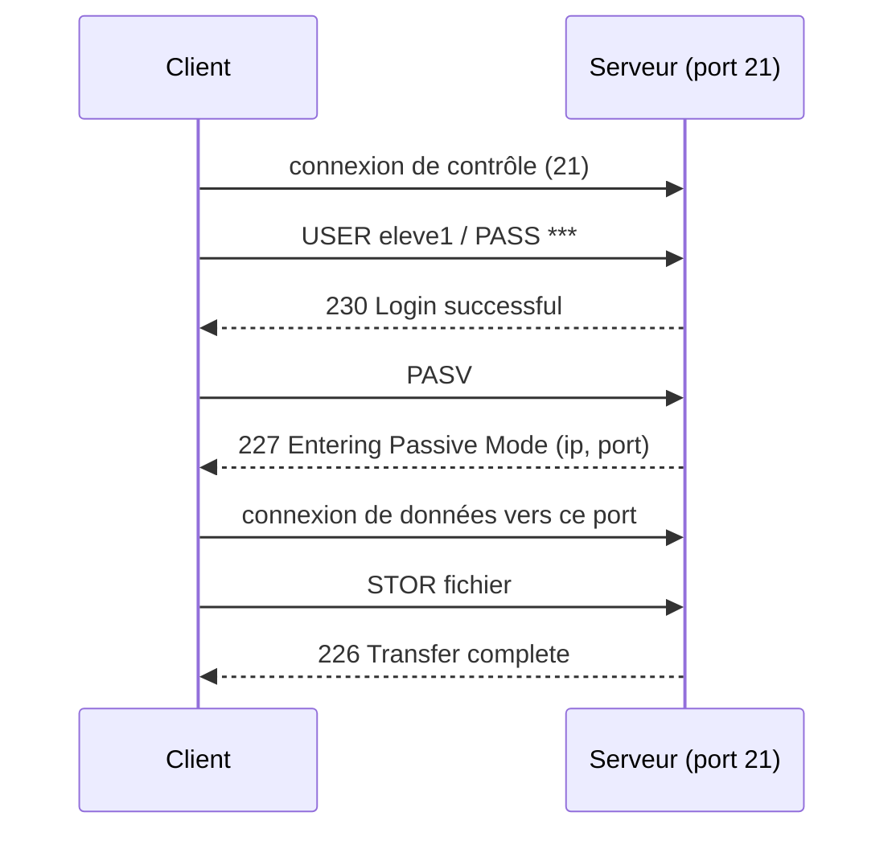

# 📖 Cours – Transfert de fichiers : FTP, FTPS et SFTP

*Parcours serveurs – module 2 – prérequis : [module 0](../m0-virtualbox/01-cours.md)*

## 🎯 À la fin de ce cours, tu sauras

- [ ] expliquer comment FTP fonctionne (**deux connexions**, mode **actif** et **passif**) ;
- [ ] expliquer **pourquoi FTP est dangereux** et quelle alternative choisir ;
- [ ] installer un serveur **vsftpd** en le **sécurisant** (utilisateurs enfermés, droits) ;
- [ ] mettre en place un accès **SFTP cloisonné** ;
- [ ] **lire les codes de réponse** FTP et dépanner.

---

## 1. À quoi ça sert, et pourquoi ça pose problème

Échanger des fichiers entre un poste et un serveur : documents d'un client, mise en ligne d'un site, sauvegardes. Trois familles de solutions :

| Protocole | Port | Chiffré ? | Principe | Verdict |
|---|---|---|---|---|
| **FTP** | 21 (+ données) | ❌ **non** | protocole historique, deux connexions | **à éviter**, sauf réseau fermé |
| **FTPS** | 21 / 990 | ✅ (TLS) | FTP + chiffrement TLS | possible, mais **le plus délicat** à faire passer dans un pare-feu |
| **SFTP** | **22** | ✅ (SSH) | transfert **par SSH** | **le choix par défaut** |

> [!WARNING]
> FTP envoie l'**identifiant et le mot de passe en clair**, ainsi que le contenu des fichiers. Quiconque peut écouter le réseau les lit. Tu le constateras toi-même avec Wireshark.

> [!NOTE]
> **FTPS ≠ SFTP.** *FTPS* = FTP **plus** TLS (comme HTTPS = HTTP + TLS). *SFTP* = un **protocole différent**, qui passe **dans** une session SSH. Les noms prêtent à confusion : les clients proposent les deux.

## 2. Comment fonctionne FTP

FTP utilise **deux connexions TCP** :

| Connexion | Rôle | Port |
|---|---|---|
| **Contrôle** | commandes (`USER`, `PASS`, `LIST`, `STOR`) et réponses numériques | **21** |
| **Données** | contenu des fichiers et listings | variable (voir ci-dessous) |

**Mode actif** : le **serveur** ouvre la connexion de données **vers le client** (depuis son port 20). **Problème :** le pare-feu ou le NAT du client bloque cette connexion **entrante**.

**Mode passif** : le **client** ouvre **aussi** la connexion de données, **vers un port choisi par le serveur** (dans une plage). C'est le mode utilisé aujourd'hui.



> [!TIP]
> **Conséquence pour l'administrateur :** en mode passif, il faut **ouvrir le port 21 ET la plage de ports passifs** dans le pare-feu. Si le login fonctionne mais que la **liste des fichiers « pend »**, pense **ports passifs / pare-feu**.

### Les codes de réponse

Comme HTTP, FTP répond par des **codes** à trois chiffres.

| Code | Sens | Exemple |
|---|---|---|
| **2xx** | succès | `230` connecté, `226` transfert terminé |
| **3xx** | attente d'info | `331` mot de passe attendu |
| **4xx** | échec **temporaire** | `421` service indisponible, `425` impossible d'ouvrir la connexion de données |
| **5xx** | échec **définitif** | `530` identifiant incorrect, `550` action refusée, `553` fichier non créé |

## 3. Installer vsftpd en comprenant

```bash
sudo apt install -y vsftpd
```

Le fichier de configuration est `/etc/vsftpd.conf`. Une configuration **sûre et minimale** :

```ini
listen=YES                    # le service écoute lui-même (pas via inetd)
listen_ipv6=NO                # une seule pile d'écoute (évite un conflit)
anonymous_enable=NO           # PAS de connexion anonyme
local_enable=YES              # les comptes du système peuvent se connecter
write_enable=YES              # autoriser l'écriture (sinon : lecture seule)
chroot_local_user=YES         # chaque utilisateur est enfermé dans son dossier
secure_chroot_dir=/var/run/vsftpd/empty
pam_service_name=vsftpd       # l'authentification passe par PAM
xferlog_enable=YES
log_ftp_protocol=YES          # journaliser les commandes (utile pour dépanner)
vsftpd_log_file=/var/log/vsftpd.log
```

| Directive | Pourquoi |
|---|---|
| `anonymous_enable=NO` | un serveur ouvert à tous n'a pas de raison d'être ici |
| `local_enable=YES` | utilise les comptes Linux (`eleve1`…) |
| `write_enable=YES` | **sans lui, tout dépôt est refusé (`550`)**, même si les droits du dossier sont bons |
| `chroot_local_user=YES` | l'utilisateur **ne voit que son dossier** et pas le reste du serveur (`/etc`, `/home` des autres) |
| `log_ftp_protocol=YES` | on voit **chaque commande et chaque réponse** dans le journal |

### La règle du chroot (piège classique)

vsftpd **refuse** de servir un utilisateur enfermé dans un dossier où **cet utilisateur peut écrire** : c'est une protection contre des attaques d'évasion. Résultat :

```text
500 OOPS: vsftpd: refusing to run with writable root inside chroot()
```

(et, côté client : *Access denied: 500*). **Solution propre :** le dossier racine appartient à `root` et n'est **pas** inscriptible ; l'utilisateur écrit dans un **sous-dossier** qui lui appartient.

```bash
sudo adduser eleve1
sudo chown root:root /home/eleve1 && sudo chmod 755 /home/eleve1
sudo mkdir /home/eleve1/depot && sudo chown eleve1:eleve1 /home/eleve1/depot
sudo systemctl restart vsftpd
```

> [!WARNING]
> L'option `allow_writeable_chroot=YES` **supprime l'erreur** mais **désactive la protection**. C'est un contournement, pas une solution. Tu dois **savoir pourquoi** tu l'utilises avant de le faire.

## 4. SFTP : le choix par défaut

SFTP **réutilise SSH** : un seul service, un seul port (22), du **chiffrement**, l'**authentification SSH** (mot de passe ou clé). Rien de plus à installer si SSH est déjà là.

```bash
sftp eleve1@adresse
sftp> ls
sftp> put rapport.pdf
sftp> get sauvegarde.zip
sftp> exit
```

### Enfermer un compte en SFTP seulement

Dans `/etc/ssh/sshd_config` (ou un fichier de `sshd_config.d/`) :

```text
Subsystem sftp internal-sftp
Match User eleve1
    ChrootDirectory /home/eleve1
    ForceCommand internal-sftp
    AllowTcpForwarding no
```

| Directive | Effet |
|---|---|
| `Match User eleve1` | les lignes qui suivent ne concernent **que** ce compte |
| `ChrootDirectory` | l'utilisateur est **enfermé** ; ce dossier doit appartenir à **root** et **ne pas être inscriptible** par un autre |
| `ForceCommand internal-sftp` | le compte ne peut faire **que du SFTP** : pas de shell |
| `AllowTcpForwarding no` | pas de rebond réseau via SSH |

**Toujours tester avant de recharger :**

```bash
sudo sshd -t && sudo systemctl reload ssh      # (le service s'appelle « ssh » sous Debian/Ubuntu)
```

> [!WARNING]
> **Ne te coupe pas l'accès :** garde une **session ouverte** pendant que tu testes une nouvelle configuration SSH dans un **second terminal**. Si tu te trompes, tu peux réparer avec la session restée ouverte (ou la console de la VM).

Si on tente un shell avec ce compte, SSH répond : `This service allows sftp connections only.`

## 5. Surveiller

| Quoi | Où |
|---|---|
| Commandes et réponses FTP | `/var/log/vsftpd.log` |
| Connexions SSH/SFTP | `journalctl -u ssh` ou `/var/log/auth.log` |
| Qui est connecté | `who`, `sudo ss -tnp \| grep -E ':21\|:22'` |

Exemple de lignes du journal vsftpd (réelles) :

```text
[eleve1] FTP command: Client "127.0.0.1", "STOR up.txt"
[eleve1] FTP response: Client "127.0.0.1", "553 Could not create file."
[eleve1] FAIL UPLOAD: Client "127.0.0.1", "/up.txt"
...
[eleve1] FAIL LOGIN: Client "127.0.0.1"
[eleve1] FTP response: Client "127.0.0.1", "530 Login incorrect."
```

## 6. Dépanner : pannes réelles et leurs messages

Reproduites avec vsftpd 3.0.5 et OpenSSH (Ubuntu 24.04).

| Symptôme (côté client) | Code / journal | Cause | Vérification | Correction |
|---|---|---|---|---|
| Connexion refusée immédiatement | `curl: (7)` / *connection refused* | vsftpd arrêté ou n'écoute pas | `systemctl status vsftpd` ; `ss -tlnp \| grep :21` | démarrer le service ; lire `journalctl -u vsftpd` |
| **530 Login incorrect** | `FAIL LOGIN` | mauvais mot de passe, compte inexistant, compte bloqué | `getent passwd eleve1` ; `local_enable=YES` ? | corriger le mot de passe ; vérifier la config |
| **Login OK puis `500 OOPS: … writable root inside chroot()`** | réponse 500 | dossier racine **inscriptible** par l'utilisateur | `ls -ld /home/eleve1` | racine à `root:root` 755 + **sous-dossier** inscriptible |
| **550** au dépôt, droits pourtant bons | réponse 550 | `write_enable=NO` (par défaut) | `grep write_enable /etc/vsftpd.conf` | `write_enable=YES` puis `restart` |
| **553 Could not create file** | `FAIL UPLOAD` | le dossier courant **n'est pas inscriptible** par l'utilisateur | `ls -ld` du dossier | déposer dans `depot/` ou ajuster les droits |
| Liste de fichiers qui **pend** après le login | `425` ou délai | **ports passifs** bloqués (pare-feu) | `pasv_min_port`/`pasv_max_port` ; règles pare-feu | définir la plage passive et l'ouvrir |
| SFTP : connexion **fermée** juste après le login | côté serveur : `bad ownership or modes for chroot directory` | le dossier du `ChrootDirectory` n'appartient pas à **root** ou est inscriptible | `ls -ld /home/eleve1` ; `journalctl -u ssh` | `chown root:root` + `chmod 755` |
| SFTP : `Permission denied` | | mauvais mot de passe ou `PasswordAuthentication no` | `sshd -T \| grep passwordauth` | corriger ou fournir la clé |
| Avertissement *REMOTE HOST IDENTIFICATION HAS CHANGED* | | le serveur a changé (réinstallé, clone, instantané restauré) | **est-ce normal ?** | si oui : `ssh-keygen -R adresse` ; **sinon : alerte de sécurité** |

> [!TIP]
> **Ne confonds pas** : `530` = on ne **s'authentifie** pas ; `550/553` = on est **authentifié mais interdit** (droits, `write_enable`). Ça oriente immédiatement la recherche.

## 7. Fiche réflexe

1. Quel **protocole** et quel **port** ? (`ss -tlnp`)
2. Le **code de réponse** (530 ? 550 ? 500 ?)
3. `sudo tail -n 30 /var/log/vsftpd.log` (ou `journalctl -u ssh`)
4. **Droits** du dossier cible (`ls -ld`) et **propriétaire** ?
5. Configuration testée (`sshd -t`) puis **rechargée** ?
6. Un changement à la fois, retest, **note**.

---

## 🧠 Quiz de fin

**1.** Pourquoi FTP utilise-t-il deux connexions, et laquelle pose problème avec un pare-feu ?

<details markdown="1"><summary>Voir la réponse</summary>

Une connexion de **contrôle** (21) et une de **données**. La connexion de **données** (surtout en mode actif, ou passif sur une plage de ports) est celle que les pare-feux bloquent.

</details>

**2.** Quelle différence entre FTPS et SFTP ?

<details markdown="1"><summary>Voir la réponse</summary>

FTPS = **FTP + TLS** (protocoles FTP, ports 21/990). SFTP = **protocole différent** qui fonctionne **dans SSH** (port 22).

</details>

**3.** Un utilisateur se connecte en FTP puis reçoit `500 OOPS: refusing to run with writable root inside chroot()`. Explique la cause et la solution **propre**.

<details markdown="1"><summary>Voir la réponse</summary>

Son dossier racine enfermé est **inscriptible par lui** (protection de vsftpd). Solution propre : racine à `root:root` non inscriptible + **sous-dossier** inscriptible pour l'utilisateur. `allow_writeable_chroot` n'est qu'un contournement.

</details>

**4.** Un dépôt échoue avec `550`, alors que les droits du dossier sont corrects. Que vérifies-tu ?

<details markdown="1"><summary>Voir la réponse</summary>

`write_enable=YES` dans `vsftpd.conf` (et un `restart`).

</details>

**5.** Pourquoi un `Match User` avec `ForceCommand internal-sftp` améliore-t-il la sécurité ?

<details markdown="1"><summary>Voir la réponse</summary>

Le compte **ne peut faire que du SFTP**, **enfermé** dans son dossier : pas de shell, pas de rebond, pas d'accès au reste du système.

</details>

**6.** Avant de recharger la configuration SSH, quelle précaution prends-tu ?

<details markdown="1"><summary>Voir la réponse</summary>

`sudo sshd -t` pour tester, et **garder une session ouverte** pour pouvoir réparer en cas d'erreur.

</details>

➡️ Suite : [le TP du module](02-tp.md).
