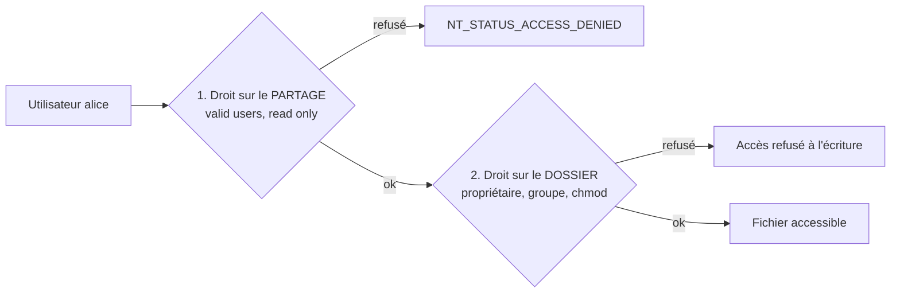

# 📖 Cours – Le NAS : stocker, partager, protéger les données

*Parcours serveurs – module 3 – prérequis : [module 0](../m0-virtualbox/01-cours.md)*

## 🎯 À la fin de ce cours, tu sauras

- [ ] situer un **NAS** par rapport aux autres solutions de stockage ;
- [ ] expliquer comment un **partage SMB** applique **deux niveaux de droits** ;
- [ ] **configurer un partage** à la main (Samba) et via une interface (OpenMediaVault) en reconnaissant que c'est la **même chose** ;
- [ ] expliquer la différence entre **RAID**, **instantané** et **sauvegarde** ;
- [ ] **diagnostiquer** les refus d'accès et les erreurs d'authentification.

---

## 1. Quel stockage pour quel besoin ?

| Solution | Principe | Accès | Exemple |
|---|---|---|---|
| **DAS** (*direct attached*) | disque branché à **un** poste | un seul poste | disque USB |
| **NAS** (*network attached storage*) | **serveur de fichiers** sur le réseau | **plusieurs postes**, par des protocoles de partage de **fichiers** | boîtier Synology, OpenMediaVault |
| **SAN** (*storage area network*) | disques présentés comme des **disques bruts** (blocs) à des serveurs | serveurs (virtualisation, bases) | baie de stockage |

> [!NOTE]
> Un NAS **parle fichiers** (dossiers, droits, noms) ; un SAN **parle blocs** (comme un disque interne). En TPE/PME, on rencontre presque toujours le **NAS**.

Un NAS, c'est **un mini-serveur Linux dédié** (système + disques + services de partage + interface web). Comprendre ce qu'il y a **dessous** permet de le dépanner : c'est ce que nous faisons dans ce module.

## 2. Les protocoles de partage

| Protocole | Pour qui | Port | Particularité |
|---|---|---|---|
| **SMB/CIFS** | **Windows** (et macOS, Linux) | **445** (TCP) | authentification par **compte** ; le plus courant en entreprise |
| **NFS** | Linux/Unix | 2049 | partage « monté » comme un dossier local |
| **FTP/SFTP** | transfert de fichiers | 21 / 22 | pas un « partage » : on envoie/récupère |
| **WebDAV / HTTP(S)** | accès depuis un navigateur ou Internet | 80/443 | passe les pare-feux |

Nous travaillons avec **SMB** (Samba côté Linux).

## 3. Deux niveaux de droits : le point que tout le monde oublie



| Niveau | Où | Contrôle |
|---|---|---|
| **1. Partage** | configuration Samba (`smb.conf`) | **qui** peut se connecter au partage, **lecture seule ou écriture** |
| **2. Système de fichiers** | droits Linux du dossier (`chown`, `chmod`) | **que peut faire** le compte une fois entré |

**Le droit effectif est la combinaison la plus restrictive des deux.** Un partage ouvert en écriture sur un dossier en lecture seule → lecture seule. Un dossier bien réglé mais un partage `read only = yes` → lecture seule.

> [!TIP]
> **Réflexe en cas de refus :** pose-toi les deux questions : *« le partage m'autorise-t-il ? »* puis *« le dossier m'autorise-t-il ? »* Ne règle jamais le problème en ouvrant tout.

### Utilisateurs Samba ≠ utilisateurs Linux

Samba tient **sa propre base de mots de passe** (`smbpasswd`), même si les **comptes** doivent exister sur le système. Un compte Linux sans mot de passe Samba **ne peut pas** se connecter au partage.

## 4. Un partage à la main (Samba)

Objectif : un dossier `commun` accessible en écriture au groupe `compta` seulement.

```bash
sudo apt install -y samba smbclient
sudo groupadd compta
sudo useradd -m -G compta alice
sudo smbpasswd -a alice                        # mot de passe SMB d'alice

sudo mkdir -p /srv/partage/commun
sudo chown root:compta /srv/partage/commun
sudo chmod 2770 /srv/partage/commun            # 2 = setgid : les nouveaux fichiers héritent du groupe
```

| Commande | Pourquoi |
|---|---|
| `groupadd compta` + `-G compta` | un **groupe** permet de gérer les droits **par équipe**, pas par personne |
| `smbpasswd -a` | crée le mot de passe **SMB** |
| `chown root:compta` + `chmod 2770` | le groupe `compta` lit/écrit, **les autres n'ont rien** ; `setgid` garde le groupe sur les nouveaux fichiers |

`/etc/samba/smb.conf` :

```ini
[global]
   workgroup = WORKGROUP
   server role = standalone server
   map to guest = never            # pas d'invité

[commun]
   path = /srv/partage/commun
   read only = no
   valid users = @compta           # niveau 1 : seul le groupe compta
```

```bash
testparm                            # valide la configuration (équivalent de configtest)
sudo systemctl restart smbd
smbclient //adresse/commun -U alice
```

| Directive | Rôle |
|---|---|
| `[commun]` | le **nom du partage** (`\\serveur\commun`) |
| `path` | le dossier réel |
| `read only = no` | écriture autorisée (niveau 1) |
| `valid users = @compta` | **liste blanche** : seuls les membres du groupe |
| `map to guest = never` | refuse les connexions invité |

## 5. Le même partage avec OpenMediaVault (OMV)

OMV est un système Linux dédié au NAS avec une **interface web**. **Chaque case de l'interface correspond à une directive que tu viens de voir** :

| Dans l'interface OMV | Équivalent à la main |
|---|---|
| *Stockage → Systèmes de fichiers* (créer, **monter**) | formater le disque (`mkfs`) + monter (`mount`, `/etc/fstab`) |
| *Utilisateurs et groupes* | `useradd`, `groupadd` |
| *Dossiers partagés* + droits | `mkdir`, `chown`, `chmod` (niveau 2) |
| *Services → SMB/CIFS → Partages* | blocs `[partage]` de `smb.conf` (niveau 1) |

> [!NOTE]
> **L'intérêt de l'avoir fait à la main :** quand l'interface affiche une erreur obscure, tu sais **quelle couche** regarder, et tu peux lire les journaux directement. Les noms de menus d'OMV varient selon la version.

## 6. Disponibilité et sauvegarde : trois notions à ne pas mélanger

| Technique | Protège contre | Ne protège **pas** contre |
|---|---|---|
| **RAID 1** (miroir de 2 disques) | la **panne d'un disque** | suppression, virus (copiés sur les deux disques), incendie, vol |
| **Instantané** (*snapshot* du système de fichiers) | une **suppression/modification récente** | la perte du disque entier |
| **Sauvegarde** (copie **ailleurs**) | tout, **si elle est hors du NAS** | rien si on ne **teste jamais** la restauration |

> [!WARNING]
> **RAID n'est pas une sauvegarde.** Un NAS en RAID dont les fichiers sont chiffrés par un virus a **perdu ses données**, malgré ses deux disques. Et **une sauvegarde jamais restaurée est une hypothèse, pas une sauvegarde**.

**Règle 3-2-1** : **3** copies des données, sur **2** supports différents, dont **1** hors site.

Exemple de copie simple d'un partage vers un autre disque :

```bash
rsync -a --delete /srv/partage/ /mnt/sauvegarde/
```

| Option | Effet | Attention |
|---|---|---|
| `-a` | copie en conservant droits, dates, propriétaires | |
| `--delete` | supprime à la destination ce qui n'existe plus à la source | **dangereux** : une suppression accidentelle est répliquée. Tester d'abord avec `--dry-run` |

À surveiller aussi : la **santé des disques** (SMART, `smartctl -a`), l'**espace libre** (`df -h` : un NAS plein cesse d'accepter des fichiers), et les **alertes** par e-mail.

## 7. Dépanner : pannes réelles et leurs messages

Reproduites avec Samba 4 et `smbclient` (Ubuntu 24.04).

| Symptôme | Message (`smbclient`) | Côté Windows | Cause | Vérification | Correction |
|---|---|---|---|---|---|
| Mot de passe refusé | `NT_STATUS_LOGON_FAILURE` | « Le nom d'utilisateur ou le mot de passe est incorrect » | mauvais mot de passe **SMB**, ou compte sans mot de passe SMB | `sudo pdbedit -L` (liste les comptes SMB) | `smbpasswd -a` / `smbpasswd` |
| Connexion refusée au partage | `NT_STATUS_ACCESS_DENIED` (« tree connect failed ») | « Accès refusé » | l'utilisateur **n'est pas dans** `valid users` (niveau 1) | `testparm -s` ; `id bob` | ajouter au groupe ; **reconnexion** requise |
| Connexion OK, **écriture refusée** | `NT_STATUS_ACCESS_DENIED opening remote file` | « Vous n'avez pas l'autorisation » | `read only = yes` (niveau 1) **ou** droits du dossier (niveau 2) | `testparm -s` ; `ls -ld` du dossier | corriger le niveau en cause |
| Partage introuvable | `NT_STATUS_BAD_NETWORK_NAME` | « Le chemin d'accès réseau est introuvable » | **nom de partage** inexistant (faute de frappe, bloc absent) | `smbclient -L adresse -U alice` | corriger le nom / créer le partage |
| Aucune connexion | *timeout* / `Connection refused` | idem | `smbd` arrêté ; port 445 bloqué | `systemctl status smbd` ; `ss -tlnp \| grep 445` | démarrer ; règles de pare-feu |
| Windows garde l'ancien compte | | « Plusieurs connexions avec le même serveur… » | **Windows mémorise** les identifiants d'une session | `net use` | `net use * /delete` puis se reconnecter |
| Fichiers créés illisibles par les collègues | | | `chmod` ne propage pas le **groupe** | `ls -l` du dossier | `chmod 2770` (setgid) ; `force create mode` |

> [!TIP]
> **Après une modification de droits ou de groupe**, l'utilisateur doit **se déconnecter puis se reconnecter** : ses droits sont pris en compte à l'ouverture de la session.

## 8. Fiche réflexe

1. **Qui** ne peut pas faire **quoi** ? (lire, écrire, se connecter)
2. `smbclient -L adresse -U compte` : le partage est-il listé ?
3. Message `NT_STATUS_…` ? (LOGON_FAILURE → mot de passe ; ACCESS_DENIED → droits ; BAD_NETWORK_NAME → nom)
4. **Niveau 1** : `testparm -s` (valid users, read only) ; **niveau 2** : `ls -ld`, `id compte`.
5. Le client a-t-il **gardé d'anciens identifiants** ? (`net use`)
6. Un changement à la fois, **note**.

---

## 🧠 Quiz de fin

**1.** Quelle différence entre un NAS et un SAN ?

<details markdown="1"><summary>Voir la réponse</summary>

Le NAS partage des **fichiers** (SMB, NFS) à des postes ; le SAN fournit des **disques bruts (blocs)** à des serveurs.

</details>

**2.** Un utilisateur se connecte au partage mais ne peut pas écrire. Quels sont les deux endroits à vérifier ?

<details markdown="1"><summary>Voir la réponse</summary>

Le **partage** (`read only`, `valid users`) et les **droits du dossier** sur le système (propriétaire, groupe, `chmod`). Le droit effectif est le **plus restrictif** des deux.

</details>

**3.** `NT_STATUS_LOGON_FAILURE` ou `NT_STATUS_ACCESS_DENIED` : lequel indique un problème de mot de passe ?

<details markdown="1"><summary>Voir la réponse</summary>

**`LOGON_FAILURE`** : l'authentification échoue. `ACCESS_DENIED` : le compte est authentifié mais **n'a pas le droit**.

</details>

**4.** Pourquoi un compte Linux existant ne peut-il pas se connecter au partage ?

<details markdown="1"><summary>Voir la réponse</summary>

Il n'a pas de **mot de passe Samba** (`smbpasswd -a`) : Samba a sa propre base de mots de passe.

</details>

**5.** Un NAS est en RAID 1 et un virus chiffre les fichiers. Les données sont-elles protégées ?

<details markdown="1"><summary>Voir la réponse</summary>

**Non** : le chiffrement est répliqué sur les deux disques. Il faut une **sauvegarde hors du NAS**, idéalement non modifiable par le poste infecté.

</details>

**6.** Que signifie la règle 3-2-1 ?

<details markdown="1"><summary>Voir la réponse</summary>

**3 copies**, sur **2 supports différents**, dont **1 hors site**.

</details>

**7.** Pourquoi tester l'option `--dry-run` avant `rsync --delete` ?

<details markdown="1"><summary>Voir la réponse</summary>

`--delete` **supprime** à la destination : un oubli ou une mauvaise source efface des données. `--dry-run` **simule** et montre ce qui serait fait.

</details>

➡️ Suite : [le TP du module](02-tp.md).
