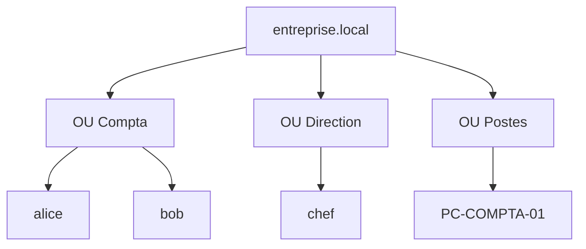

# 📖 Cours – Active Directory : l'annuaire de l'entreprise

*Parcours serveurs – module 4 – prérequis : [module 0](../m0-virtualbox/01-cours.md), notions de DNS*

## 🎯 À la fin de ce cours, tu sauras

- [ ] expliquer **à quoi sert un annuaire** et ce que change un **domaine** ;
- [ ] décrire le rôle du **contrôleur de domaine**, du **DNS**, de **Kerberos**, de **LDAP** ;
- [ ] expliquer **pourquoi** on prépare le réseau (IP fixe, DNS, heure) **avant** d'installer ;
- [ ] organiser **utilisateurs, groupes, unités d'organisation et GPO** ;
- [ ] **diagnostiquer** les pannes classiques (jonction impossible, GPO non appliquée, relation d'approbation rompue).

---

## 1. Le problème que résout un annuaire

Sans annuaire, chaque poste a **ses propres comptes**. Pour 30 postes et 30 employés :

| Sans annuaire | Avec Active Directory |
|---|---|
| un compte à créer sur **chaque poste** | un compte créé **une fois**, valable partout |
| mot de passe changé **poste par poste** | un seul changement |
| un départ = 30 suppressions | **une** désactivation |
| réglages (fond d'écran, imprimantes, sécurité) faits à la main | **stratégies de groupe** appliquées automatiquement |
| aucune vue d'ensemble | inventaire des comptes et des postes |

**Active Directory (AD)** est l'annuaire de Microsoft. Il stocke des **objets** (utilisateurs, groupes, ordinateurs…) et sert à **authentifier** (qui es-tu ?) et **autoriser** (que peux-tu faire ?).

## 2. Le vocabulaire, avec les relations entre les notions

| Terme | Définition | Analogie |
|---|---|---|
| **Domaine** (`entreprise.local`) | périmètre d'administration : comptes et postes gérés ensemble | une entreprise |
| **Contrôleur de domaine** (*DC*) | serveur Windows qui héberge l'annuaire et valide les connexions | le service des badges |
| **Forêt / arbre** | ensemble de domaines | le groupe de sociétés |
| **Unité d'organisation** (*OU*) | **dossier** de l'annuaire pour ranger les objets et **y lier des GPO** | un service |
| **Groupe** | ensemble d'utilisateurs auquel on donne des droits | une équipe |
| **GPO** | règles appliquées automatiquement aux utilisateurs/ordinateurs d'une OU | le règlement intérieur |
| **SYSVOL** | dossier partagé du DC qui contient les **GPO** et les scripts | le tableau d'affichage |



## 3. Les protocoles qui travaillent en coulisses

| Protocole | Port | Rôle |
|---|---|---|
| **DNS** | 53 | **trouver** le contrôleur de domaine |
| **Kerberos** | 88 | **authentifier** (système de tickets) |
| **LDAP** | 389 (636 en chiffré) | **interroger** l'annuaire |
| **SMB** | 445 | accéder à SYSVOL, aux partages |
| **RPC** | 135 + ports dynamiques | administration, réplication |

### Le DNS, cœur de l'AD

Le poste ne connaît pas l'adresse du contrôleur de domaine : il **interroge le DNS** pour des enregistrements spéciaux, les enregistrements **SRV** :

```text
_ldap._tcp.dc._msdcs.entreprise.local   →  srv-ad.entreprise.local : 389
_kerberos._tcp.entreprise.local         →  srv-ad.entreprise.local : 88
```

> [!WARNING]
> **Conséquence : le DNS du poste doit pointer vers le serveur AD** (qui héberge les enregistrements SRV), **pas** vers la box ni `8.8.8.8` qui ignorent tout de `entreprise.local`. C'est la **première cause** d'échec de jonction au domaine. C'est pourquoi on installe **AD + DNS ensemble**.

### Kerberos et l'heure

Kerberos délivre des **tickets** qui expirent. Pour qu'un ticket soit valide, **l'heure du poste et celle du contrôleur de domaine ne doivent pas différer de plus de 5 minutes** (valeur par défaut). Sinon l'authentification échoue, avec un message trompeur.

> [!TIP]
> En VM, **l'heure dérive** après un instantané restauré ou une mise en veille. **Vérifier l'heure est un réflexe** quand un compte valide « ne marche plus ».

## 4. Préparer avant d'installer (et pourquoi)

| Préparation | Pourquoi |
|---|---|
| **Nom d'hôte définitif** (`SRV-AD`) | renommer un contrôleur de domaine **après** est délicat |
| **Adresse IP fixe** | un DC dont l'adresse change devient **injoignable** |
| **DNS du serveur = lui-même** (`127.0.0.1` ou sa propre IP) | il héberge le DNS du domaine |
| **Heure et fuseau corrects** | Kerberos (§3) |
| **Mot de passe administrateur robuste** | le DC est la **clé de l'entreprise** |
| **Instantané** avant promotion | retour arrière si besoin |

> [!NOTE]
> **Choix du nom de domaine.** `entreprise.local` est courant en TP, mais Microsoft recommande plutôt un **sous-domaine d'un nom que l'on possède** (par exemple `ad.entreprise.fr`) : le suffixe `.local` peut entrer en conflit avec le service de découverte `mDNS` de certains systèmes. Pour un laboratoire fermé, c'est acceptable ; en production, on choisit autrement.

## 5. Installer le rôle et promouvoir le serveur

Interface graphique : *Gestionnaire de serveur → Ajouter des rôles → Services AD DS*, puis **Promouvoir ce serveur en contrôleur de domaine**. Équivalent PowerShell :

```powershell
Install-WindowsFeature AD-Domain-Services -IncludeManagementTools
Install-ADDSForest -DomainName "entreprise.local" -InstallDns
```

| Étape | Ce qui se passe |
|---|---|
| **Installer le rôle** | copie les composants **sans créer d'annuaire** |
| **Promouvoir** | crée la **forêt** et le domaine, la base de l'annuaire, **SYSVOL**, installe le **DNS**, **redémarre** |
| **Mot de passe DSRM** | mot de passe de **restauration** de l'annuaire : à conserver précieusement |

**Vérifier après redémarrage :**

```powershell
dcdiag                                  # diagnostic global du contrôleur de domaine
nslookup -type=SRV _ldap._tcp.dc._msdcs.entreprise.local
Get-Service NTDS, DNS, Kdc              # services de l'AD
```

## 6. Organiser l'annuaire

**Bonne pratique : ne pas laisser les comptes dans le conteneur par défaut `Users`.** On crée des **unités d'organisation** qui reflètent l'entreprise (services, sites), **et on y range comptes et ordinateurs**.

| Principe | Pourquoi |
|---|---|
| OU par **service** | on lie une GPO au service concerné |
| **Groupes** pour les droits (**AGDLP** : Comptes → Groupes globaux → Groupes locaux de domaine → Permissions) | on donne des droits à des **groupes**, jamais à des personnes une à une |
| Nommage cohérent (`alice.dupont`, `PC-COMPTA-01`) | s'y retrouver à 300 comptes |

```powershell
New-ADOrganizationalUnit -Name "Compta" -Path "DC=entreprise,DC=local"
New-ADUser -Name "alice" -SamAccountName alice -Path "OU=Compta,DC=entreprise,DC=local" `
  -AccountPassword (Read-Host -AsSecureString "Mot de passe") -Enabled $true
```

> [!WARNING]
> Une OU **n'est pas un groupe** : on lie des **GPO** à une OU, on donne des **droits** à un groupe. Un utilisateur est dans **une seule** OU mais peut être membre de **plusieurs** groupes.

## 7. Les stratégies de groupe (GPO)

Une **GPO** est un ensemble de réglages (fond d'écran, mots de passe, lecteurs réseau, restrictions, installation de logiciels). Elle est **liée** à un site, un domaine ou une **OU**, et s'applique aux **utilisateurs** et/ou **ordinateurs** qui s'y trouvent.

| Notion | À retenir |
|---|---|
| **Configuration ordinateur** | s'applique **au démarrage** de la machine, quel que soit l'utilisateur |
| **Configuration utilisateur** | s'applique **à l'ouverture de session** |
| **Ordre d'application (LSDOU)** | Local → Site → Domaine → **OU** ; **la dernière appliquée gagne** (la plus proche de l'objet) |
| **Héritage** | les OU enfants héritent des GPO des parents |
| **Filtrage de sécurité** | restreint la GPO à certains groupes |
| **Rafraîchissement** | toutes les ~90 min ; immédiat avec `gpupdate /force` |

Contrôler ce qui s'applique réellement :

```powershell
gpresult /r          # GPO appliquées (utilisateur et ordinateur)
gpupdate /force      # forcer l'application
```

## 8. Joindre un poste au domaine

Conditions : le poste **joint** le serveur (réseau), son **DNS pointe vers le DC**, l'**heure est correcte**, on utilise un compte autorisé à joindre des machines. Après la jonction : redémarrage, connexion avec `ENTREPRISE\alice`.

```powershell
Add-Computer -DomainName entreprise.local -Credential ENTREPRISE\Administrateur -Restart
```

> [!NOTE]
> Un poste joint **crée un compte d'ordinateur** dans l'annuaire, avec un **mot de passe de machine** qui change tous les **30 jours** environ. C'est ce mot de passe qui fabrique la *relation d'approbation* poste ↔ domaine (voir panne n°4).

## 9. Dépanner : les pannes classiques

| Symptôme | Message typique | Cause | Vérifications | Correction |
|---|---|---|---|---|
| **Jonction impossible** | « *An Active Directory Domain Controller (AD DC) for the domain "entreprise.local" could not be contacted* » | le poste **ne trouve pas** le DC : DNS incorrect, DC injoignable | `ipconfig /all` (DNS ?) ; `ping IP-du-DC` ; `nslookup entreprise.local` ; `nslookup -type=SRV _ldap._tcp.dc._msdcs.entreprise.local` | DNS du poste → **IP du DC** ; réseau |
| **Compte valide refusé** | échec d'authentification inexpliqué | **heure décalée** de plus de 5 min | `w32tm /query /status` ; comparer les heures | resynchroniser (`w32tm /resync`) ; vérifier le fuseau |
| **GPO non appliquée** | le réglage n'apparaît pas | utilisateur/ordinateur **hors de l'OU liée** (souvent dans `Users`/`Computers` par défaut) ; GPO sur la mauvaise configuration (ordinateur vs utilisateur) ; filtrage de sécurité ; pas de `gpupdate` | `gpresult /r` ; position de l'objet dans l'annuaire | **déplacer l'objet dans la bonne OU** ; corriger la GPO ; `gpupdate /force` |
| **« La relation d'approbation entre cette station de travail et le domaine principal a échoué »** | ouverture de session impossible avec un compte du domaine | le **mot de passe de machine** du poste ne correspond plus à l'annuaire (instantané ancien restauré, VM restaurée, poste cloné) | se connecter avec un compte **local** ; `Test-ComputerSecureChannel` | `Reset-ComputerMachinePassword -Server SRV-AD -Credential …` ou **rejoindre le domaine** |
| **Création d'utilisateur refusée** | « *The password does not meet the password policy requirements* » | la **stratégie de mot de passe** du domaine (longueur, complexité) | lire la stratégie de mot de passe par défaut | mot de passe conforme |
| **L'AD ne démarre plus / lenteurs** | erreurs dans l'Observateur d'événements | DNS ou services arrêtés, disque plein | *Observateur d'événements → Services d'annuaire / DNS* ; `dcdiag` ; espace disque | corriger la cause ; **restaurer** depuis une sauvegarde si besoin |
| **Un compte « disparaît »** | | compte **désactivé**, **verrouillé** (trop d'échecs) ou expiré | propriétés du compte dans l'annuaire | déverrouiller/réactiver |

> [!TIP]
> **Le réflexe des quatre vérifications** pour un poste qui n'arrive pas à ouvrir de session dans le domaine : **réseau → DNS → heure → compte**. Dans cet ordre.

> [!WARNING]
> **Instantanés et Active Directory ne font pas bon ménage.** Restaurer un instantané **ancien** d'un DC (ou d'un poste joint) crée des incohérences (mots de passe de machine, réplication). Dans un **vrai** parc, on **sauvegarde l'état du système** du DC (`wbadmin`), on **ne le restaure pas** à coup d'instantanés. En TP, on les utilise **avec méthode** : tous les éléments du domaine **restaurés ensemble**.

## 10. Fiche réflexe

1. Le **réseau** : `ipconfig /all` (IP, **DNS = DC**), `ping` du DC.
2. Le **nom** : `nslookup entreprise.local` puis l'enregistrement **SRV**.
3. L'**heure** : `w32tm /query /status`.
4. Le **compte** : existe, activé, **bonne OU** ?
5. Le **DC** : `dcdiag`, services `NTDS`, `DNS`, `Kdc` démarrés.
6. L'**Observateur d'événements** (*Journaux Windows → Système / Services d'annuaire*).
7. Une chose à la fois, **note**.

---

## 🧠 Quiz de fin

**1.** Pourquoi un poste ne peut-il pas joindre le domaine si son DNS pointe vers `8.8.8.8` ?

<details markdown="1"><summary>Voir la réponse</summary>

Il doit trouver le contrôleur de domaine grâce à des enregistrements **SRV** que **seul le DNS du domaine** connaît. `8.8.8.8` ignore `entreprise.local`.

</details>

**2.** Un utilisateur a le bon mot de passe mais l'authentification échoue sur un poste d'une VM restaurée. Quelle piste prioritaire ?

<details markdown="1"><summary>Voir la réponse</summary>

L'**heure** (écart de plus de 5 minutes → Kerberos refuse), et la **relation d'approbation** (mot de passe de machine ancien).

</details>

**3.** Une GPO liée à l'OU « Compta » ne s'applique pas à `alice`. Cite trois causes possibles.

<details markdown="1"><summary>Voir la réponse</summary>

`alice` est dans une **autre OU** (ex. `Users` par défaut) ; la GPO configure l'**ordinateur** et non l'**utilisateur** (ou l'inverse) ; **filtrage de sécurité** ; `gpupdate` pas fait. On contrôle avec `gpresult /r`.

</details>

**4.** Quelle différence entre une OU et un groupe ?

<details markdown="1"><summary>Voir la réponse</summary>

L'**OU** range les objets et **reçoit des GPO** (un objet n'est que dans **une** OU). Le **groupe** sert à **donner des droits** (un utilisateur peut être dans **plusieurs** groupes).

</details>

**5.** Pourquoi l'ordre d'application LSDOU est-il important ?

<details markdown="1"><summary>Voir la réponse</summary>

En cas de **conflit**, **la dernière GPO appliquée gagne** : celle de l'OU la plus proche de l'objet l'emporte sur celle du domaine.

</details>

**6.** Pourquoi éviter de restaurer des instantanés anciens sur un contrôleur de domaine ?

<details markdown="1"><summary>Voir la réponse</summary>

Cela crée des **incohérences** (mots de passe de machine, réplication, objets). On utilise des **sauvegardes de l'état du système**.

</details>

➡️ Suite : [le TP du module](02-tp.md).
