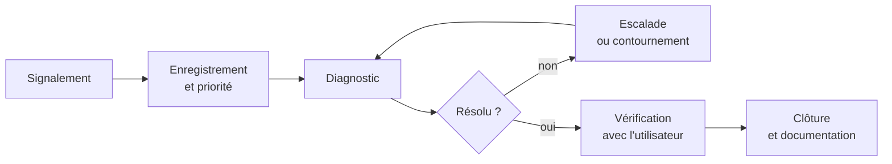

# 📖 Cours – Le technicien face à l'incident

*Parcours serveurs – module 5 – prérequis : au moins les modules 0 et 1*

## 🎯 À la fin de ce cours, tu sauras

- [ ] traiter un **incident** de bout en bout : du **ticket** à la **clôture** ;
- [ ] **prioriser** et **communiquer** avec un utilisateur non technicien ;
- [ ] **rédiger** un compte rendu exploitable ;
- [ ] transformer un incident en **amélioration** (prévention).

---

## 1. Du « ça ne marche pas » à l'incident documenté

Un utilisateur ne dit jamais « le service Apache est arrêté ». Il dit : *« Internet ne marche plus »*, *« je n'ai plus mon dossier »*. Le travail du technicien commence par **comprendre**.

### Questions à poser (sans jargon)

| Question | Ce qu'elle apporte |
|---|---|
| « Qu'essayiez-vous de faire ? » | le **contexte** |
| « Que voyez-vous exactement à l'écran ? Pouvez-vous le photographier ? » | le **message exact** |
| « Ça marchait quand pour la dernière fois ? Qu'est-ce qui a changé ? » | l'**origine** possible |
| « Est-ce que cela concerne que vous, ou vos collègues aussi ? » | le **périmètre** |
| « Pouvez-vous reproduire le problème ? » | la **fiabilité** du diagnostic |

> [!WARNING]
> **Ne jamais dire « ce n'est pas grave »** ni « c'est de votre faute ». On **reformule** pour vérifier qu'on a compris, on **annonce un délai réaliste**, on **tient l'utilisateur informé**.

## 2. Le cycle de vie d'un ticket

| Étape | Contenu |
|---|---|
| **Enregistrement** | qui, quand, quoi, quel message, quel poste/service |
| **Priorité** | impact (combien de personnes ?) × urgence (activité bloquée ?) |
| **Diagnostic** | [la méthode en 7 étapes](../methode-depannage.md) |
| **Contournement** | solution **provisoire** pour que l'utilisateur travaille (la cause reste à traiter) |
| **Escalade** | passer la main (collègue, niveau supérieur, fournisseur) **avec un dossier complet**, pas un « ça ne marche pas » |
| **Vérification** | l'**utilisateur** confirme que **son** problème est réglé |
| **Clôture** | documenter cause, correctif, prévention |

### Prioriser

| Impact \ Urgence | Activité **bloquée** | Gêne |
|---|---|---|
| **Plusieurs utilisateurs / service critique** | 🔴 **P1** : tout de suite | 🟠 P2 |
| **Un seul utilisateur** | 🟠 P2 | 🟢 P3 |

## 3. Avant d'intervenir : se protéger

| Réflexe | Pourquoi |
|---|---|
| **Instantané ou copie** du fichier avant de le modifier (`cp fichier fichier.bak`) | retour arrière |
| **Un seul changement à la fois** | savoir ce qui a corrigé |
| **Annoncer** l'intervention si elle coupe un service | pas de surprise |
| **Noter** les commandes lancées | traçabilité |
| **Ne jamais** « bricoler » en production sans plan de retour | |

## 4. Le compte rendu d'intervention

Un bon compte rendu tient en quelques lignes et répond à : **quoi, pourquoi, comment, et comment éviter**.

> *« **Incident :** site de la compta inaccessible (403) depuis 9 h 10. **Cause :** les droits du dossier `/var/www/compta` ont été modifiés lors d'une copie de fichiers (propriétaire `root`, mode `600`). **Correctif :** `chmod 644` sur les fichiers, `755` sur les dossiers ; contrôle par `curl -I` : 200. **Vérifié avec :** M. Durand. **Prévention :** documenter la procédure de dépôt de fichiers (droits à appliquer). »*

## 5. De l'incident à l'amélioration

Une panne résolue sans suite **reviendra**. On se demande toujours :

| Question | Exemple d'action |
|---|---|
| **Pouvait-on l'éviter ?** | procédure de mise à jour, droits automatiques |
| **L'a-t-on détectée assez vite ?** | supervision, alerte disque |
| **L'a-t-on diagnostiquée assez vite ?** | journaux plus lisibles, documentation, fiche réflexe |
| **Le contournement est-il connu des collègues ?** | base de connaissances |

> [!TIP]
> **La base de connaissances** (même un simple dossier partagé de fiches) est ce qui fait gagner le plus de temps à une équipe. Chaque fiche de dépannage que tu écris **en est une brique**.

## 6. Les outils à avoir en tête

| Besoin | Linux | Windows |
|---|---|---|
| Réseau | `ip a`, `ip r`, `ping`, `ss -tlnp`, `curl -v` | `ipconfig /all`, `ping`, `netstat -ano`, `Test-NetConnection` |
| Noms | `getent hosts`, `dig` | `nslookup` |
| Services | `systemctl status`, `journalctl -u` | `Get-Service`, Observateur d'événements |
| Fichiers et droits | `ls -l`, `namei -l`, `id` | onglet Sécurité, `icacls` |
| Configuration | `apache2ctl configtest`, `nginx -t`, `testparm`, `sshd -t` | gestion du rôle, `gpresult /r` |
| Ressources | `df -h`, `free -h`, `top` | Gestionnaire des tâches |

---

## 🧠 Quiz de fin

**1.** Un utilisateur dit « Internet ne marche plus ». Quelles trois questions poses-tu ?

Voir la réponse

Par exemple : **que voyez-vous exactement** (message) ? **Depuis quand** et **qu'est-ce qui a changé** ? **Vos collègues** sont-ils touchés aussi (périmètre) ?

**2.** Quelle différence entre un **contournement** et une **correction** ?

Voir la réponse

Le contournement permet de **continuer à travailler** sans traiter la cause ; la correction **supprime la cause**.

**3.** Pourquoi l'**utilisateur** doit-il confirmer la résolution ?

Voir la réponse

Un test technique OK ne garantit pas que **son** problème (son poste, son usage) soit résolu.

**4.** À quoi sert la section « prévention » du compte rendu ?

Voir la réponse

À **éviter la récidive** et à alimenter la base de connaissances.

➡️ Suite : [le TP de synthèse](02-tp.md).
