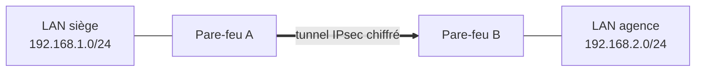

# 📖 Cours – VPN IPsec

*Parcours Stormshield – module S09*

> [!EXAMPLE] 🚀 Pour aller plus loin
> Module du parcours Stormshield (préparation CSNA). Les bases sont dans le [module CCNA 5-05](../../ccna/5-05-vpn-ipsec/01-cours.md).

## 🎯 À la fin de ce cours, tu sauras

- [ ] expliquer ce qu'est un **VPN site à site** ;
- [ ] décrire les **deux phases** d'IPsec et la différence **IKEv1 / IKEv2** ;
- [ ] configurer, sur le papier, un VPN avec une **clé pré-partagée** ;
- [ ] expliquer la **Virtual Tunnel Interface (VTI)**.

---

## 1. Le besoin

Une entreprise a deux sites (siège, agence). Pour que leurs réseaux privés communiquent **à travers Internet**, on monte un **tunnel chiffré** entre les deux pare-feux : c'est un **VPN site à site**.

## 2. IPsec en deux phases

| Phase | Nom | Rôle |
|---|---|---|
| **1** | **IKE SA** | les deux pare-feux **s'authentifient** (clé pré-partagée ou certificat) et négocient un canal sûr |
| **2** | **IPsec SA** (*Child SA*) | on négocie le **chiffrement du trafic** entre les réseaux |

| Paramètre | Exemple |
|---|---|
| Chiffrement | AES 256 |
| Intégrité | SHA-256 |
| Groupe Diffie-Hellman | 14 |
| Authentification | clé pré-partagée (*PSK*) ou **certificat** |

> [!NOTE]
> Ports et protocoles : **UDP 500** (IKE), **UDP 4500** (NAT-T, si un NAT est sur le chemin), **ESP** (protocole IP 50) pour les données.

## 3. IKEv1 et IKEv2

| | **IKEv1** | **IKEv2** |
|---|---|---|
| Négociation | plus longue (modes *main* / *aggressive*) | **plus simple**, plus rapide |
| Robustesse | correcte | meilleure (détection de panne, reprise) |
| Usage conseillé | équipements anciens | **à préférer** |

## 4. Configuration d'un tunnel avec clé pré-partagée

| Étape | À définir **identique des deux côtés** |
|---|---|
| 1. Pairs | adresse publique de chaque pare-feu |
| 2. **Réseaux locaux et distants** | `192.168.1.0/24` ↔ `192.168.2.0/24` |
| 3. **Politique de chiffrement** | AES-256, SHA-256, DH 14 |
| 4. **Clé pré-partagée** | longue et aléatoire |
| 5. **Filtrage** | règle autorisant le trafic entre les deux réseaux |

> [!WARNING]
> **Les réseaux ne doivent pas se chevaucher** : deux sites en `192.168.1.0/24` ne peuvent pas communiquer par VPN sans retraitement (changer un adressage ou faire du NAT).

## 5. Virtual Tunnel Interface (VTI)

La **VTI** est une **interface virtuelle** qui représente le tunnel : le trafic y arrive par **routage** (une route statique vers le réseau distant passe par la VTI). Intérêt : on peut **filtrer** le trafic comme sur n'importe quelle interface, faire du **routage dynamique** et gérer des tunnels redondants.

## 6. Dans les simulateurs

> [!NOTE]
> 🧊 **Limite du simulateur.** Le **pare-feu Stormshield du simulateur n'a pas de VPN** (ni IKE, ni VTI). **Alternative dans le simulateur :** le TP **CCNA 5-05** monte un **vrai tunnel IPsec** entre **deux routeurs Cisco** : mêmes notions (phases, AES/SHA/DH, clé pré-partagée, trafic à chiffrer), commandes Cisco. **Alternatives :** Packet Tracer (même scénario) ; **VM EVA** ×2 (TP du module).

## 🔧 Dépanner : le tunnel IPsec

> [!NOTE]
> **Pourquoi ce chapitre ?** Un tunnel qui ne monte pas ne dit pas pourquoi à l'utilisateur. La méthode : **identifier la phase** qui échoue (la phase 1 construit le canal de contrôle, la phase 2 crée le tunnel de données), puis comparer les deux extrémités **paramètre par paramètre**.

> [!WARNING]
> **Ce tableau n'est pas reproductible dans le simulateur** du site (pas de tunnel IPsec). Il décrit les causes **classiques** à connaître pour la certification ; **vérifie-les sur ta VM EVA** (ou en classe) avant de les considérer comme acquises.

### Phase 1 qui n'aboutit pas

| Cause | À comparer / vérifier |
|---|---|
| Clé pré-partagée différente | la clé, **à l'identique** des deux côtés (casse, espaces) |
| Propositions incompatibles | chiffrement, hachage, groupe Diffie-Hellman, **version IKE** : mêmes choix des deux côtés |
| Pair injoignable | adresse du pair juste ? ports UDP 500 / 4500 ouverts sur le chemin ? |
| Identifiants (ID locaux/distants) incohérents | l'identité attendue par chaque extrémité |

### Phase 1 établie, mais pas de trafic

| Cause | À comparer / vérifier |
|---|---|
| Réseaux locaux / distants **non symétriques** | ce qui est « local » à un bout doit être « distant » à l'autre, avec **les mêmes réseaux** |
| Règle de filtrage absente | le trafic à destination du tunnel doit être autorisé |
| Route absente | les réseaux distants sont-ils routés vers le tunnel ? |
| Proposition de phase 2 différente | chiffrement, hachage, PFS identiques des deux côtés |

> [!TIP]
> **Le réflexe :** on lit le **journal des VPN des deux extrémités**. L'une des deux dit presque toujours précisément ce qu'elle a refusé (proposition, identité, réseau).

---

## 🧠 Quiz de fin

**1.** Que fait la phase 1 d'IPsec ?

Voir la réponse

Les pairs **s'authentifient** et établissent un canal sûr (IKE SA).

**2.** Pourquoi les réseaux des deux sites ne doivent-ils pas se chevaucher ?

Voir la réponse

Le pare-feu ne saurait pas **de quel côté** envoyer un paquet pour une adresse présente des deux côtés.

**3.** Quel est l'intérêt de IKEv2 ?

Voir la réponse

Négociation **plus simple, plus rapide et plus robuste**.

**4.** Qu'est-ce qu'une VTI ?

Voir la réponse

Une **interface virtuelle** représentant le tunnel, utilisée par le **routage**.

➡️ Suite : [le TP du module](02-tp.md).
