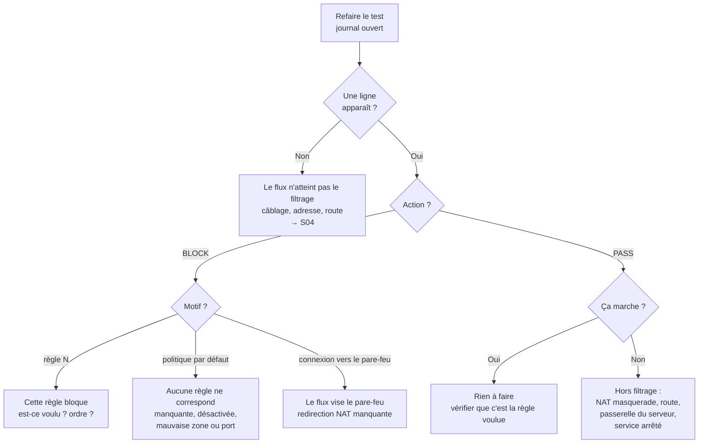

# 🔧 S11 · Dépanner un pare-feu : la méthode

*Parcours Stormshield – module de synthèse (transversal)*

> [!EXAMPLE] 🚀 Pour aller plus loin
> Ce module **rassemble** les sections « Dépanner » des modules S02 à S06. Il peut se faire dès que tu as vu le filtrage et le NAT.

## 🎯 À la fin de ce cours, tu sauras

- appliquer une **méthode** de dépannage à un pare-feu (et non tester au hasard) ;
- **lire le journal** pour distinguer un problème de **filtrage**, de **NAT**, de **routage** ou d'**hôte** ;
- relier chaque symptôme à sa **première vérification** ;
- tenir un **journal de dépannage** exploitable.

---

## 1. Pourquoi une méthode spécifique au pare-feu ?

Un pare-feu est **au carrefour** de quatre mécanismes qui se masquent mutuellement : la **configuration réseau** (interfaces, routes), le **filtrage** (règles), le **NAT** (traductions) et les **hôtes** (serveurs, postes). Une panne peut venir de n'importe lequel, et le symptôme est toujours le même : *« ça ne marche pas »*. La seule façon de s'y retrouver est de **laisser le journal décider** de la direction.

> [!WARNING]
> **Les trois erreurs classiques :** (1) ajouter une règle « `any → any` pour voir » (on a ouvert une brèche **et** on ne sait plus ce qui bloquait) ; (2) modifier plusieurs choses à la fois ; (3) ne pas lire le journal.

## 2. L'arbre de décision du journal

Refais le test **en regardant le journal**, puis :

## 3. La fiche réflexe

| Symptôme | Ce que montre le journal | Cause probable | Module |
|---|---|---|---|
| Rien ne sort vers Internet, la DMZ marche | **aucune ligne** pour Internet | route par défaut absente | [S04](../s04-configuration-reseau/01-cours.md) |
| Le serveur de la DMZ ne répond à personne | `PASS` (aller) | mauvaise passerelle du serveur, service arrêté | [S04](../s04-configuration-reseau/01-cours.md) |
| Plus d'accès Internet pour le LAN | `PASS … LAN→WAN`, pas de réponse | masquerade absent | [S05](../s05-nat/01-cours.md) |
| Le site publié ne répond plus depuis Internet | `BLOCK … WAN→FW … connexion vers le pare-feu refusée` | redirection absente | [S05](../s05-nat/01-cours.md) |
| La redirection existe mais rien ne passe | `BLOCK … WAN→DMZ … politique par défaut` | règle de filtrage absente ou désactivée | [S05](../s05-nat/01-cours.md), [S06](../s06-filtrage/01-cours.md) |
| Un poste censé être bloqué passe | `PASS … règle N` | règle générale placée avant la règle de blocage | [S06](../s06-filtrage/01-cours.md) |
| Un flux autorisé est bloqué | `BLOCK … politique par défaut` | mauvaise zone, mauvais port, règle décochée | [S06](../s06-filtrage/01-cours.md) |

## 4. Les gestes à ne jamais oublier

1. **Changer une seule chose à la fois**, puis retester.
2. **Ne jamais « ouvrir tout »** pour tester : on crée un risque et on perd l'information. On crée une règle **précise** et temporaire, qu'on supprime.
3. **Vérifier qu'on n'a rien cassé** : refaire les tests qui marchaient avant la panne.
4. **Documenter** : symptôme, ligne du journal, cause, correction, vérification.

> [!NOTE]
> **Réseau d'abord.** Si ton symptôme concerne aussi des équipements qui ne passent pas par le pare-feu, le problème n'est probablement pas le pare-feu : applique la [méthode de dépannage réseau du parcours CCNA](../../ccna/7-01-depannage-reseau/01-cours.md).

## 5. Le journal de dépannage

| Champ | Exemple |
|---|---|
| **Symptôme** | le site publié n'est plus accessible depuis Internet |
| **Test** | `http://203.0.113.2` depuis le poste Internet |
| **Ligne du journal** | `BLOCK … [WAN→DMZ] politique par défaut` |
| **Cause** | la règle `WAN→DMZ tcp 80` est désactivée |
| **Correction** (une seule) | réactiver la règle |
| **Vérification** | la page s'affiche ; ligne `PASS … règle 5` |
| **Prévention** | ne pas désactiver une règle sans commentaire daté |

---

## 🧠 Quiz de fin

**1.** Le journal affiche `PASS` mais la page ne s'ouvre pas. Où cherches-tu ?

Voir la réponse

**Hors du filtrage** : NAT (masquerade), route, passerelle du serveur, service arrêté.

**2.** Que signifie `BLOCK … politique par défaut` ?

Voir la réponse

**Aucune règle** n'a correspondu au flux : règle manquante, désactivée, ou écrite avec la mauvaise zone ou le mauvais port.

**3.** Dans le journal, la destination est l'**adresse publique du pare-feu**, zone `FW`. Que soupçonnes-tu ?

Voir la réponse

Une **redirection de port manquante** : le flux n'a pas été traduit et vise le pare-feu lui-même.

**4.** Pourquoi ne faut-il pas ouvrir `any → any` « pour tester » ?

Voir la réponse

Cela crée une **brèche de sécurité** et ne dit plus quelle règle posait problème. On crée plutôt une règle précise et temporaire.

**5.** Un poste bloqué par une règle passe pourtant. Quelle est la cause la plus probable ?

Voir la réponse

Une règle **plus générale placée avant** correspond la première : les règles sont évaluées de haut en bas.

➡️ Suite : [le TP « Site en panne »](02-tp.md).
