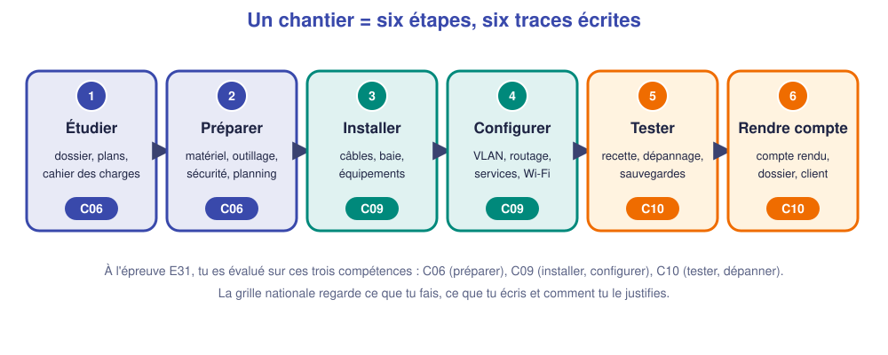

# 📖 Cours – Les règles du jeu de l'année

*Bac Pro CIEL – Terminale – E31 – S01*

> [!IMPORTANT]
> **Une idée à la fois.** Réponds à la question **avant** de déplier la réponse.

## 🎯 À la fin de ce cours, tu sauras

- [ ] décrire un **chantier en 6 étapes** ;
- [ ] expliquer **ce que l'évaluation regarde** ;
- [ ] dire ce que contient ton **dossier de preuves** et à quoi il te sert.

---

## 1. Un chantier en six étapes

### 🤔 Avant de lire : à ton avis ?

Dans un chantier, quelle étape est la plus souvent **oubliée ou bâclée** ?

Voir la réponse

**Rendre compte.** On a installé, ça marche, on range… et trois mois plus tard personne ne sait comment c'est fait. L'étape 6 (compte rendu, dossier, sauvegardes) est celle qui **protège le client et le technicien suivant**.

### ✅ Vérifie que tu as compris

À quelle étape place-tu la **sauvegarde** d'une configuration validée ? Et le **test d'interdiction** (« les invités ne doivent pas passer ») ?

Voir la réponse

La sauvegarde : étapes **4** (après chaque configuration validée) et **6** (copie dans le dossier). Le test d'interdiction : étape **5** (recette).

---

## 2. Ce que regarde l'évaluation

### 🤔 Avant de lire : à ton avis ?

Un évaluateur voit deux candidats : l'un fait tout juste mais ne dit rien ; l'autre se trompe, **s'en rend compte, explique, corrige**. Lequel a le plus de chances d'être bien évalué ?

Voir la réponse

Les deux sont évalués sur la **grille**. Le premier peut manquer de **justification** et de **traces écrites** ; le second montre une **démarche** (constater, analyser, corriger), qui est précisément ce qu'on cherche à valider. **Ce qui compte : une réalisation juste, justifiée et documentée.**

### 💡 L'idée

| Compétence | Ce qu'on attend de toi |
|---|---|
| **C06 – Valider la conformité d'une installation** | Vérifier que l'installation respecte le cahier des charges : **tests** réalisés, **résultats attendus** vérifiés, **procédure** suivie |
| **C09 – Installer** | Vérifier le matériel, câbler, monter, **configurer**, **mettre en service**, renseigner l'état de l'installation, appliquer les règles de **sécurité** |
| **C10 – Exploiter un réseau** | **Consigner** alertes et problèmes, identifier les équipements sur un schéma, **mettre à jour**, **optimiser**, préparer son travail et le tenir dans les **délais**, travailler en équipe |

> [!NOTE]
> **À l'épreuve**, tu disposes de **documentation d'appui** (fiches mémo, documentation constructeur) : on n'attend pas que tu saches **tout par cœur**, mais que tu saches **où chercher** et **appliquer**. **Prépare tes fiches mémo.**

> [!WARNING]
> **L'épreuve E31 est une épreuve pratique de 3 heures, de coefficient 5**, sur plateau technique : tu réalises un chantier qui mobilise **C06, C09 et C10**. La date et le déroulé précis te sont présentés en classe par ton enseignant.

---

## 3. Le dossier de preuves : garder la trace de ce que tu sais faire

Le **dossier de preuves** est un outil de suivi et de préparation : il n'est **pas évalué à l'épreuve**, mais il t'aide à **garder la trace de ce que tu sais faire** et à réviser. Il rassemble les activités réalisées **en formation et en entreprise**. Pour chaque activité, tu y déposes : une **fiche** (contexte, tâches **personnelles**, résultat) et des **preuves** (schéma, procès-verbal de test, compte rendu, mesures).

| Famille d'activités | Exemples |
|---|---|
| **R2** | Installer et configurer un réseau (câblage, VLAN, DHCP…) |
| **R3** | Mettre en service, tester, recetter |
| **R5** | Dépanner, intervenir, rendre compte |

### ✅ Vérifie que tu as compris

Qu'est-ce qu'une **bonne preuve** ? Cite deux exemples.

Voir la réponse

Une trace **datée, personnelle et vérifiable** : un **procès-verbal de test** (câblage, recette), un **schéma commenté**, un **compte rendu d'intervention**, une **capture annotée**. *Pas* : « j'ai vu », « on a fait ».

---

## 🧠 À retenir

- Un chantier = **6 étapes**, chacune laisse **une trace**.
- On est évalué sur **C06 · C09 · C10** : réaliser, **justifier**, **documenter**.
- Le **livret** se construit **toute l'année** : n'attends pas mai.
