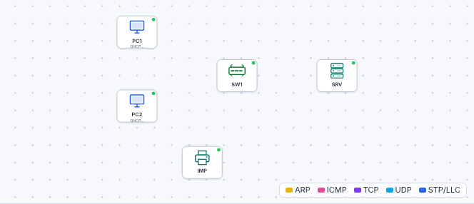

# 🛠️ TP – Mini-chantier de positionnement et retour de PFMP

*Bac Pro CIEL – Terminale – E31 – S01 – **individuel, sans aide** (diagnostic non noté)*

> [!NOTE]
> **Mission.** Un **cabinet médical** emménage et te demande un réseau minimal. Tu as **2 heures**, **le simulateur** et **tes fiches mémo**. Tu dois **câbler, configurer, tester et documenter**. **Personne ne te note** : c'est pour **savoir où tu en es** et construire **ton** plan de travail.
>
> **Prérequis :** année de Première.

**Nom :** ____________________  **Date :** ____________

---

## Partie A – Le mini-chantier (2 h)

### A1. Le cahier des charges du cabinet Martin

| Élément | Demande |
|---|---|
| **Réseau** | Un seul réseau **192.168.1.0/24** |
| **Équipements** | 2 postes (secrétariat, médecin), 1 imprimante, 1 serveur, 1 switch administrable |
| **Adresses** | Postes en **DHCP** (plage **192.168.1.50 à .100**) ; serveur **192.168.1.2** ; imprimante **192.168.1.20** (fixe) |
| **Services** | DHCP et DNS sur le serveur ; **page web** du cabinet à l'adresse `http://cabinet.martin.local` ; nom `imprimante.martin.local` |
| **Sécurité** | Switch : mot de passe privilégié **chiffré**, **bannière**, **ports libres désactivés** ; configuration **sauvegardée** |
| **Documentation** | Un **schéma** et un **plan d'adressage** à remettre |

### A2. Ce que tu dois faire

1. Ouvre le [simulateur](../../simulateur/simulateur-reseau.html), puis **Ouvre** [`t01-mini-chantier.json`](tp/t01-mini-chantier.json).
2. **Planifie d'abord** (5 minutes, sur papier) : quelles étapes, dans quel ordre ?
3. **Câble, configure, teste.**
4. **Documente** : schéma + plan d'adressage (sur papier ou fichier).
5. **Enregistre** ton fichier : `nom-t01.json`.

> [!IMPORTANT]
> **Aucune aide** n'est donnée pendant les 2 heures. Si tu bloques, **note** où et pourquoi : c'est une information précieuse pour ton plan de travail.

### A3. Ton journal de bord

| Heure | Ce que j'ai fait | Difficulté éventuelle |
|---|---|---|
| | | |
| | | |
| | | |

### A4. Auto-contrôle (sans l'enseignant)

| # | Test | Résultat |
|---|---|---|
| 1 | `PC1` reçoit une adresse .50 à .100 | ☐ |
| 2 | `PC2` reçoit une adresse .50 à .100 | ☐ |
| 3 | `PC1` ouvre `http://cabinet.martin.local` | ☐ |
| 4 | `PC1` joint l'imprimante (`ping 192.168.1.20`) | ☐ |
| 5 | Switch : `enable secret` et bannière | ☐ |
| 6 | Switch : ports Fa0/5 à Fa0/24 `shutdown` | ☐ |
| 7 | Switch : `show startup-config` = configuration courante | ☐ |

Après la partie A, remplis ta colonne de la [fiche de positionnement](03-fiche-positionnement.md).

---

## Partie B – Retour de PFMP (≈ 40 min)

1. **En binôme**, raconte à ton voisin **une activité** de PFMP (3 minutes chacun) : contexte, ce que **tu** as fait, résultat.
2. Remplis le [**point sur le livret**](04-point-livret.md) : activités documentées, lacunes, preuves à récupérer.
3. **En classe**, chacun cite **une preuve** qu'il a déjà et **une** qui lui manque.

❓ **Quelle activité de PFMP t'a le plus appris ? Pourquoi ?** ______________________

## Partie C – Mon plan de remédiation (≈ 20 min)

À partir de la fiche de positionnement et du point sur le livret :

| Domaine | Mon niveau (1 à 4) | Ce que je vais faire | Quand ? |
|---|---|---|---|
| Câblage, mesures | | | |
| Adressage, VLAN, routage | | | |
| Services (DHCP, DNS, web) | | | |
| Sécurité, sauvegardes | | | |
| Dépannage | | | |
| Documentation, livret | | | |

> [!TIP]
> Choisis **3 priorités maximum**. Au-delà, on ne fait rien.

**Mes 3 priorités :** 1. ____________ 2. ____________ 3. ____________

## 🛟 Dépannage

| Problème | Piste |
|---|---|
| Un poste n'a pas d'adresse | Câble ? Port actif ? DHCP **activé** et pool créé ? |
| Le nom ne marche pas, l'adresse oui | DNS : enregistrement ? DNS donné par le DHCP ? |
| L'imprimante est injoignable | Adresse **fixe** ? Même réseau ? Câble ? |
| La configuration disparaît après redémarrage | `write memory` oublié |

## 🧭 Passeport d'autonomie

> *Je peux **mener seul un mini-chantier** de la lecture du besoin à la sauvegarde.* ☐ Je sais faire seul ☐ Avec aide ☐ Pas encore
