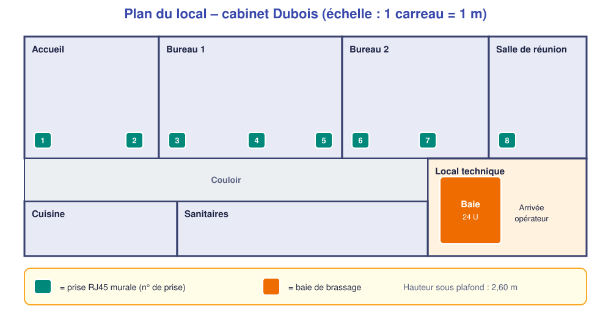
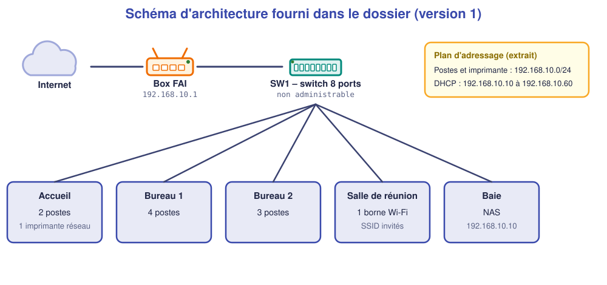

# 📁 Dossier d'installation – Cabinet Dubois

*Version 1 – document fourni par le bureau d'études – **à analyser***

## 1. Cahier des charges simplifié

Le **cabinet Dubois** (9 collaborateurs, architectes) emménage dans de nouveaux locaux. Il demande :

| Réf. | Exigence |
|---|---|
| **EX1** | **Accueil** : 2 postes et 1 imprimante réseau |
| **EX2** | **Bureau 1** : 4 postes |
| **EX3** | **Bureau 2** : 3 postes |
| **EX4** | **Salle de réunion** : 2 prises réseau pour les ordinateurs portables, et **une borne Wi-Fi** au plafond |
| **EX5** | Un **NAS** (stockage des projets) dans la baie |
| **EX6** | **Internet** par la box de l'opérateur, installée dans le local technique |
| **EX7** | Le **Wi-Fi invité** doit être **isolé** du réseau interne : les visiteurs n'accèdent ni aux postes ni au NAS |
| **EX8** | Une **évolution** de 3 postes supplémentaires est prévue sous 2 ans |

## 2. Plan du local

*Hauteur sous plafond : 2,60 m. Le câblage chemine par le faux-plafond du couloir.*

## 3. Schéma d'architecture

## 4. Plan d'adressage

| Élément | Adresse | Remarque |
|---|---|---|
| Réseau | 192.168.10.0/24 | Un seul réseau |
| Box (passerelle) | 192.168.10.1 | |
| NAS | 192.168.10.10 | Adresse fixe |
| Imprimante | 192.168.10.20 | Adresse fixe |
| Plage DHCP (postes et Wi-Fi) | 192.168.10.10 à 192.168.10.60 | Gérée par la box |

## 5. Liste de matériel

| Matériel | Quantité |
|---|---|
| Switch 8 ports Gigabit non administrable | 1 |
| Panneau de brassage 12 ports | 1 |
| Cordons RJ45 catégorie 6, 2 m | 13 |
| Prises murales RJ45 | 8 |
| Borne Wi-Fi | 1 |
| NAS 2 baies | 1 |
| Baie 12 U | 1 |

## 6. Consignes

| Élément | Valeur |
|---|---|
| **Accès** | Local ouvert de 8 h à 17 h ; le cabinet travaille pendant l'installation |
| **Interlocutrice** | Mme Dubois, 06 xx xx xx xx |
| **Contraintes** | Pas de perçage pendant les rendez-vous clients (9 h–11 h) |

## 7. Stock disponible à l'atelier (pour la comparaison)

| Matériel | Quantité |
|---|---|
| Switch 8 ports non administrable | 3 |
| Switch 24 ports administrable, **sans PoE** | 1 |
| Switch 24 ports administrable, **PoE** | 1 |
| Panneau de brassage 12 ports | 2 |
| Panneau de brassage 24 ports | 1 |
| Cordons RJ45 cat. 6 : 0,5 m / 2 m / 3 m | 15 / 20 / 10 |
| Bobine de câble cat. 6 (305 m) | 1 |
| Prises murales RJ45 | 20 |
| Borne Wi-Fi (alimentation PoE) | 1 |
| Injecteur PoE | 0 |
| NAS 2 baies | 0 |
| Baie 12 U | 1 |
| Passe-câbles 1 U | 3 |
| Étiqueteuse | 1 |
