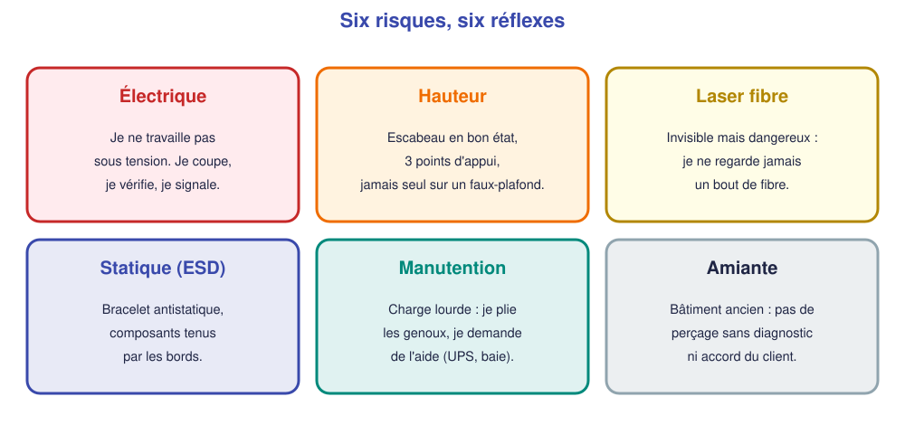

# 📖 Cours – Préparer un chantier en sécurité

*Bac Pro CIEL – Terminale – E31 – S03*

> [!IMPORTANT]
> **Une idée à la fois.** Réponds à la question **avant** de déplier la réponse.

## 🎯 À la fin de ce cours, tu sauras

- [ ] construire un **planning de chantier** ;
- [ ] remplir une **checklist de préparation** ;
- [ ] citer **six risques** et leur prévention ;
- [ ] expliquer ce qu'est l'**AIPR**.

---

## 1. Planifier

### 🤔 Avant de lire : à ton avis ?

Tu dois installer 12 prises, une baie et un switch en **une journée**, dans un cabinet **ouvert au public**. Comment t'organises-tu ?

Voir la réponse

On **découpe en étapes**, on **évalue chaque durée**, on place les tâches **bruyantes** (perçage) **hors des horaires sensibles** (rendez-vous clients), et on garde **une marge** (≈ 20 %) pour les imprévus.

### 💡 L'idée : le planning en 5 colonnes

| Étape | Durée | Qui | Matériel / outillage | Contrainte |
|---|---|---|---|---|
| Repérage et marquage | 45 min | A | Mètre, crayon, plan | Après 11 h |
| Pose des goulottes | 2 h | A + B | Perceuse, niveau | Avant 9 h, après 11 h |
| Tirage des câbles | 2 h | A + B | Tire-câble, étiquettes | |
| Raccordement des prises | 1 h 30 | A | Pince à sertir, testeur | |
| Baie et brassage | 1 h 30 | B | Panneau, cordons | |
| Tests et étiquetage | 1 h | A + B | Testeur | |

> [!TIP]
> Le planning se construit **à l'envers** : on part de la **fin** (livraison, recette) et on remonte.

### ✅ Vérifie que tu as compris

Pourquoi prévoir **« tests et étiquetage »** comme une **étape à part** ?

Voir la réponse

Parce qu'on a tendance à les **oublier** ou à les **bâcler** en fin de journée. Les prévoir **dans le planning** leur garantit du **temps**.

---

## 2. La checklist de préparation

> [!NOTE]
> **À la livraison**, on contrôle le matériel **avant de signer** : bon de livraison comparé à la commande, état, numéros de série ; tout écart est noté en **réserve** sur le bon.

On ne part **jamais** sans l'avoir **cochée**. Elle couvre : **documents**, **matériel**, **outillage**, **sécurité**, **accès**, **client** (voir [la checklist](03-checklist-chantier.md)).

> [!NOTE]
> Un **oubli** d'outil sur place coûte **un aller-retour** (une demi-journée). Une checklist coûte **dix minutes**.

---

## 3. Les risques

### 🤔 Avant de lire : à ton avis ?

Le risque **laser** sur la fibre optique : pourquoi est-il **piégeux** ?

Voir la réponse

Parce que la lumière est **infrarouge, donc invisible**. On ne sent rien, on ne voit rien, mais l'œil peut être **lésé**. Réflexe : **ne jamais regarder** un bout de fibre ou un connecteur, **même « éteint »**, et mettre les **capuchons**.

### 💡 Prévention

| Risque | Mesures |
|---|---|
| **Électrique** | Ne pas travailler **sous tension** ; **couper et vérifier** l'absence de tension ; respecter les **limites de ton habilitation** (B1V : rappel) ; signaler les installations défectueuses |
| **Hauteur** | Escabeau **conforme**, stable ; **3 points d'appui** ; ne **jamais** marcher sur un faux-plafond ; pas seul pour les travaux importants |
| **Laser** | Capuchons ; ne jamais regarder ; sources **éteintes** pendant le raccordement ; **récupérer les chutes de fibre** (éclats de verre) |
| **ESD** | **Bracelet** relié à la masse, sac antistatique, composants tenus **par les bords** |
| **Manutention** | Charges lourdes (onduleur, baie) : **à deux**, genoux fléchis, chariot |
| **Amiante** | Bâtiment ancien : **ne pas percer** sans diagnostic ni accord du client |

### ✅ Vérifie que tu as compris

Tu constates qu'un fil électrique est dénudé près de ta prise. **Que fais-tu ?**

Voir la réponse

Tu **ne touches à rien**, tu **balises** la zone, tu **préviens** le client (et ton responsable) qui fera intervenir un **électricien habilité**. Tu **notes** l'événement.

---

## 4. L'AIPR : intervenir près des réseaux enterrés

### 🤔 Avant de lire : à ton avis ?

Tu dois **percer un mur extérieur** pour faire entrer un câble. Pourquoi devrais-tu te poser la question « où passent les **réseaux** » ?

Voir la réponse

Parce qu'un **perçage** ou une **tranchée** peut endommager un réseau **enterré ou encastré** (électricité, gaz, eau, télécoms) : **danger de mort** et **gros dégâts**. Avant tous travaux à proximité, on **consulte** les exploitants des réseaux.

### 💡 L'idée

| Notion | Ce qu'il faut retenir |
|---|---|
| **AIPR** | **A**utorisation d'**I**ntervention à **P**roximité des **R**éseaux : une **compétence attestée** exigée pour intervenir près de réseaux sensibles |
| **DT / DICT** | Démarches **avant travaux** auprès d'un **guichet unique** : le **responsable du projet** déclare son projet (DT), l'**entreprise** déclare son intention de commencer les travaux (DICT) |
| **Marquage-piquetage** | Sur le terrain, on **repère** les réseaux sur le sol |
| **Réseaux** | Électricité, gaz, eau, télécommunications… **Ne jamais** travailler sans plan à jour |

> [!WARNING]
> **Les règles et les délais exacts** évoluent : **vérifie** auprès de ton enseignant et des textes en vigueur. Ce cours donne les **principes**.

## 🧠 À retenir

- On **planifie** : étapes, durées, outillage, contraintes ; on garde une **marge**.
- On part **avec la checklist cochée**.
- **Six risques**, six **réflexes** : en cas de doute, **on s'arrête et on demande**.
- **AIPR** : on se renseigne **avant** de percer ou de creuser.
