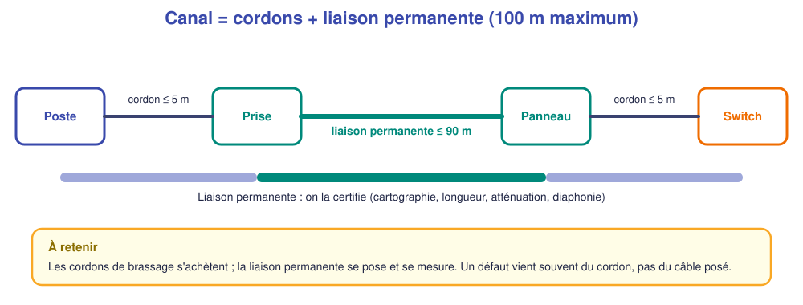
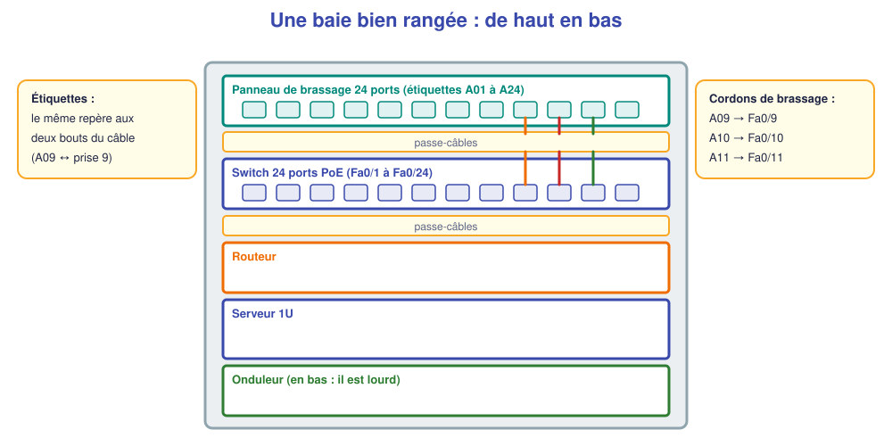

# 📖 Cours – Installer, brasser, étiqueter, mesurer

*Bac Pro CIEL – Terminale – E31 – S04*

> [!IMPORTANT]
> **Une idée à la fois.** Réponds à la question **avant** de déplier la réponse.

## 🎯 À la fin de ce cours, tu sauras

- [ ] **raccorder** une prise RJ45 et **ranger** une baie ;
- [ ] **étiqueter** et **documenter** une liaison ;
- [ ] **mesurer** et **lire** un rapport cuivre ;
- [ ] **calculer** un bilan optique.

---

## 1. Le canal et la liaison permanente

### 🤔 Avant de lire : à ton avis ?

Un poste a une connexion instable. Tu as mesuré **la liaison permanente** : elle est **conforme**. Où cherches-tu en premier ?

Voir la réponse

**Dans les cordons de brassage** (poste→prise, panneau→switch) : **abîmés, mal sertis, trop longs, non catégorisés**. Ils sont **hors** de la liaison permanente mesurée, et c'est la cause la plus fréquente.

### ✅ Vérifie que tu as compris

Combien de **mètres** au maximum pour la liaison permanente ? Pour le canal complet ?

Voir la réponse

**90 m** pour la liaison permanente, **100 m** pour le canal (avec les cordons).

---

## 2. Le raccordement d'une prise et la baie

| Étape | Bonnes pratiques |
|---|---|
| **Dénuder** | Juste ce qu'il faut ; ne pas entailler les conducteurs |
| **Respecter le code** | **T568B** des deux côtés (le même partout dans l'installation) |
| **Garder les paires torsadées** | Détorsader **au minimum** (≈ 13 mm) |
| **Rayon de courbure** | ≥ 4 fois le diamètre du câble (cat. 6) |
| **Chemin de câbles** | **Sans pincer**, sans tirer, sans croiser le courant fort |
| **Baie** | Passe-câbles, **velcro** (pas de colliers serrés), cordons de **bonne longueur** |

> [!TIP]
> **Étiquetage** : le **même repère** aux deux extrémités (prise et panneau) ; **lisible**, **durable**, cohérent avec le **tableau de câblage**.

### ✅ Vérifie que tu as compris

Pourquoi **ne pas serrer** les colliers plastiques sur un faisceau de câbles ?

Voir la réponse

Un collier trop serré **écrase** les paires et dégrade les **performances** (diaphonie, atténuation). On utilise du **velcro**, qu'on **peut desserrer**.

---

## 3. Mesurer une liaison cuivre

| Mesure | Ce qu'elle dit | Valeur typique |
|---|---|---|
| **Cartographie** (wiremap) | Les 8 fils sont bien reliés, **sans inversion** ni **croisement** | ✔ « OK » |
| **Longueur** | Distance réelle | ≤ 90 m |
| **Atténuation** (perte d'insertion) | Le signal s'**affaiblit** | Plus **faible** = mieux |
| **Diaphonie** (NEXT) | Les paires se **perturbent** | Plus **élevée** (en dB) = mieux |

> [!NOTE]
> Un **testeur simple** donne cartographie et longueur ; un **certificateur** mesure atténuation et diaphonie par rapport à une **norme** (catégorie 6, classe E…). Le rapport indique **PASS** ou **FAIL**.

### 🤔 Avant de lire : à ton avis ?

Le testeur indique **« paires croisées 3-6 »**. Que s'est-il passé ?

Voir la réponse

Les paires **vert (3-6)** et **orange (1-2)** ont été **inversées** à une extrémité : **erreur de code couleur** (on a mélangé T568A et T568B). **Refaire le raccordement** à une extrémité.

---

## 4. La fibre : le bilan optique

Une liaison optique perd de la lumière : **fibre** (atténuation linéique), **connecteurs**, **soudures**.

**Perte totale = (longueur × atténuation linéique) + (nb connecteurs × perte/connecteur) + (nb soudures × perte/soudure)**

**Marge = budget de la liaison − perte totale** (doit être **positive** avec une **réserve**).

| Exemple (valeurs d'exercice) | Valeur |
|---|---|
| Fibre monomode 1310 nm, 2,4 km, atténuation 0,35 dB/km | 0,84 dB |
| 2 connecteurs × 0,5 dB | 1,0 dB |
| 2 soudures × 0,1 dB | 0,2 dB |
| **Perte totale** | **2,04 dB** |
| Budget de l'équipement | 7 dB |
| **Marge** | **4,96 dB** ✔ |

> [!WARNING]
> **Valeurs d'exercice.** Les valeurs réelles dépendent des **fiches techniques** des composants.

### ✅ Vérifie que tu as compris

Une mesure donne **8 dB** de perte pour un budget de **7 dB**. Que conclus-tu ?

Voir la réponse

**Non conforme** : la liaison **perd plus** que ce que l'équipement peut compenser. On cherche la cause : **connecteur sale** (nettoyer), **courbure** excessive, **soudure défectueuse**, **longueur** supérieure à celle du dossier.

## 🧠 À retenir

- **Liaison permanente ≤ 90 m**, canal ≤ 100 m ; **même code** (T568B) partout.
- On **étiquette** et on **documente** (tableau de câblage, photos).
- **Cartographie, longueur, atténuation, diaphonie** : on mesure, on compare à la **norme**, on conclut.
- **Bilan optique** = somme des pertes **vs** budget.
