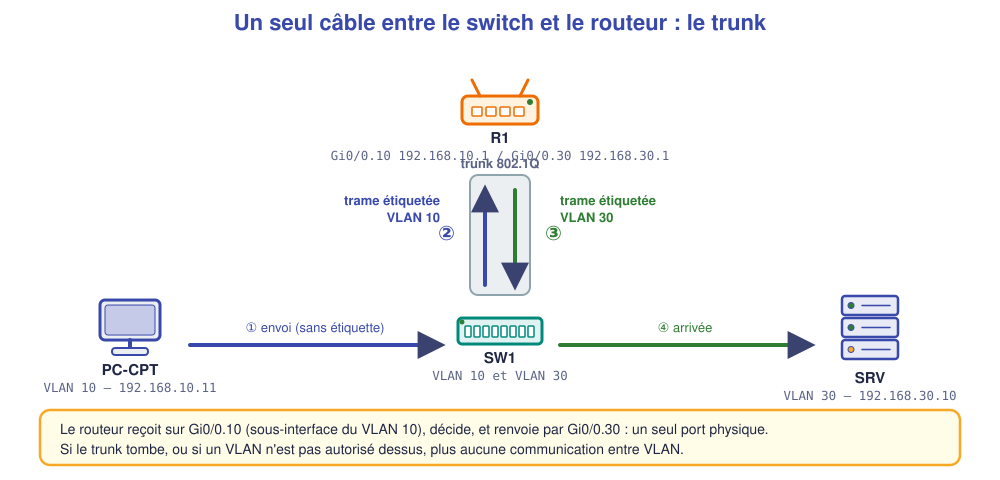

# 📖 Cours – Faire communiquer les VLAN

*Bac Pro CIEL – Terminale – E31 – S05*

> [!IMPORTANT]
> **Une idée à la fois.** Réponds à la question **avant** de déplier la réponse.

## 🎯 À la fin de ce cours, tu sauras

- [ ] expliquer pourquoi il faut un **routeur** (ou un switch L3) entre VLAN ;
- [ ] configurer un **routeur sur un tronc** (sous-interfaces) ;
- [ ] configurer des **interfaces VLAN** sur un switch de niveau 3 ;
- [ ] **filtrer** entre VLAN avec une ACL et **expliquer** ce qu'elle bloque.

---

## 1. Pourquoi router entre VLAN ?

### 🤔 Avant de lire : à ton avis ?

Deux postes sont dans deux VLAN différents sur le **même switch**. Leurs adresses sont dans deux réseaux IP différents. Peuvent-ils communiquer sans routeur ?

<details markdown="1"><summary>Voir la réponse</summary>

**Non.** Un VLAN est un **réseau séparé** (couche 2) ; deux réseaux IP différents ne se parlent que **par un routeur** (couche 3). Le VLAN **isole** ; le routeur **autorise** les échanges **choisis**.

</details>

### 💡 L'idée

> **VLAN = séparer. Routeur = relier, mais à nos conditions.** Entre les deux, on place les **règles d'accès** (ACL).

---

## 2. Le routeur sur un tronc ("router on a stick")



Un **seul câble** relie le switch au routeur. Le port du switch est en **trunk**, et le routeur a **une sous-interface par VLAN**.

```text
interface gi0/0
 no shutdown
interface gi0/0.10
 encapsulation dot1Q 10
 ip address 192.168.10.1 255.255.255.0
interface gi0/0.30
 encapsulation dot1Q 30
 ip address 192.168.30.1 255.255.255.0
```

| Élément | Rôle |
|---|---|
| `gi0/0` (interface physique) | Doit être **`no shutdown`** ; **pas d'adresse** |
| `gi0/0.10` | Sous-interface **du VLAN 10** |
| `encapsulation dot1Q 10` | « Les trames de ce VLAN portent l'étiquette **10** » |
| `ip address` | **Passerelle** du VLAN 10 |

### ✅ Vérifie que tu as compris

Un poste du VLAN 10 a pour passerelle `192.168.10.1`. **Quelle sous-interface** reçoit ses paquets ?

<details markdown="1"><summary>Voir la réponse</summary>

**`Gi0/0.10`**, l'interface qui porte l'adresse `192.168.10.1`. Le **numéro** après `encapsulation dot1Q` doit être celui du **VLAN**, sinon le routeur ne reconnaît pas les trames.

</details>

---

## 3. Le switch de niveau 3

### 🤔 Avant de lire : à ton avis ?

Le routeur sur un tronc a un **inconvénient** : tout le trafic entre VLAN passe par **un seul câble**. Quelle autre solution ?

<details markdown="1"><summary>Voir la réponse</summary>

Un **switch de niveau 3** : il **route lui-même** entre VLAN, à la vitesse du switch, **sans câble de retour**.

</details>

### 💡 L'idée

```text
ip routing
interface vlan 10
 ip address 192.168.10.1 255.255.255.0
 no shutdown
interface vlan 30
 ip address 192.168.30.1 255.255.255.0
 no shutdown
```

| | Routeur sur un tronc | Switch de niveau 3 |
|---|---|---|
| **Principe** | Sous-interfaces | Interfaces VLAN (SVI) |
| **Performance** | Limitée par **un** câble | Débit du switch |
| **Coût** | Faible (routeur existant) | Plus élevé |
| **Usage** | Petite PME | PME plus grande, cœur de réseau |

---

## 4. Filtrer entre VLAN : les ACL

La **ACL** se pose **sur l'interface** qui voit passer le trafic à filtrer.

```text
ip access-list extended COMMERCIAL-IN
 deny ip 192.168.20.0 0.0.0.255 192.168.10.0 0.0.0.255
 permit ip any any
interface gi0/0.20
 ip access-group COMMERCIAL-IN in
```

> [!WARNING]
> **Une ACL n'a pas de mémoire** (« sans état ») : elle filtre chaque paquet **isolément**. Ici, elle bloque **le commercial → compta**, **donc aussi les réponses du commercial vers la compta** : un ping de la compta vers le commercial **n'aboutit pas**.

### ✅ Vérifie que tu as compris

L'ACL ci-dessus est posée **`in`** sur `Gi0/0.20`. **Quel trafic** inspecte-t-elle ?

<details markdown="1"><summary>Voir la réponse</summary>

Les paquets **qui entrent** dans le routeur **par** la sous-interface du VLAN 20 : donc ceux **émis par** le VLAN 20 (le commercial).

</details>

---

## 5. Documenter : le schéma commenté

Un schéma d'architecture comporte : **équipements nommés**, **VLAN** (couleurs), **adresses**, **liens** (trunks signalés), **flux autorisés / interdits** (légende), **date**, **auteur**.

## 🧠 À retenir

- **Un VLAN isole ; un routeur relie** (avec règles).
- **Routeur sur un tronc** : une sous-interface **par VLAN**, **dot1Q** avec le **bon numéro**.
- **Switch L3** : `ip routing` + interface VLAN.
- **ACL** : sur la **bonne interface**, dans le **bon sens**, **sans état**.
