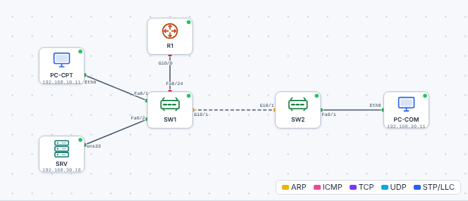
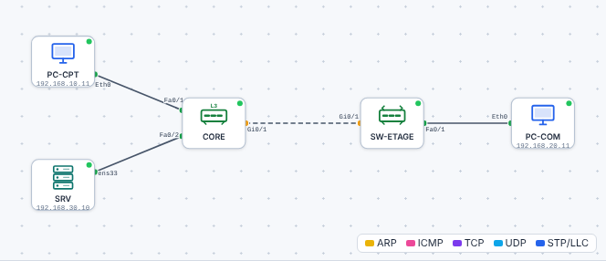

# 🛠️ TP – La PME Rivière : routage entre VLAN

*Bac Pro CIEL – Terminale – E31 – S05 – binôme, on **échange les rôles** à chaque partie*

> [!NOTE]
> **Mission.** La **PME Rivière** a trois services : **Comptabilité** (VLAN 10), **Commercial** (VLAN 20), **Serveurs** (VLAN 30), répartis sur **deux switches**. Les postes sont déjà adressés, mais **rien ne communique**. Tu configures les **VLAN**, les **trunks** et le **routage**, tu **filtres** compta ↔ commercial, puis tu **dépannes** une version cassée.
>
> **Temps prévu :** 3 h 30. **Prérequis :** [cours S05](01-cours.md) lu ; [aide-mémoire](03-aide-memoire.md).

> [!NOTE]
> **Comment ce TP fonctionne.** Tu as des **buts** et des **points de contrôle**, pas les commandes : cherche d'abord dans le [cours](01-cours.md), ouvre l'[aide-mémoire](03-aide-memoire.md) en dernier recours et **note ce qui t'avait échappé**. Réponds aux 🤔 et ❓ **avant** de tester. Le **bilan final** nourrit ton **passeport d'autonomie**.

**Binôme :** ____________ / ____________

Ouvre le [simulateur](../../simulateur/simulateur-reseau.html), puis **Ouvre** [`t05-intervlan.json`](tp/t05-intervlan.json).

| Équipement | VLAN | Adresse | Passerelle | Branché sur |
|---|---|---|---|---|
| `PC-CPT` | 10 | 192.168.10.11/24 | 192.168.10.1 | SW1 Fa0/1 |
| `SRV` | 30 | 192.168.30.10/24 | 192.168.30.1 | SW1 Fa0/2 |
| `PC-COM` | 20 | 192.168.20.11/24 | 192.168.20.1 | SW2 Fa0/1 |
| `R1` | – | .1 de chaque réseau | – | SW1 Fa0/24 (trunk) |
| Liaison SW1 – SW2 | – | – | – | Gi0/1 de chaque switch (trunk) |

---

## Partie A – Constater avant d'agir (≈ 10 min)

| Test | Résultat attendu avant configuration | Résultat |
|---|---|---|
| `PC-CPT` → `ping 192.168.30.10` | ? | |
| `PC-COM` → `ping 192.168.20.1` | ? | |

> [!TIP]
> Écris **ce que tu prévois** avant de lancer : si tu te trompes, c'est que tu as quelque chose à apprendre.

## Partie B – Les VLAN et les trunks (≈ 40 min)

1. Sur **SW1** et **SW2** : crée les **VLAN 10, 20, 30** avec un nom, place les ports d'accès (voir le tableau).
2. Configure les **trunks** : SW1 `Fa0/24` (vers le routeur), `Gi0/1` des deux switches.

✅ **Points de contrôle :**
- `show vlan brief` sur chaque switch ;
- `show interfaces trunk` : les deux trunks sont `on`, VLAN 1,10,20,30 autorisés.

❓ **Pourquoi crée-t-on les VLAN 20 et 30 sur SW1 alors qu'aucun poste n'y est en VLAN 20 ?** ______________

## Partie C – Le routeur : sous-interfaces (≈ 40 min)

🤔 **J'anticipe :** le routeur n'a **qu'un seul câble** vers le switch, mais doit être la passerelle de **trois** réseaux. Comment est-ce possible ? ______________

Sur `R1` : configure **gi0/0** et **trois sous-interfaces** (`.10`, `.20`, `.30`) avec les **bonnes encapsulations** et les **passerelles**.

✅ **Points de contrôle :**
- `show ip interface brief` : `Gi0/0`, `Gi0/0.10`, `.20`, `.30` en `up/up` ;
- `show ip route` : trois lignes `C` ;
- `PC-CPT` → `ping 192.168.30.10` ✓ ; `PC-COM` → `ping 192.168.30.10` ✓ ; `PC-CPT` → `ping 192.168.20.11` ✓.

**Que lis-tu dans `show ip route` ?** Combien de réseaux connectés ? Par quelles sous-interfaces ? ______________

## Partie D – Les règles d'accès (≈ 30 min)

**Exigence de la direction :** *« Aucun échange entre le commercial et la comptabilité, dans les deux sens. Le commercial et la compta peuvent tous deux utiliser le serveur. »*

🤔 **J'anticipe :** laquelle des deux directions (`in` / `out`) et quelle interface, pour bloquer le commercial **au plus près de la source** ? Et que se passera-t-il pour un ping *de la compta vers le commercial* ? ______________

1. Écris l'ACL `COMMERCIAL-IN` (cours §4) et pose-la **`in`** sur la sous-interface du VLAN 20.
2. **Teste** :

| Test | Attendu | Obtenu |
|---|---|---|
| `PC-COM` → `ping 192.168.10.11` | ✗ | |
| `PC-CPT` → `ping 192.168.20.11` | ✗ (pourquoi ?) | |
| `PC-COM` → `ping 192.168.30.10` | ✓ | |
| `PC-CPT` → `ping 192.168.30.10` | ✓ | |

3. `show access-lists` : **lis les « matches »**.

❓ **Pourquoi le ping de la compta vers le commercial échoue-t-il alors que l'ACL ne bloque que le commercial → compta ?** ______________

💡 Aide

La compta **envoie** la requête : elle arrive au commercial. Mais **la réponse** du commercial est **émise par le VLAN 20** : elle entre dans le routeur par `Gi0/0.20`, où l'ACL la bloque. Une ACL **sans état** ne sait pas que c'est une **réponse**.

## Partie E – Avec un switch de niveau 3 (≈ 45 min)

Ouvre [`t05-switch-niveau3.json`](tp/t05-switch-niveau3.json) : même réseau, **sans routeur**, avec un **Catalyst 3560** (`CORE`).

1. Sur `CORE` : **active le routage** (`ip routing`), crée les VLAN, les **interfaces VLAN** avec les passerelles, configure le **trunk** vers `SW-ETAGE` (`switchport trunk encapsulation dot1q`).
2. Sur `SW-ETAGE` : VLAN 20, port d'accès Fa0/1, trunk Gi0/1.

✅ **Points de contrôle :** `show ip interface brief` sur `CORE` ; `PC-COM` → serveur ✓ ; `PC-COM` → `PC-CPT` ✓.

| Question | Réponse |
|---|---|
| Quelle **différence** de câblage avec la version routeur ? | |
| Où se trouve **l'adresse de passerelle** de chaque VLAN ? | |
| Dans quel cas choisirais-tu **le routeur**, dans quel cas **le switch L3** ? Pourquoi ? | |

## Partie F – Dépannage (≈ 30 min)

Ouvre [`t05-panne.json`](tp/t05-panne.json) : **la PME marchait**, mais **trois choses** ont changé. Symptôme rapporté : *« Le commercial n'atteint plus le serveur, la compta non plus ; et le serveur ne répond à personne. »*

| | Constat | Test | Cause | Correction | Vérification |
|---|---|---|---|---|---|
| Panne 1 | | | | | |
| Panne 2 | | | | | |
| Panne 3 | | | | | |

> [!TIP]
> Suis la méthode de Première : **constater → délimiter → hypothèse → test → correction → vérification**. **Une** correction à la fois.

## Partie G – Le schéma commenté (≈ 30 min, individuel)

Dessine **le schéma d'architecture** de la PME Rivière avec : équipements, **VLAN en couleur**, adresses, **trunks** signalés, **flux autorisés** (vert) et **interdits** (rouge).

| Critère | OK |
|---|---|
| Tous les équipements et leurs noms | ☐ |
| VLAN et réseaux IP | ☐ |
| Trunks et ports | ☐ |
| Passerelles | ☐ |
| Flux autorisés / interdits | ☐ |
| Titre, date, auteur | ☐ |

## 📒 Mon bilan pour le passeport d'autonomie (individuel, écrit)

| Question | Ma réponse |
|---|---|
| Une **décision** que j'ai prise, et **pourquoi** (place de l'ACL, sens `in`, routeur ou switch L3…) | |
| Ce qui m'a **surpris** ou ne s'est pas passé comme prévu | |
| Ce que je saurais **refaire seul(e)**, sans fiche | |
| Ma **preuve** (`show ip route`, `show access-lists` avec matches, schéma) | |

> [!TIP]
> **Niveau 3 « Autonome » du passeport** : je fais communiquer des VLAN et je filtre **sans fiche**, et j'**explique** pourquoi la réponse d'un ping peut être bloquée par une ACL sans état.

## 🛟 Dépannage du TP

| Symptôme | Piste |
|---|---|
| Aucun ping inter-VLAN | `show ip interface brief` : sous-interfaces `up/up` ? `encapsulation dot1Q` avec le **bon numéro** ? |
| Un seul VLAN passe | Trunk : `show interfaces trunk` → VLAN **autorisés** ? |
| `PC-COM` joint le serveur mais pas la compta (voulu) | Normal : ACL ! |
| Sous-interface `down` | L'interface **physique** est-elle `no shutdown` ? |

## 🧭 Passeport d'autonomie

> *Je peux **faire communiquer des VLAN** (routeur ou switch L3), **filtrer** et **dépanner**.* ☐ Je sais faire seul ☐ Avec aide ☐ Pas encore
