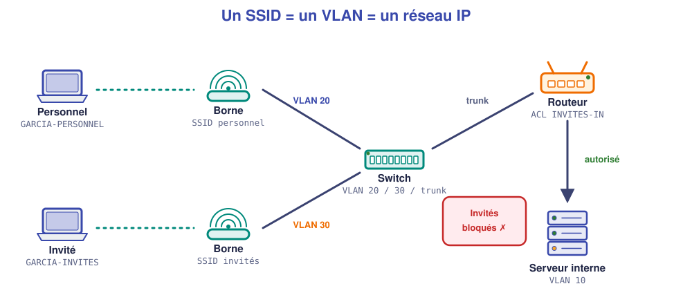

# 📖 Cours – Le Wi-Fi d'une entreprise

*Bac Pro CIEL – Terminale – E31 – S06*

> [!IMPORTANT]
> **Une idée à la fois.** Réponds à la question **avant** de déplier la réponse.

## 🎯 À la fin de ce cours, tu sauras

- [ ] expliquer le lien **SSID ↔ VLAN ↔ réseau IP** ;
- [ ] choisir entre **WPA2-Personnel**, **WPA3** et **WPA2/3-Entreprise** ;
- [ ] **isoler** un Wi-Fi invités du réseau interne ;
- [ ] dire ce que fait un **serveur RADIUS** ;
- [ ] **diagnostiquer** un problème de connexion Wi-Fi.

---

## 1. Un SSID, c'est quoi ?

### 🤔 Avant de lire : à ton avis ?

Tu vois dans ta classe les réseaux « CFA-ELEVES » et « CFA-PROFS ». Il y a **une seule borne** au plafond. Comment est-ce possible ?

<details markdown="1"><summary>Voir la réponse</summary>

Une borne peut **diffuser plusieurs SSID** (plusieurs « noms de réseau »). Chaque SSID est comme un **réseau séparé** : son nom, sa clé, son réseau IP.

</details>

### 💡 L'idée

> **Un SSID = un nom de réseau Wi-Fi.** En entreprise, on associe chaque SSID à **un VLAN** : le trafic des invités et celui du personnel ne se mélangent jamais.

| SSID | VLAN | Réseau IP | Qui ? |
|---|---|---|---|
| `GARCIA-PERSONNEL` | 20 | 192.168.20.0/24 | Le personnel |
| `GARCIA-INVITES` | 30 | 192.168.30.0/24 | Les visiteurs |

La borne est reliée au switch par **un câble** (un *trunk* si elle diffuse plusieurs SSID, un port d'accès si elle n'en diffuse qu'un).



### ✅ Vérifie que tu as compris

Un visiteur se connecte à `GARCIA-INVITES`. **Dans quel VLAN** arrive-t-il, et **quelle passerelle** reçoit-il ?

<details markdown="1"><summary>Voir la réponse</summary>

Dans le **VLAN 30**. Il reçoit une adresse en `192.168.30.x` et pour passerelle `192.168.30.1` (la sous-interface du routeur).

</details>

---

## 2. Sécuriser : la clé et le protocole

### 🤔 Avant de lire : à ton avis ?

Un restaurant laisse son Wi-Fi **ouvert** « pour que ce soit plus simple ». Cite **un risque**.

<details markdown="1"><summary>Voir la réponse</summary>

N'importe qui peut **se connecter** (et utiliser la connexion pour des actes illégaux, c'est le propriétaire qui répond) et **espionner** les échanges non chiffrés des autres clients.

</details>

### 💡 L'idée

| Protocole | Clé | À retenir |
|---|---|---|
| **Ouvert** | aucune | À éviter, ou avec **portail captif** pour un accueil du public |
| **WPA2-Personnel (PSK)** | une clé partagée | Standard actuel des petits réseaux ; clé **longue**, à **changer** quand un salarié part |
| **WPA3-Personnel** | une clé partagée | Plus résistant au piratage de la clé ; si les équipements le gèrent |
| **WPA2/WPA3-Entreprise** | **un compte par personne** (RADIUS) | Le plus sûr : on retire **un** compte sans changer la clé de tous |

> [!WARNING]
> **WEP** et **WPA (v1)** sont **cassés** : on les remplace.

### ✅ Vérifie que tu as compris

Un salarié part de l'entreprise. Le Wi-Fi est en **WPA2-Personnel**. Que faut-il faire ? Et en WPA2-Entreprise ?

<details markdown="1"><summary>Voir la réponse</summary>

En PSK : **changer la clé** et la redonner à **tous** les autres. En Entreprise : **désactiver son compte** seulement, personne d'autre n'est dérangé.

</details>

---

## 3. RADIUS : l'authentification d'entreprise (lecture)

> [!EXAMPLE]+ 🚀 Pour aller plus loin
> Ce passage va **au-delà du référentiel** : il est utile au métier, mais **non exigé à l'épreuve terminale**.

### 🤔 Avant de lire : à ton avis ?

À l'entrée d'un immeuble, le gardien ne connaît pas tous les visiteurs. Qui lui dit s'il peut laisser entrer ?

<details markdown="1"><summary>Voir la réponse</summary>

Il **téléphone à l'accueil** qui a la **liste** des personnes autorisées. Le gardien exécute, l'accueil décide.

</details>

### 💡 L'idée

> La **borne** joue le gardien ; le **serveur RADIUS** joue l'accueil : il détient la liste des comptes.

```text
Portable ──identifiants──► Borne ──question──► Serveur RADIUS
Portable ◄──accès accordé── Borne ◄──réponse──── (annuaire : comptes)
```

Tu **ne configures pas** RADIUS en Terminale ; tu dois savoir le **lire sur un schéma** et dire **pourquoi** on l'utilise : un compte par personne, retrait immédiat, traçabilité.

### ✅ Vérifie que tu as compris

Sur un schéma, une flèche relie la borne à un serveur marqué « RADIUS ». **Que se passe-t-il** quand un salarié saisit son identifiant ?

<details markdown="1"><summary>Voir la réponse</summary>

La borne **transmet** les identifiants au serveur RADIUS, qui **répond oui ou non**. Si oui, la borne autorise la connexion (et peut placer le client dans un VLAN selon son groupe).

</details>

---

## 4. Canaux et signal : pourquoi ça rame

### 🤔 Avant de lire : à ton avis ?

Dans un immeuble, **dix** box diffusent sur le **même canal**. Que se passe-t-il ?

<details markdown="1"><summary>Voir la réponse</summary>

Elles se **gênent** : comme dix personnes qui parlent en même temps dans une pièce. Les débits chutent.

</details>

### 💡 L'idée

| Bande | Portée | Débit | Canaux sans chevauchement |
|---|---|---|---|
| **2,4 GHz** | grande | modeste | **1, 6, 11** seulement (3 canaux) |
| **5 GHz** | moyenne | élevé | beaucoup (selon la largeur) |

**Réflexes de dépannage :** 1) le **signal** est-il suffisant (distance, murs) ? 2) le **canal** est-il saturé ? 3) la **clé** est-elle bonne ? 4) le client est-il dans le **bon VLAN** ? 5) le **DHCP** répond-il ?

### ✅ Vérifie que tu as compris

Un portable se connecte au Wi-Fi mais obtient `169.254.x.x`. **Wi-Fi ou DHCP ?**

<details markdown="1"><summary>Voir la réponse</summary>

Le **Wi-Fi fonctionne** (il est associé à la borne) ; c'est le **DHCP** qui ne répond pas (mauvais VLAN, serveur DHCP éteint, relais absent). Chercher côté réseau, pas côté radio.

</details>

---

## 🧠 À retenir

- **SSID = nom de réseau ; VLAN = séparation ; ACL = règles.**
- **Invités** : VLAN dédié + **aucun accès** au réseau interne.
- **WPA2/WPA3**, jamais WEP ; **Entreprise** = un compte par personne (RADIUS).
- **Dépannage** : signal → clé → VLAN → DHCP.
- **Ne jamais** laisser le même mot de passe Wi-Fi des années.
