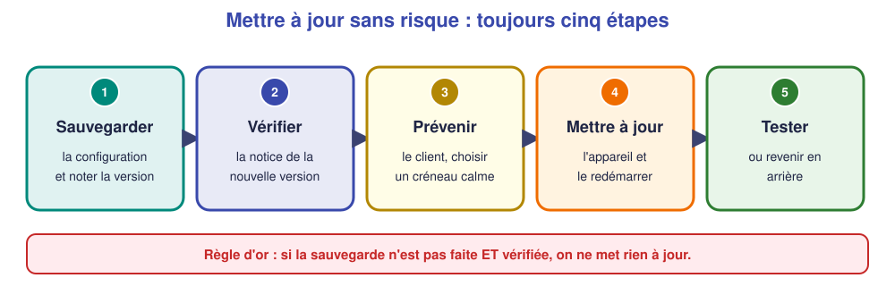

# 📖 Cours – Mises à jour et sauvegardes

*Bac Pro CIEL – Terminale – E31 – S07*

> [!IMPORTANT]
> **Une idée à la fois.** Réponds à la question **avant** de déplier la réponse.

## 🎯 À la fin de ce cours, tu sauras

- [ ] expliquer la différence entre **running-config** et **startup-config** ;
- [ ] **sauvegarder** puis **restaurer** une configuration ;
- [ ] **préparer** une mise à jour avec un **retour arrière** ;
- [ ] **tenir** un journal des modifications.

---

## 1. Deux configurations, une seule survit au redémarrage

### 🤔 Avant de lire : à ton avis ?

Tu tapes des commandes sur un switch : le réseau fonctionne. Le switch redémarre (coupure de courant). **Tes réglages sont-ils encore là ?**

<details markdown="1"><summary>Voir la réponse</summary>

**Pas forcément.** Les commandes agissent sur la configuration **en cours** (en mémoire vive). Au redémarrage, le switch relit la configuration **enregistrée**. Tout ce qui n'a pas été enregistré est **perdu**.

</details>

### 💡 L'idée

| Configuration | Où ? | Survit au redémarrage ? | Commande pour la voir |
|---|---|---|---|
| `running-config` | mémoire vive (RAM) | **Non** | `show running-config` |
| `startup-config` | mémoire permanente (NVRAM) | **Oui** | `show startup-config` |

```text
write memory          (ou : copy running-config startup-config)
```

> [!TIP]
> Après **chaque** série de modifications validées : **`write memory`**. Et **vérifie** avec `show startup-config`.

### ✅ Vérifie que tu as compris

Tu as ajouté un VLAN et le réseau marche. Tu ne tapes pas `write memory`. Le client éteint le switch le soir. Que trouve-t-il le lendemain ?

<details markdown="1"><summary>Voir la réponse</summary>

Le switch **a perdu le VLAN** (retour à la dernière configuration sauvegardée). Les postes concernés ne fonctionnent plus comme avant.

</details>

---

## 2. Sauvegarder pour pouvoir remplacer

### 🤔 Avant de lire : à ton avis ?

Un switch grille. Le patron en achète un neuf identique. **De quoi as-tu besoin** pour le remettre comme l'ancien ?

<details markdown="1"><summary>Voir la réponse</summary>

De la **configuration** de l'ancien switch (VLAN, ports, mots de passe, nom). Si elle n'a **jamais été copiée ailleurs**, elle est **perdue avec le switch**.

</details>

### 💡 L'idée

> **Une sauvegarde utile est : récente, hors de l'appareil, et testée.**

**Sauvegarde simple (copier-coller) :** `show running-config` → copier le texte → l'enregistrer dans un fichier `SW-ATELIER_2026-11-30.txt`.

**Sauvegarde réseau (si le matériel le permet) :** `copy running-config tftp:` ou SCP vers un serveur.

**Restauration :** coller les lignes dans le terminal en mode `configure terminal`, puis `write memory`.

| Règle **3-2-1** | Sens |
|---|---|
| **3** copies | l'original + 2 sauvegardes |
| **2** supports | par ex. serveur + clé USB |
| **1** hors site | par ex. dans le cloud ou chez le responsable |

### ✅ Vérifie que tu as compris

Pourquoi faut-il **tester** une sauvegarde ?

<details markdown="1"><summary>Voir la réponse</summary>

Parce qu'une sauvegarde **qu'on n'a jamais restaurée** peut être vide, incomplète ou illisible. On le découvre **le jour de la panne**, trop tard.

</details>

---

## 3. Mettre à jour : la démarche en 5 étapes

### 🤔 Avant de lire : à ton avis ?

Ton collègue dit : « Il y a une nouvelle version du micrologiciel, je la mets tout de suite sur le switch du client ! » **Que lui réponds-tu ?**

<details markdown="1"><summary>Voir la réponse</summary>

« **Attends** : on sauvegarde d'abord, on lit la notice, on prévient le client et on prévoit comment revenir en arrière. » Une mise à jour peut **casser** ce qui marchait.

</details>

### 💡 L'idée

1. **Sauvegarder** la configuration et **noter la version** actuelle (`show version`).
2. **Vérifier** la notice (compatibilité, ce qui change).
3. **Prévenir** le client, choisir un **créneau calme** (pas en pleine activité).
4. **Mettre à jour**, redémarrer, attendre le retour de l'équipement.
5. **Tester** (`show version`, ping, services). **Si ça ne va pas : revenir en arrière** (ancienne version + configuration sauvegardée).

Pourquoi mettre à jour malgré le risque ? Pour corriger des **failles de sécurité** et des **bugs** : un équipement jamais mis à jour est une **porte ouverte**.



### ✅ Vérifie que tu as compris

Quelle étape un technicien pressé oublie-t-il le plus souvent, et quelle est la conséquence ?

<details markdown="1"><summary>Voir la réponse</summary>

La **sauvegarde** (étape 1) ou le **plan de retour arrière** (étape 5). Conséquence : si la mise à jour échoue, il faut **tout reconfigurer à la main**, pendant que l'entreprise est à l'arrêt.

</details>

---

## 4. Le journal des modifications

### 🤔 Avant de lire : à ton avis ?

Un collègue intervient sur le même client trois mois après toi. **De quoi a-t-il besoin pour comprendre l'état du réseau ?**

<details markdown="1"><summary>Voir la réponse</summary>

D'un **historique** : ce qui a été changé, **quand**, **par qui**, **pourquoi**. Sans ça, il perd du temps ou refait une erreur déjà corrigée.

</details>

### 💡 L'idée

| Date | Équipement | Modification | Pourquoi | Par qui | Sauvegarde |
|---|---|---|---|---|---|
| 30/11/2026 | SW-ATELIER | VLAN 20 « ATELIER » créé | Séparer l'atelier | Y. L. | `SW-ATELIER_2026-11-30.txt` |

> [!NOTE]
> Le journal est une **preuve** pour ton livret E31 : il montre que tu **documentes** ce que tu fais.

### ✅ Vérifie que tu as compris

Complète : « Une modification **non notée** dans le journal, c'est… »

<details markdown="1"><summary>Voir la réponse</summary>

…une modification que **personne ne saura expliquer** à la prochaine panne (y compris toi).

</details>

---

## 🧠 À retenir

- **running-config** = en cours (perdue) ; **startup-config** = enregistrée.
- **Sauvegarder** = copier **hors de l'équipement** ; **tester** la restauration.
- **Mise à jour** : sauvegarde → notice → client prévenu → mise à jour → test/retour arrière.
- **Journal** : date, équipement, modification, pourquoi, qui.
- **Règle 3-2-1** : 3 copies, 2 supports, 1 hors site.
