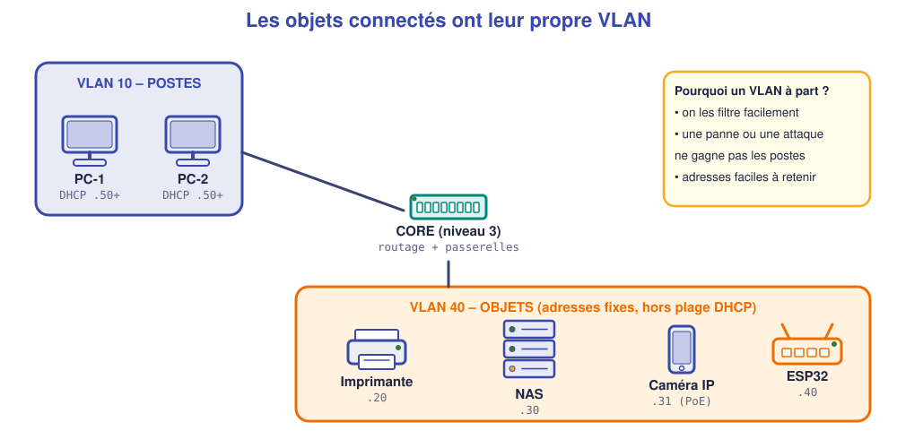

# 📖 Cours – Intégrer de nouveaux équipements

*Bac Pro CIEL – Terminale – E31 – S08*

> [!IMPORTANT]
> **Une idée à la fois.** Réponds à la question **avant** de déplier la réponse.

## 🎯 À la fin de ce cours, tu sauras

- [ ] **intégrer** un équipement réseau avec une méthode en 6 étapes ;
- [ ] **réserver** une adresse et éviter les conflits ;
- [ ] **isoler** les objets connectés dans un VLAN ;
- [ ] expliquer le **PoE** ;
- [ ] **mettre à jour** la documentation après l'intégration.

---

## 1. Intégrer, c'est plus que brancher

### 🤔 Avant de lire : à ton avis ?

Un client branche une imprimante neuve qui prend une adresse par DHCP. Trois semaines plus tard, plus personne n'imprime. **Pourquoi ?**

Voir la réponse

Le DHCP a **changé son adresse** (bail renouvelé, autre adresse attribuée). Les postes cherchaient l'ancienne. Un équipement que d'autres utilisent doit avoir **une adresse qui ne bouge pas**.

### 💡 L'idée

**Les 6 étapes d'une intégration :**

1. **Où ?** emplacement, prise, alimentation.
2. **Quelle adresse ?** fixe, **hors de la plage DHCP**, notée dans le plan d'adressage.
3. **Quel VLAN ?** objets → VLAN dédié.
4. **Brancher et configurer** (port du switch, adresse, passerelle, mot de passe).
5. **Tester** (ping, fonction réelle : imprimer, sauvegarder…).
6. **Documenter** (plan d'adressage, schéma, journal).

### ✅ Vérifie que tu as compris

Dans une plage DHCP de `.50` à `.200`, où places-tu l'adresse fixe d'une imprimante, et pourquoi ?

Voir la réponse

**En dehors** de la plage : par exemple `.20`. Sinon le DHCP pourrait la donner à un autre poste (**conflit d'adresse**).

---

## 2. Un VLAN pour les objets

### 🤔 Avant de lire : à ton avis ?

Une caméra connectée a le mot de passe `admin` d'origine. Elle est sur le même réseau que la comptabilité. **Quel risque ?**

Voir la réponse

Un pirate qui **prend la caméra** (mot de passe connu) se retrouve **dans le réseau** de l'entreprise, **à côté** des ordinateurs de la comptabilité.

### 💡 L'idée

> **Les objets connectés sont souvent mal protégés.** On les **isole** dans un VLAN à part (ici VLAN 40) : si l'un est compromis, l'attaque **ne gagne pas** les postes.

| VLAN | Réseau | Équipements |
|---|---|---|
| 10 POSTES | 192.168.10.0/24 | Ordinateurs (DHCP `.50`+, distribué par le switch cœur) |
| 40 OBJETS | 192.168.40.0/24 | Imprimante `.20`, NAS `.30`, caméra `.31`, ESP32 `.40` |

### 💡 Qui distribue les adresses ?

Le DHCP est un **service** : il peut tourner sur plusieurs types d'équipements. Dans un petit réseau :

| Équipement | Quand ? |
|---|---|
| **Box / routeur** | maison, très petit bureau |
| **Switch de niveau 3 ou routeur d'entreprise** | petite structure avec VLAN (**cas du cabinet Lemoine** : le switch cœur distribue les adresses du VLAN 10) |
| **Serveur dédié** (Windows Server, Linux) | structure plus grande, besoin de réservations, de journaux |
| **NAS** | certains NAS offrent un service DHCP : à **éviter** s'il y en a déjà un autre, deux serveurs DHCP sur un même réseau se perturbent |

> [!WARNING]
> **Un seul serveur DHCP par réseau** (sauf configuration spéciale). Un second serveur « sauvage » (une box branchée, un NAS mal configuré) distribue de mauvaises adresses.

### ✅ Vérifie que tu as compris

Pourquoi change-t-on **toujours** le mot de passe par défaut d'un objet connecté ?

Voir la réponse

Parce que les mots de passe **par défaut sont publics** (dans les notices et sur Internet) : n'importe qui les connaît.

---

## 3. Le PoE : un seul câble pour tout

### 🤔 Avant de lire : à ton avis ?

Une caméra est fixée au plafond, loin de toute prise électrique. Comment l'alimenter **sans** tirer un second câble ?

Voir la réponse

Avec le **PoE** (*Power over Ethernet*) : le **câble réseau** apporte **aussi l'électricité**.

### 💡 L'idée

| | Sans PoE | Avec PoE |
|---|---|---|
| Câbles | réseau **+** secteur | réseau **seul** |
| Matériel | bloc d'alimentation par objet | switch **PoE** (ou injecteur) |
| Panne de courant | coupure | peut être sauvé par **un seul** onduleur sur le switch |

> [!WARNING]
> Le switch doit fournir **assez de puissance** (budget PoE en watts) pour **tous** les appareils branchés. Sinon, certains ne démarrent pas.

### ✅ Vérifie que tu as compris

Un switch PoE offre 120 W. Tu veux brancher 6 caméras de 15 W. **Est-ce possible ?**

Voir la réponse

6 × 15 = **90 W** ≤ 120 W : **oui**, avec 30 W de marge.

---

## 4. Un aperçu des réseaux industriels

### 🤔 Avant de lire : à ton avis ?

Dans un atelier, une machine envoie des informations à un ordinateur. **Comment ?**

Voir la réponse

Souvent par un **réseau de type industriel** : un **automate** (le « cerveau de la machine ») relié à des **capteurs** et à un **switch**, avec des protocoles comme **Modbus** ou **Profinet**.

### 💡 L'idée

Tu **repères** les équipements, tu **ne les configures pas** en Terminale :

| Équipement | Rôle |
|---|---|
| **Capteur** | mesure (température, présence…) |
| **Automate** | décide et commande |
| **Passerelle** | relie l'atelier au réseau de bureau |
| **Switch industriel** | robuste, rail DIN |

Ce qui reste **pareil** : adresse IP, VLAN, câblage, documentation.

Ce qui **change** par rapport à un réseau de bureau :

| | Réseau de bureau | Réseau d'atelier (industriel) |
|---|---|---|
| **Environnement** | Salle propre, climatisée | Poussière, vibrations, chaleur, humidité |
| **Disponibilité** | Une panne gêne les utilisateurs | Une panne **arrête la production** |
| **Sécurité** | Réseau relié à Internet | Réseau **séparé** (VLAN ou pare-feu), **jamais** exposé directement à Internet |
| **Intervention** | On prévient le responsable informatique | On demande l'**accord du chef d'atelier** (arrêt, consignation) |

### ✅ Vérifie que tu as compris

Quelle règle de ce cours s'applique **aussi** à un automate d'atelier ?

Voir la réponse

**Adresse fixe réservée**, **VLAN dédié**, **mot de passe changé**, **documentation à jour**.

Pourquoi demande-t-on l'accord du chef d'atelier **avant** de redémarrer un switch d'atelier ?

Voir la réponse

Parce qu'un redémarrage coupe le réseau et peut **arrêter les machines** en cours de production : on choisit **le bon moment** avec le responsable.

---

## 🧠 À retenir

- **6 étapes :** où, adresse, VLAN, brancher, tester, documenter.
- **Adresse fixe hors plage DHCP.**
- **Objets connectés → VLAN dédié, mot de passe changé.**
- **PoE** : un câble pour réseau + courant ; vérifier le **budget en watts**.
- **La documentation est la dernière étape** : intégration non documentée = intégration non terminée.
