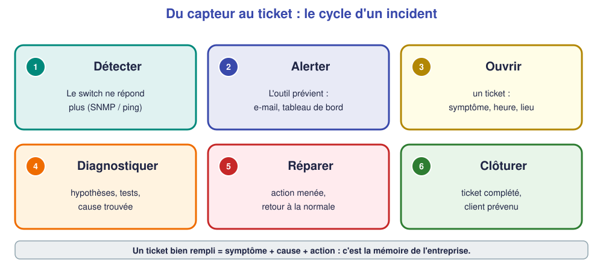

# 📖 Cours – Superviser et tracer les incidents

*Bac Pro CIEL – Terminale – E31 – S10*

> [!IMPORTANT]
> **Une idée à la fois.** Réponds à la question **avant** de déplier la réponse.

## 🎯 À la fin de ce cours, tu sauras

- [ ] dire à quoi servent **supervision**, **SNMP** et **syslog** ;
- [ ] activer SNMP et syslog sur un switch ;
- [ ] **interroger** un équipement et **lire** la réponse ;
- [ ] **rédiger** un ticket exploitable.

---

## 1. Superviser, c'est surveiller sans être devant

### 🤔 Avant de lire : à ton avis ?

Une entreprise a 40 équipements réseau. Le technicien peut-il les surveiller **tous**, **toute la journée**, à la main ?

<details markdown="1"><summary>Voir la réponse</summary>

**Non.** Il faut un **outil** qui interroge les équipements **en continu** et **prévient** quand quelque chose change.

</details>

### 💡 L'idée

> **Superviser = mesurer en continu et alerter.**

| Ce qu'on surveille | Exemple | Pourquoi |
|---|---|---|
| **Disponibilité** | ping : l'équipement répond-il ? | savoir qu'il est tombé |
| **État des ports** | port `up` / `down` | un câble débranché |
| **Charge** | débit, processeur | avant que ça rame |
| **Événements** | journal (syslog) | comprendre ce qui s'est passé |

Outils courants : **Zabbix**, **Uptime Kuma**, Centreon… (démonstration).

### ✅ Vérifie que tu as compris

Un port du switch passe de `up` à `down` à 14 h 03. **Quel type d'information** est-ce (disponibilité, charge, événement) ?

<details markdown="1"><summary>Voir la réponse</summary>

Un **événement** (changement d'état) **et** une information de **disponibilité** du poste branché.

</details>

---

## 2. SNMP : poser des questions aux équipements

> [!EXAMPLE]+ 🚀 Pour aller plus loin
> Ce passage va **au-delà du référentiel** : il est utile au métier, mais **non exigé à l'épreuve terminale**.

### 🤔 Avant de lire : à ton avis ?

Tu veux savoir « combien de temps le switch est-il allumé ? » depuis ton poste. **Comment lui demander** sans te connecter dessus ?

<details markdown="1"><summary>Voir la réponse</summary>

Avec un protocole fait pour ça : **SNMP**. Le switch répond à des **questions standardisées**.

</details>

### 💡 L'idée

Le switch tient à jour une sorte de **tableau de valeurs** (la **MIB**). Chaque valeur a un **numéro** (un **OID**). Le poste de supervision **demande** (`get`), le switch **répond**.

```text
snmp-server community supervision RO
snmp-server location Atelier - baie 1
snmp-server host 192.168.1.5 version 2c supervision
snmp-server enable traps
```

Depuis le poste de supervision :

```text
snmpget  -v2c -c supervision 192.168.1.2 1.3.6.1.2.1.1.5.0     # nom du switch (sysName)
snmpwalk -v2c -c supervision 192.168.1.2 1.3.6.1.2.1.2.2.1.8   # état de chaque port (ifOperStatus)
```

| OID | Signification |
|---|---|
| `1.3.6.1.2.1.1.5.0` | nom de l'équipement |
| `1.3.6.1.2.1.1.6.0` | emplacement |
| `1.3.6.1.2.1.2.2.1.8` | état des ports (1 = up, 2 = down) |

> [!WARNING]
> La **communauté** (`supervision`) joue le rôle d'un mot de passe, **sans chiffrement** en SNMP v2c. On la met en **lecture seule (RO)** et on **ne laisse pas** `public`.

### ✅ Vérifie que tu as compris

Pourquoi met-on la communauté en **RO** (lecture seule) ?

<details markdown="1"><summary>Voir la réponse</summary>

Pour que le poste de supervision puisse **lire** mais **pas modifier** la configuration des équipements : si la communauté fuit, on limite les dégâts.

</details>

---

## 3. Les journaux : la boîte noire du réseau

### 🤔 Avant de lire : à ton avis ?

Un switch a redémarré cette nuit. Le lendemain, on veut savoir **pourquoi**. Où chercher ?

<details markdown="1"><summary>Voir la réponse</summary>

Dans les **journaux** (*logs*) du switch. Mais s'ils sont **seulement dans le switch** et qu'il redémarre, ils peuvent disparaître : on les envoie à un **serveur de journaux** (syslog).

</details>

### 💡 L'idée

```text
logging host 192.168.1.5
logging trap informational
service sequence-numbers
```

`show logging` affiche le journal local. Un message ressemble à :

```text
%LINK-3-UPDOWN: Interface FastEthernet0/2, changed state to down
```

| Partie | Sens |
|---|---|
| `%LINK` | quel **module** |
| `-3-` | **gravité** (0 = très grave … 7 = détail) |
| `UPDOWN` | **type** d'événement |
| texte | le détail |

### ✅ Vérifie que tu as compris

Pourquoi envoie-t-on les journaux **hors** du switch ?

<details markdown="1"><summary>Voir la réponse</summary>

Pour **les conserver** si le switch tombe ou redémarre (et pour les consulter **au même endroit** pour tous les équipements).

</details>

---

## 4. Le ticket : garder la mémoire

### 🤔 Avant de lire : à ton avis ?

Tu répares la même panne chez le même client pour la 3ᵉ fois en un mois. **Qu'est-ce qui t'aurait aidé ?**

<details markdown="1"><summary>Voir la réponse</summary>

Un **historique** des interventions : « 12 oct. : câble de la salle 2 abîmé, remplacé ». Tu aurais **vu le motif** et proposé de changer **toute la liaison**.

</details>

### 💡 L'idée

Un **ticket** est la **fiche de vie** d'un incident.

| Champ | Exemple |
|---|---|
| **Date / heure** | 12/10, 8 h 42 |
| **Demandeur** | Mme Laporte |
| **Symptôme** | « Les 2 postes de la compta n'ont plus Internet » |
| **Cause** | Câble du poste 1 sectionné ; switch redémarré |
| **Action** | Câble remplacé, `write memory` |
| **Résultat** | Internet OK, test réalisé |
| **Durée** | 25 min |

> [!NOTE]
> **GLPI** (outil libre) gère les tickets : il numérote, assigne, suit, clôture. Le **contenu** que tu rédiges est le même que sur papier.



### ✅ Vérifie que tu as compris

Ce ticket est-il bien rempli ? « Internet en panne. Réparé. »

<details markdown="1"><summary>Voir la réponse</summary>

**Non** : pas de symptôme précis, pas de **cause**, pas d'**action** ni de **résultat**. Un collègue ne pourrait **rien en tirer**.

</details>

---

## 🧠 À retenir

- **Superviser = mesurer en continu + alerter.**
- **SNMP** : le poste **demande**, l'équipement **répond** (OID). Communauté **RO**.
- **Syslog** : envoyer les journaux **hors** de l'équipement.
- **Ticket** = symptôme + cause + action + résultat.
- Un ticket vide ne sert **à personne**.
