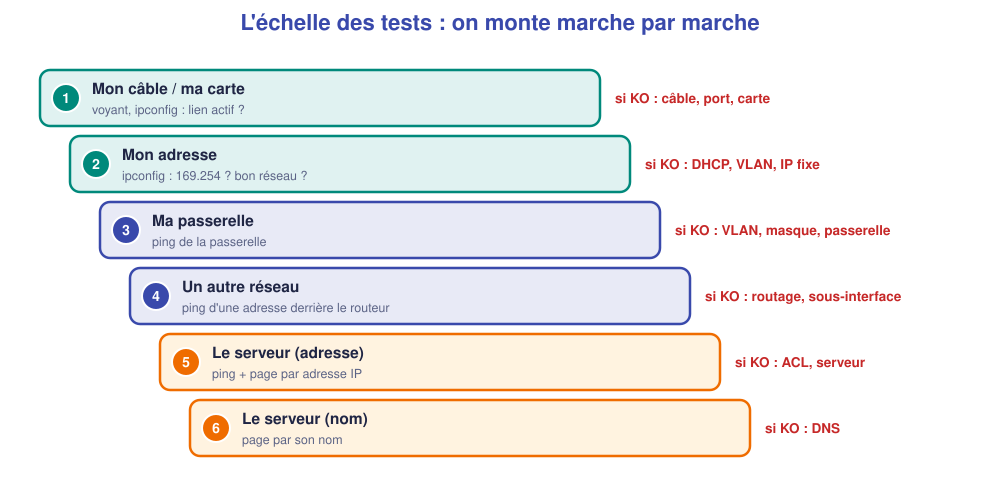

# 📖 Cours – Dépanner (1) : raisonner

*Bac Pro CIEL – Terminale – E31 – S11*

> [!IMPORTANT]
> **Une idée à la fois.** Réponds à la question **avant** de déplier la réponse.

## 🎯 À la fin de ce cours, tu sauras

- [ ] suivre la démarche **symptôme → hypothèses → tests → cause → action** ;
- [ ] utiliser l'**échelle des tests** ;
- [ ] **lire** les commandes de diagnostic ;
- [ ] **ne pas** s'arrêter à la première panne trouvée.

---

## 1. La démarche : ne pas deviner, enquêter

### 🤔 Avant de lire : à ton avis ?

Un poste n'a plus Internet. Un collègue change **tout de suite** le câble, puis la carte réseau, puis redémarre le routeur. Qu'est-ce qui cloche dans sa méthode ?

Voir la réponse

Il **essaie au hasard**. Il perd du temps, peut **aggraver** la situation (redémarrer le routeur coupe tout le monde) et **ne sait pas** ce qui était vraiment cassé.

### 💡 L'idée

> **Symptôme → hypothèses → tests → cause → action → vérification.**

| Étape | Question | Exemple |
|---|---|---|
| **Symptôme** | Qu'est-ce qui ne marche pas, **précisément** ? | « PC-COM n'ouvre pas l'intranet » |
| **Hypothèses** | Qu'est-ce qui **pourrait** l'expliquer ? | câble, adresse, VLAN, routeur, DNS |
| **Tests** | Comment **trier** les hypothèses ? | `ipconfig`, `ping` |
| **Cause** | Qu'est-ce qui est **prouvé** ? | « passerelle erronée » |
| **Action** | Je **corrige** une chose à la fois. | corriger la passerelle |
| **Vérification** | Je **reteste** *tout*. | les 4 tests |

### ✅ Vérifie que tu as compris

Pourquoi ne corrige-t-on qu'**une chose à la fois** ?

Voir la réponse

Pour **savoir** ce qui a résolu (ou aggravé) le problème. Si on change trois choses et que ça marche, on ne sait pas laquelle était la bonne.

> [!EXAMPLE]+ 🚀 Pour aller plus loin : les types de maintenance
> Dépanner, c'est de la maintenance **corrective** (après la panne). Un technicien en fait aussi d'autres types :
>
> | Type | Quand ? | Exemples |
> |---|---|---|
> | **Préventive** | **Avant** la panne | Mises à jour, sauvegardes, nettoyage, contrôle des câbles |
> | **Corrective** | **Après** la panne | Dépannage, remplacement d'un équipement |
> | **Améliorative** | Pour mieux répondre au besoin | Ajouter un VLAN, optimiser, remplacer un switch trop lent |
>
> **Question :** une mise à jour de micrologiciel planifiée est-elle préventive ou corrective ?
>
> 

Voir la réponse

<strong>Préventive</strong> : on agit avant qu'une panne n'arrive.

---

## 2. L'échelle des tests

### 🤔 Avant de lire : à ton avis ?

Un poste n'ouvre pas le site de l'entreprise. Tu peux faire **six** tests. Dans quel **ordre** : du plus proche au plus lointain, ou l'inverse ?

Voir la réponse

Du **plus proche au plus lointain**. Si ta propre carte ne marche pas, inutile de tester le serveur.

### 💡 L'idée

> **Le premier test qui échoue désigne la zone en cause.**

### ✅ Vérifie que tu as compris

`ipconfig` affiche `169.254.12.7`. À quelle marche de l'échelle es-tu ? Quelles causes ?

Voir la réponse

**Marche 2** (adresse). `169.254.x.x` = le poste **n'a pas reçu** d'adresse DHCP : mauvais VLAN, DHCP éteint, relais absent, câble mal enfiché.

---

## 3. Lire les commandes

### 🤔 Avant de lire : à ton avis ?

Tu tapes `show ip interface brief` et vois `GigabitEthernet0/0.20  192.168.20.1  YES manual  administratively down  down`. **Que comprends-tu ?**

Voir la réponse

L'interface est **arrêtée volontairement** (`shutdown`). Il faut taper `no shutdown`.

### 💡 L'idée

| Ce que je lis | Signification | Cause probable |
|---|---|---|
| `administratively down` | interface arrêtée par commande | `shutdown` oublié |
| `down / down` | pas de lien | câble débranché, autre bout éteint |
| `up / down` | lien présent, protocole en erreur | encapsulation, vitesse |
| `up / up` | OK | – |

| Commande | Utile pour |
|---|---|
| `ipconfig /all` | adresse, passerelle, DNS du poste |
| `ping` | joignabilité |
| `show vlan brief` | un port est-il dans le bon VLAN ? |
| `show interfaces trunk` | le VLAN passe-t-il ? |
| `show ip interface brief` | état et adresses des interfaces |
| `show ip dhcp binding` | qui a reçu quelle adresse ? |

### ✅ Vérifie que tu as compris

Ping de la passerelle : OK. Ping du serveur : KO. Ping d'un site par son nom : KO. **Que suspectes-tu en premier ?**

Voir la réponse

Entre la passerelle et le serveur : **routage, VLAN du serveur, ACL, serveur éteint**. Le nom (DNS) n'est qu'une conséquence : on le teste **après**.

---

## 4. Deux pannes en même temps

### 🤔 Avant de lire : à ton avis ?

Tu as réparé le port d'un poste. Il ne fonctionne toujours pas. **Est-ce que tu t'es trompé ?**

Voir la réponse

Pas forcément. Il y a peut-être **une deuxième panne** derrière la première. Tu l'as simplement **découverte** après avoir corrigé la première.

### 💡 L'idée

> **Tu n'as fini que quand TOUS les tests de départ sont verts.**

Après chaque correction : **reprends l'échelle** du bas. Note ce que tu as corrigé **et** ce qui reste à faire.

### ✅ Vérifie que tu as compris

Dans l'atelier, tu corriges un défaut et le premier test passe au vert. Les trois autres restent rouges. **Que fais-tu ?**

Voir la réponse

Je **continue** l'échelle : un test rouge restant = **une autre cause**. Je ne rends pas la main tant que **tout** n'est pas vert.

---

## 🧠 À retenir

- **Symptôme → hypothèses → tests → cause → action → vérification.**
- **Échelle des tests** : du plus proche au plus lointain.
- **Une correction à la fois**, puis on reteste.
- **Plusieurs pannes** : on n'a fini que quand tout est vert.
- **Noter** ce qu'on observe : on gagne du temps et on prouve.
