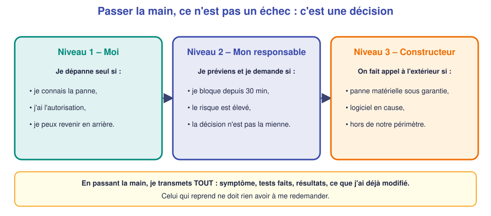

# 📖 Cours – Dépanner (2) : réparer et rendre compte

*Bac Pro CIEL – Terminale – E31 – S12*

> [!IMPORTANT]
> **Une idée à la fois.** Réponds à la question **avant** de déplier la réponse.

## 🎯 À la fin de ce cours, tu sauras

- [ ] **remplacer** un équipement et **restaurer** sa configuration ;
- [ ] **prouver** que tout est revenu à la normale ;
- [ ] **rédiger** un compte rendu d'intervention ;
- [ ] **décider** de passer la main.

---

## 1. Remplacer un équipement

### 🤔 Avant de lire : à ton avis ?

Un switch grille. Le patron en achète un neuf identique. Tu le branches. **Tout fonctionne-t-il tout de suite ?**

Voir la réponse

**Non** : un switch neuf est **vierge** (tous les ports dans le VLAN 1, pas de trunk, pas de nom). Il faut **restaurer** la configuration de l'ancien.

### 💡 L'idée

**Procédure de remplacement :**

1. **Noter** l'état avant (photos des câbles, étiquettes).
2. **Retrouver** la dernière sauvegarde de configuration.
3. **Débrancher** l'ancien, **brancher** le neuf **aux mêmes ports** (les étiquettes servent !).
4. **Restaurer** : `enable` → `configure terminal` → coller → `end` → `write memory`.
5. **Vérifier** : tests, état des ports, adresses.
6. **Documenter** (ancien numéro de série, nouveau, date).

### ✅ Vérifie que tu as compris

Pourquoi rebrancher **aux mêmes ports** ?

Voir la réponse

Parce que la configuration (VLAN, trunk) dépend du **numéro de port**. Un câble sur un autre port = un poste dans un mauvais VLAN.

---

## 2. Vérifier le retour à la normale

### 🤔 Avant de lire : à ton avis ?

Tu as restauré le switch. Le patron demande : « C'est bon ? ». Tu réponds « Ça devrait. » **Est-ce suffisant ?**

Voir la réponse

**Non.** « Ça devrait » n'est pas une preuve. On **teste** et on **montre** que ça fonctionne.

### 💡 L'idée

> **Retour à la normale = les tests qui échouaient réussissent maintenant, et rien d'autre n'est cassé.**

| Test | Preuve |
|---|---|
| Postes ont une adresse | `ipconfig` |
| Chaque poste joint sa passerelle | `ping` |
| Les services fonctionnent | page de l'intranet |
| Config sauvegardée | `show startup-config` |

Quand c'est possible, on **demande à l'utilisateur** de **confirmer** (« Tu peux ouvrir ton logiciel ? »).

### ✅ Vérifie que tu as compris

Après restauration, un poste **n'a toujours pas** d'adresse. Quelle est ta première hypothèse ?

Voir la réponse

Le **bail DHCP** : le poste doit le **renouveler** (`ipconfig /renew`) ou être rebranché. Sinon : mauvais port ou VLAN.

---

## 3. Le compte rendu d'intervention

### 🤔 Avant de lire : à ton avis ?

Tu as réparé un problème il y a trois semaines. Le client te rappelle pour le même symptôme. **Que te faudrait-il pour agir vite ?**

Voir la réponse

Un **compte rendu** de la précédente intervention : ce qui avait été trouvé, fait et **ce qui restait à surveiller**.

### 💡 L'idée

| Rubrique | Contenu |
|---|---|
| **Contexte** | client, date, heure, lieu, demandeur |
| **Symptôme** | ce que le client a constaté |
| **Diagnostic** | tests faits et **résultats** |
| **Cause** | ce qui est **prouvé** |
| **Action** | ce qui a été **fait** (et par qui) |
| **Résultat** | tests de retour à la normale |
| **À suivre** | recommandations (par ex. changer le câble, doubler la sauvegarde) |
| **Durée** | temps passé |

> [!TIP]
> Un bon compte rendu se lit en **2 minutes** et peut être **compris par le client**, pas seulement par un technicien.

### ✅ Vérifie que tu as compris

Parmi ces phrases, laquelle est la mieux rédigée ? A) « Switch HS, remplacé. » B) « Le switch SW1 ne démarrait plus (voyants éteints, bloc d'alimentation défaillant). Remplacé par un modèle identique, configuration restaurée depuis la sauvegarde du 30/11, 4 tests de retour à la normale OK. »

Voir la réponse

**B** : elle donne le **symptôme**, la **cause**, l'**action** et le **résultat**. La A ne permet à personne de comprendre ce qui s'est passé.

---

## 4. Passer la main

### 🤔 Avant de lire : à ton avis ?

Tu cherches depuis 45 minutes et le client s'impatiente. **Continues-tu seul ?**

Voir la réponse

**Non** : au-delà d'un temps raisonnable, ou si le risque est élevé, il faut **demander de l'aide**. Insister seul peut **aggraver** la panne.

### 💡 L'idée

**Comment passer la main (script en 4 phrases) :**

1. « Voici le **symptôme**… »
2. « J'ai **testé**… et j'ai obtenu… »
3. « J'ai **déjà modifié**… (rien / ceci) »
4. « Il me faut **de l'aide pour**… »

### ✅ Vérifie que tu as compris

Pourquoi faut-il dire **ce qu'on a déjà modifié** quand on passe la main ?

Voir la réponse

Pour que celui qui reprend **sache l'état réel** du système, et **ne perde pas de temps** à chercher une modification qu'on a oublié de signaler.

---

## 🧠 À retenir

- **Remplacer** : mêmes ports, restaurer la config, **write memory**.
- **Vérifier** par des tests, pas par un « ça devrait ».
- **Compte rendu** : contexte, symptôme, diagnostic, cause, action, résultat, à suivre.
- **Passer la main** : tôt, en disant **tout** (symptôme, tests, modifications).
- Passer la main n'est pas un échec.
