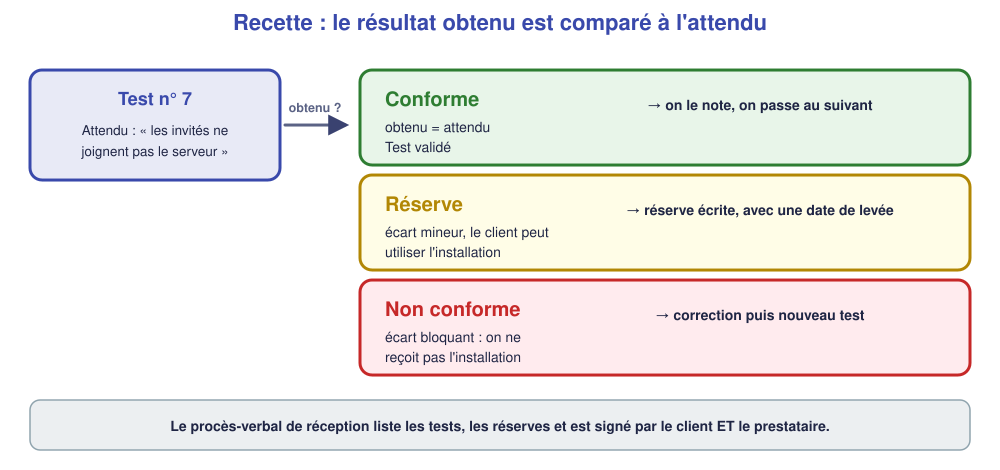

# 📖 Cours – Recette et accompagnement du client

*Bac Pro CIEL – Terminale – E31 – S13*

> [!IMPORTANT]
> **Une idée à la fois.** Réponds à la question **avant** de déplier la réponse.

## 🎯 À la fin de ce cours, tu sauras

- [ ] **construire** un cahier de recette avec des tests **positifs** et **négatifs** ;
- [ ] **noter** un écart en **réserve** ;
- [ ] **rédiger** un procès-verbal ;
- [ ] **expliquer** simplement à un client.

---

## 1. Le cahier de recette

### 🤔 Avant de lire : à ton avis ?

Tu viens de terminer une installation Wi-Fi. Le client demande : « Comment je sais que vous avez fait ce que je voulais ? ». **Que lui montres-tu ?**

Voir la réponse

Une **liste de tests** qui prouvent chaque point demandé, avec le **résultat obtenu** : le **cahier de recette**.

### 💡 L'idée

| N° | Exigence du client | Test | Attendu | Obtenu | Statut |
|---|---|---|---|---|---|
| 1 | Le personnel a le Wi-Fi interne | `LAP-PERS` se connecte à `GARCIA-PERSONNEL` | adresse `192.168.20.x` | | |
| 2 | Le personnel accède au serveur | ping `192.168.10.10` | réponse | | |
| 3 | Les invités ont Internet / passerelle | ping `192.168.30.1` | réponse | | |
| 4 | **Les invités ne voient pas le serveur** | ping `192.168.10.10` depuis `LAP-INV` | **pas de réponse** | | |

> [!IMPORTANT]
> **Teste aussi ce qui doit être IMPOSSIBLE** (tests **négatifs**) : c'est souvent là qu'on trouve les défauts de sécurité.

### ✅ Vérifie que tu as compris

Le client dit : « Mes invités ne doivent pas voir mon serveur. » **Quel test écris-tu ?**

Voir la réponse

Un test **négatif** : depuis un poste du Wi-Fi invités, **ping du serveur** ; **attendu : aucune réponse**.

---

## 2. Écarts et réserves

### 🤔 Avant de lire : à ton avis ?

Un test échoue à la recette, mais le client veut **quand même** emménager vendredi. **Peut-on recevoir l'installation ?**

Voir la réponse

Cela dépend de la **gravité** de l'écart. Un écart **mineur** (logo manquant) → oui, avec une **réserve**. Un écart **bloquant** (les invités voient le serveur) → il faut **corriger** d'abord.

### 💡 L'idée

Une **réserve** s'écrit : **quel test**, **quel écart**, **qui corrige**, **pour quand**.

### ✅ Vérifie que tu as compris

Tu trouves un écart de **sécurité** (les invités voient le serveur). Réserve ou non-conformité ?

Voir la réponse

**Non conforme** (bloquant) : un défaut de sécurité **ne doit pas rester** en production. On corrige, puis on refait le test.

---

## 3. Le procès-verbal de réception

### 🤔 Avant de lire : à ton avis ?

À quoi sert une **signature** du client en fin de chantier ?

Voir la réponse

À **prouver** que le client a reçu l'installation, **tests à l'appui**, et à **fixer** la date : la garantie et la facturation en dépendent.

### 💡 L'idée

Le PV comporte : **client**, **prestataire**, **date**, **liste des tests** (conformes), **réserves** (avec délai), **documents remis**, **signatures** des deux parties.

> [!NOTE]
> Signer, c'est **engager** : il faut que **tout** ce qui est écrit soit **vrai**. On ne coche pas un test qu'on n'a pas fait.

### ✅ Vérifie que tu as compris

Tu es pressé. Peux-tu cocher « test 4 conforme » sans l'avoir fait ?

Voir la réponse

**Non** : c'est un **faux** dans un document contractuel. Et si le défaut est découvert plus tard, **tu en es responsable**.

---

## 4. Accompagner le client

### 🤔 Avant de lire : à ton avis ?

Tu dis à un client : « J'ai créé deux SSID sur des VLAN séparés avec une ACL. » **A-t-il compris ?**

Voir la réponse

**Non**, sauf s'il est du métier. Tu dois **traduire** : « Vos clients ont leur **propre Wi-Fi**, qui ne leur permet **pas** d'accéder à vos ordinateurs. »

### 💡 L'idée

**Quatre règles pour parler à un client :**

1. **Écouter** d'abord ses attentes et ses inquiétudes.
2. **Parler son langage** (pas de sigles sans explication).
3. **Montrer** plutôt qu'expliquer (« essayez de vous connecter »).
4. **Laisser une trace** : la **notice d'une page**.

**La notice d'une page** : à quoi sert l'installation, **comment s'en servir**, **qui appeler** en cas de problème. **Sans jargon.**

### ✅ Vérifie que tu as compris

Réécris pour un client : « Le DHCP est configuré sur le VLAN 20 avec un bail de 8 heures. »

Voir la réponse

« Vos ordinateurs reçoivent **automatiquement** leur réglage réseau chaque jour : **vous n'avez rien à faire**. »

---

## 🧠 À retenir

- **Recette = tests (positifs et négatifs) + attendu + obtenu.**
- **Réserve** : écart mineur, avec date de levée ; **non-conformité** : on corrige avant de recevoir.
- **PV** : tests, réserves, signatures ; on n'écrit **que ce qui est vrai**.
- **Client** : écouter, traduire, montrer, laisser une notice.
- **Une page** de notice, **sans jargon**.
