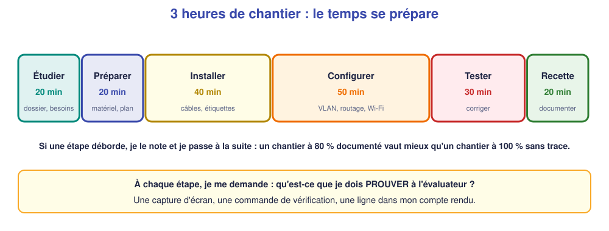

# 📖 Cours – Un chantier de dépannage

*Bac Pro CIEL – Terminale – E31 – S16*

> [!IMPORTANT]
> **Une idée à la fois.** Réponds à la question **avant** de déplier la réponse.

## 🎯 À la fin de ce cours, tu sauras

- [ ] **rassembler** les indices ;
- [ ] **ne pas** s'arrêter à la première cause ;
- [ ] **rendre compte** clairement.

---

## 1. Collecter les indices avant d'agir

### 🤔 Avant de lire : à ton avis ?

Le client dit « rien ne marche ». **Quelle est ta première action ?**

Voir la réponse

**Préciser** : quoi, qui, depuis quand ? Je **reproduis** le problème et je note **ce qui marche encore**.

### 💡 L'idée

| Question | Pourquoi |
|---|---|
| Qu'est-ce qui ne marche **plus** ? | précise le symptôme |
| Qu'est-ce qui marche **encore** ? | élimine des causes |
| Depuis **quand** ? | relie à un changement |
| **Qu'a-t-on changé** récemment ? | première piste |

### ✅ Vérifie que tu as compris

L'imprimante ne répond plus, **mais** les postes ont Internet. Que déduis-tu ?

Voir la réponse

Le **réseau général** (routeur, DHCP, NAT) fonctionne : je cherche **autour de l'imprimante** (port, VLAN, adresse, câble).

---

## 2. Une panne peut en cacher une autre

### 🤔 Avant de lire : à ton avis ?

Tu corriges la clé Wi-Fi : le patient se connecte et a une adresse, mais **n'ouvre toujours pas** un site. **Est-ce que ta correction était fausse ?**

Voir la réponse

**Non** : elle était **juste** mais il y a **une deuxième panne** derrière (ici, le NAT).

### 💡 L'idée

> **Après chaque correction, je reprends l'échelle des tests du début.**

### ✅ Vérifie que tu as compris

Comment sais-tu que **tout** est réparé ?

Voir la réponse

Quand **tous** les tests de mon cahier de recette (positifs **et** négatifs) sont **conformes**.

---

## 3. Le compte rendu : écrire pour être utile

### 🤔 Avant de lire : à ton avis ?

Que doit pouvoir faire un collègue qui lit ton compte rendu **sans** t'avoir vu travailler ?

Voir la réponse

**Comprendre** ce qui s'est passé, ce que tu as changé et ce qui reste à surveiller, **sans te rappeler**.

### 💡 L'idée

Contexte · symptôme · diagnostic · causes (**toutes**) · actions · résultat · à suivre · durée. **Un exemple complet** : [S12](../S12-depanner-2/01-cours.md).

### ✅ Vérifie que tu as compris

Ton compte rendu dit « problème réglé ». **Que lui manque-t-il ?**

Voir la réponse

Les **causes**, les **actions** précises et les **tests** qui prouvent le retour à la normale.

---

## 🧠 À retenir

- **Indices d'abord**, actions ensuite.
- **Une panne peut en cacher une autre.**
- **Tous les tests verts** = fini.
- **Compte rendu** : causes + actions + résultat.
- **Plan de travail individuel** après chaque chantier.
