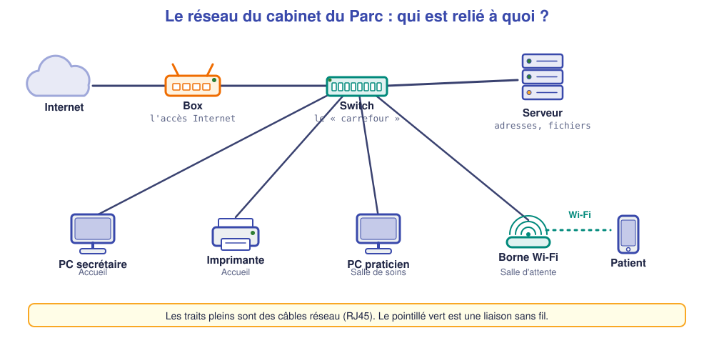
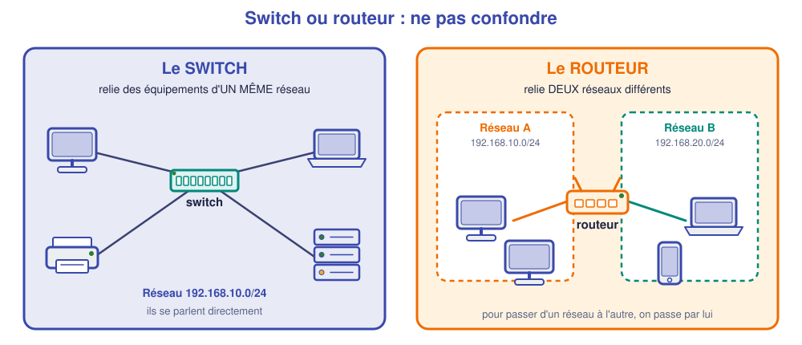
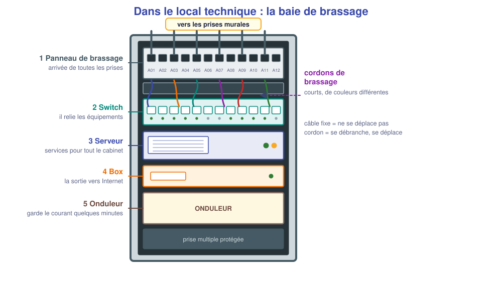
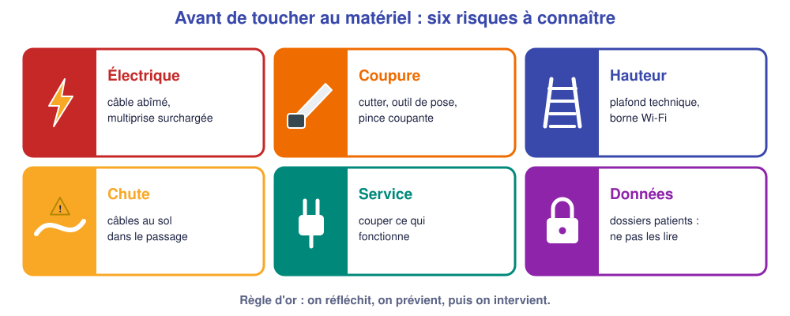

# M01 – Comprendre un réseau, reconnaître le matériel, travailler en sécurité

*Bac Pro CIEL – Terminale – Mise à niveau E31 – semaine 1 sur 15 – 4 h*

> [!NOTE]
> **Mission de l'année.** Tu es technicien(ne) réseau. Ton **client fil rouge** est le **cabinet de kinésithérapie du Parc** : 2 praticiens, 1 secrétaire, un serveur, une imprimante et du Wi-Fi pour les patients. À la fin de l'année, tu sauras **lui installer, configurer et dépanner son réseau**, comme à l'examen E31.
>
> **Tâche d'épreuve visée :** reconnaître les équipements d'une baie et appliquer les consignes de sécurité. **Compétence :** C09.

## ✅ À la fin de la séance, je sais…

- ☐ nommer poste, serveur, switch, routeur, box, borne Wi-Fi, imprimante, panneau de brassage et dire à quoi ils servent ;
- ☐ lire un schéma simple de petit réseau ;
- ☐ appliquer les consignes de sécurité d'un chantier et protéger les données du client.

## ⏱️ Déroulé (4 h)

| Durée | Activité |
|---|---|
| 0 h 00 – 0 h 30 | Quiz de départ (diagnostic, sans note) |
| 0 h 30 – 1 h 15 | Cours : réseau, équipements, sécurité |
| 1 h 15 – 1 h 30 | Pause |
| 1 h 30 – 3 h 30 | TP : visite de la baie, puis premier réseau dans le simulateur |
| 3 h 30 – 4 h 00 | Bilan et passeport |

---

## 📖 Cours

> [!NOTE]
> **Comment lire ce cours.** Il part de zéro : aucun prérequis. Chaque mot technique est **expliqué la première fois qu'il apparaît** et repris dans le **lexique** en fin de page. Les encadrés **« À retenir »** résument l'essentiel ; les questions 🤔 servent à vérifier que tu as compris **avant** de continuer.

### 1. Un réseau, c'est quoi, et à quoi ça sert ?

Imagine un cabinet de kinésithérapie **sans réseau** : la secrétaire écrit un rendez-vous sur son ordinateur, mais le praticien dans la salle de soins ne le voit pas. Pour imprimer une ordonnance, il faut copier le fichier sur une clé USB et la porter à l'ordinateur relié à l'imprimante. C'est lent, et source d'erreurs.

Un **réseau informatique** résout ce problème : c'est un ensemble d'équipements **reliés entre eux** pour **échanger des données**. Grâce à lui :

- on **partage** des ressources (une imprimante, des fichiers, un agenda) ;
- on **centralise** les informations sur un **serveur** (tout le monde voit le même agenda) ;
- on **accède à Internet** depuis tous les postes.

Pour que deux équipements puissent s'échanger des données, il faut réunir **trois ingrédients** :

| Ingrédient | Question | Exemples |
|---|---|---|
| **Un support** | Par où passent les données ? | un câble (cuivre, fibre optique), ou l'air (Wi-Fi) |
| **Des équipements** | Qui s'envoie des données, et qui les aiguille ? | postes, serveurs, imprimantes, switchs, routeurs |
| **Des règles communes** | Dans quelle « langue » se parle-t-on ? | les **protocoles** : adresses, formats de messages |

Un **protocole** est un ensemble de règles que tous les équipements respectent, comme le code de la route : si chacun roulait à sa façon, rien ne circulerait. Tu rencontreras beaucoup de protocoles dans ce parcours (IP, DHCP, DNS, ARP…). Pas de panique : on les découvre **un par un**.

### 2. Les équipements d'un réseau

Regarde le schéma ci-dessus. Il montre le réseau du cabinet du Parc : **Internet** à gauche, puis la **box**, puis le **switch**, auquel tout le reste est relié. Chaque équipement a un rôle précis.

| Équipement | À quoi il sert | Pour comprendre |
|---|---|---|
| **Poste client** (PC, portable) | La machine qu'une personne utilise | Le « client » **demande** des services |
| **Serveur** | Un ordinateur qui **rend un service** aux autres (fichiers, adresses automatiques, sauvegardes, site web) | Le « serveur » **fournit** : il tourne en permanence, souvent sans écran |
| **Switch** (commutateur) | Relie les équipements **d'un même réseau** par des ports RJ45 et envoie chaque message **au bon destinataire** | Un **standard téléphonique** : il met en relation le bon poste avec le bon poste |
| **Routeur** | Relie **deux réseaux différents** et choisit le chemin des données | Le **centre de tri postal** entre deux villes |
| **Box** | Un routeur d'opérateur, avec un point d'accès Wi-Fi et un modem | Le **point de sortie** du cabinet vers Internet |
| **Borne Wi-Fi** (point d'accès) | Relie **sans fil** des portables et des téléphones au réseau câblé | Une **prise réseau sans câble** |
| **Imprimante réseau** | Reçoit les impressions par le réseau, pour tous les postes | Une ressource **partagée** |

> [!NOTE]
> **Switch ou routeur ? la confusion la plus fréquente.** Le switch fait communiquer des équipements **à l'intérieur d'un même réseau**. Le routeur fait passer d'**un réseau à un autre** (par exemple, du cabinet vers Internet). Ils se complètent : un switch seul ne peut pas aller sur Internet, un routeur seul n'a pas assez de ports pour brancher tous les postes.

### 3. Un petit réseau, des réseaux, Internet

Un réseau limité à un bâtiment s'appelle un **réseau local** (en anglais **LAN**, *Local Area Network*). C'est le réseau du cabinet. **Internet** est un immense ensemble de réseaux reliés entre eux, **à l'échelle du monde**. La **box** est la porte qui relie le réseau local à Internet.

Un réseau local peut être **découpé** en plusieurs réseaux séparés (par exemple « les postes » et « les patients »), c'est le sujet des semaines 6 à 9.

### 4. Le local technique et la baie de brassage

Dans les bâtiments professionnels, on ne laisse pas les switchs traîner sous un bureau : on les range dans un **local technique**, à l'intérieur d'une **armoire** appelée **baie de brassage** (ou baie informatique).

Une baie standard (« **19 pouces** », soit 48 cm de large) contient, de haut en bas :

1. Le **panneau de brassage** : une barrette de ports RJ45. Chaque port reçoit **un câble fixe** qui part **dans les murs** vers **une prise murale** d'une pièce (accueil, salle de soins…). Les câbles fixes ne bougent plus jamais.
2. Le **switch** : il porte les ports qui servent à relier les équipements.
3. Le **serveur**, la **box**, un **onduleur** (batterie qui garde le courant quelques minutes en cas de coupure).

Entre le panneau et le switch, on installe de **petits câbles mobiles** appelés **cordons de brassage**. Brancher la prise de la salle de soins 2 sur le réseau, c'est donc **relier le bon port du panneau au bon port du switch avec un cordon**. Cette opération s'appelle **brasser**. Si une prise doit changer de rôle, il suffit de **déplacer un cordon**, sans percer un mur. C'est tout l'intérêt du panneau.

🤔 **Je comprends :** quelle est la différence entre un **câble fixe** et un **cordon de brassage** ? Lequel déplace-t-on le plus souvent ? ______________

💡 Réponse

Le **câble fixe** est posé dans les murs, entre une prise murale et le panneau : il ne bouge jamais. Le **cordon de brassage** relie le panneau au switch dans la baie : on le déplace facilement pour changer l'affectation d'une prise.

### 5. Lire un schéma réseau

Un **schéma** représente un réseau avec des **symboles**. Quelques règles pour le lire :

- un **trait plein** est un **câble**, un **pointillé** est une liaison **sans fil** ;
- l'**ordre** de lecture va de l'extérieur (Internet) vers l'intérieur (les postes) ;
- chaque équipement porte un **nom** (ex. `SW-KINE`, `PC-ACCUEIL`) et souvent une **adresse** (étudiée en semaine 3).

À l'examen, le **dossier technique** contient toujours un schéma de ce type : savoir le lire **vite** est la première compétence.

### 6. Travailler en sécurité

Un technicien intervient dans des locaux **occupés**, avec des outils **coupants**, parfois en **hauteur**, sur des équipements **électriques** et des **données sensibles**. La sécurité n'est pas un détail : c'est une compétence **évaluée**.

| Risque | Comment on se protège |
|---|---|
| **Électrique** | Ne jamais ouvrir une alimentation, débrancher avant d'intervenir, signaler un câble abîmé |
| **Coupure** | Découper **loin de soi**, ranger les lames après usage, porter des lunettes |
| **Hauteur** | Escabeau **stable** et **déplié**, ne jamais monter sur une chaise, se faire aider |
| **Chute de plain-pied** | Ne laisser aucun câble en travers d'un passage, utiliser des passe-câbles |
| **Service interrompu** | **Prévenir** le client, choisir le bon moment (pas en pleine consultation), ne jamais débrancher ce qui marche |
| **Données du client** | Ne **jamais** consulter ni copier un dossier patient : seul le matériel te concerne |

> [!WARNING]
> **Données de santé.** Les dossiers des patients sont des **données de santé**, protégées par le **secret professionnel** et le **RGPD** (règlement européen sur la protection des données). Un technicien qui lit un dossier sans nécessité commet une faute grave, même s'il a le mot de passe administrateur. Il agit sur le matériel, **pas sur le contenu**.

🤔 **Je comprends :** pourquoi prévient-on le client **avant** de débrancher un switch, même 5 minutes ? ______________

💡 Réponse

Le switch relie **tout le cabinet** : sa coupure interrompt l'impression, l'accès au serveur et le Wi-Fi. Un praticien en pleine consultation pourrait perdre son travail. On choisit un moment sans patients et on informe.

> [!TIP]
> **À retenir de la séance**
> - Un réseau = des équipements + un support + des règles (protocoles).
> - **Switch** : relie dans un même réseau. **Routeur** : relie deux réseaux. **Box** : routeur + Wi-Fi vers Internet.
> - La **baie** rassemble le **panneau** (câbles fixes), le **switch** et les équipements ; on **brasse** avec des **cordons**.
> - Avant d'intervenir : sécurité, prévenir, et **jamais** toucher aux données du client.

### 📖 Lexique de la séance

| Mot | Définition simple |
|---|---|
| **Réseau local (LAN)** | Réseau limité à un bâtiment |
| **Protocole** | Règles communes pour que les équipements se comprennent |
| **Serveur** | Ordinateur qui rend un service aux autres |
| **Switch** | Équipement qui relie les machines d'un même réseau |
| **Routeur** | Équipement qui relie deux réseaux |
| **Box** | Routeur de l'opérateur avec Wi-Fi |
| **Baie de brassage** | Armoire qui regroupe l'équipement réseau |
| **Panneau de brassage** | Barrette de ports où arrivent les câbles des prises murales |
| **Brasser** | Relier un port du panneau à un port du switch par un cordon |
| **RGPD** | Règlement européen de protection des données personnelles |

---

## 🛠️ TP

### Partie A – Visite de la baie (≈ 45 min, plateau réel)

Observe la baie du plateau et remplis le tableau (aide-toi du cours).

| Équipement repéré | Son rôle | Le nombre de ports ou de câbles qui y arrivent |
|---|---|---|
| | | |
| | | |
| | | |
| | | |

❓ Combien de **câbles** arrivent au panneau de brassage ? Combien de **cordons** partent vers le switch ? ______________

❓ Que se passe-t-il pour le poste branché sur la prise 3 si on débranche le cordon qui relie le port A03 au switch ? ______________

### Partie B – Mon premier réseau dans le simulateur (≈ 1 h 15)

Ouvre le [simulateur réseau](../../simulateur/simulateur-reseau.html).

1. Place un **switch** (catégorie *Commutateurs*, modèle **Alcatel-Lucent OmniSwitch 6400-P48**) et **trois PC**.
2. Relie chaque PC à un port du switch par un câble droit.
3. Donne à chaque PC une adresse fixe dans ses propriétés :

| PC | Adresse IP | Masque |
|---|---|---|
| `PC-1` | 192.168.1.11 | 255.255.255.0 |
| `PC-2` | 192.168.1.12 | 255.255.255.0 |
| `PC-3` | 192.168.1.13 | 255.255.255.0 |

4. Sur `PC-1`, ouvre le terminal et tape : `ping 192.168.1.12`.

🤔 **J'anticipe :** le ping va-t-il réussir ? Pourquoi ? ______________

🔍 **Je vérifie :** résultat obtenu : ______________

5. Supprime le câble de `PC-2`, puis refais le ping. Résultat : ______________ **Explication :** ______________

> [!TIP]
> **Ce que tu viens de voir :** un switch fait communiquer des équipements du même réseau, sans réglage. Si le support est coupé, la communication s'arrête : **toute panne commence par le câble**.

### Partie C – Les règles du plateau (≈ 20 min)

Lis le règlement du plateau avec l'enseignant, puis complète : trois consignes de sécurité à respecter **avant** de toucher au matériel : ______________

---

## 📒 Mon bilan pour le passeport d'autonomie

| Question | Ma réponse |
|---|---|
| Ce que j'ai **compris** aujourd'hui avec mes mots | |
| Ce qui m'a **surpris** | |
| Ma **preuve** (tableau de la baie, capture du ping) | |

## 🏁 Ce que je sais faire maintenant

| Je sais… | Pas encore | Avec aide | Seul(e) |
|---|---|---|---|
| nommer les équipements d'une baie et leur rôle | ☐ | ☐ | ☐ |
| expliquer la différence entre switch et routeur | ☐ | ☐ | ☐ |
| citer 3 consignes de sécurité d'un chantier | ☐ | ☐ | ☐ |
| créer un petit réseau dans le simulateur | ☐ | ☐ | ☐ |

---

[M02 →](M02.md)
