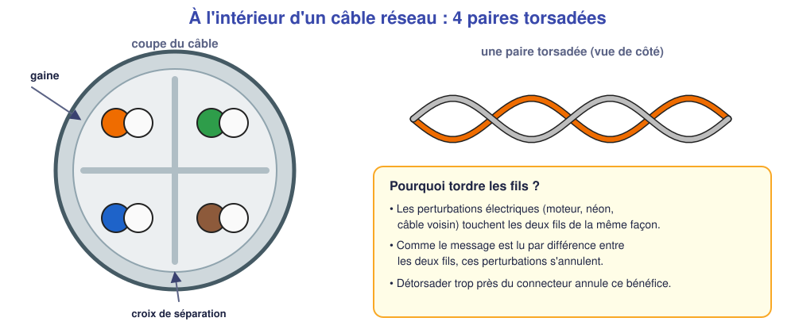
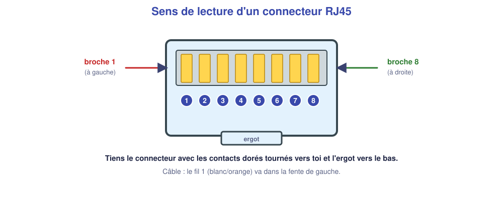
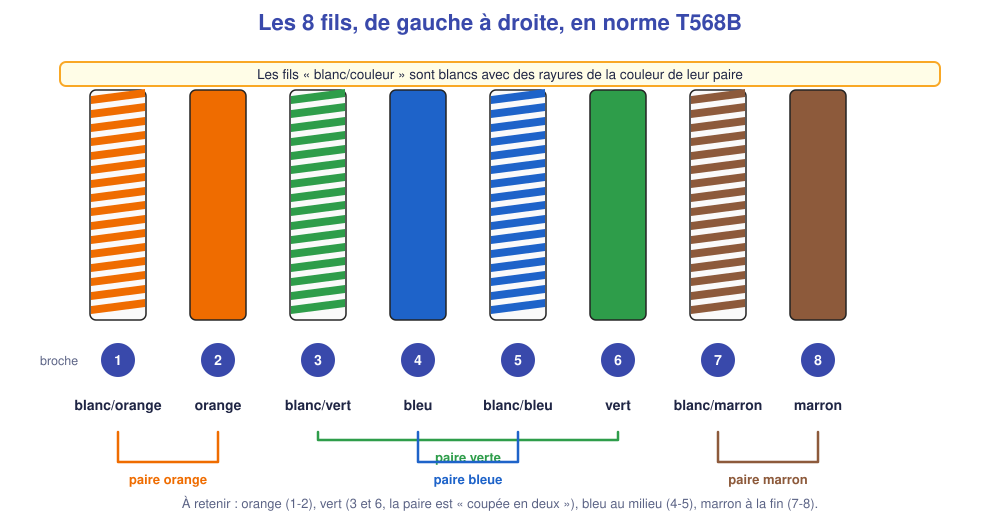
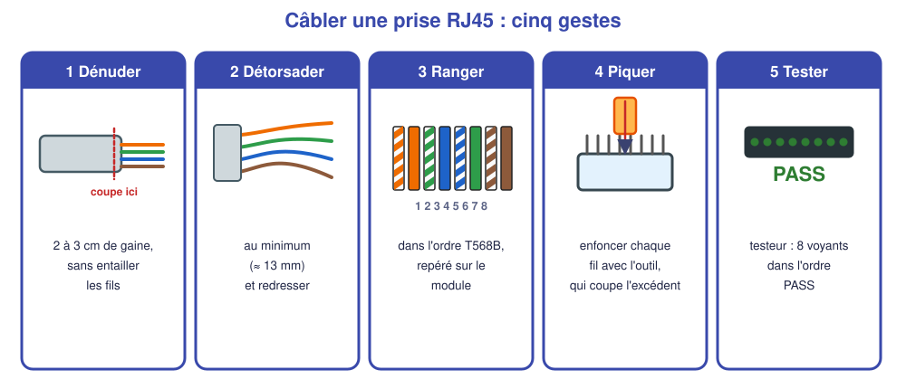
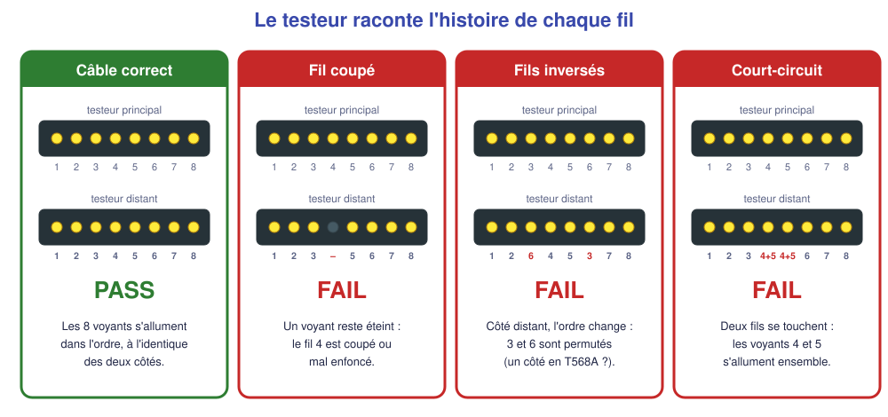
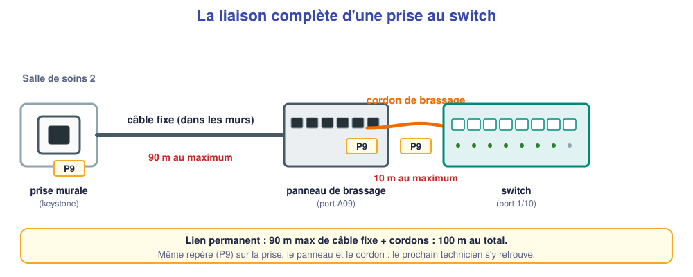

# M02 – Le câblage cuivre : poser, tester, brasser, étiqueter

*Bac Pro CIEL – Terminale – Mise à niveau E31 – semaine 2 sur 15 – 4 h*

> [!NOTE]
> **Mission.** La nouvelle salle de soins du cabinet du Parc a besoin d'une **prise RJ45**. Tu la câbles, tu la testes, tu la brasses et tu l'étiquettes. **Tâche d'épreuve visée :** raccorder, tester et étiqueter une prise en T568B. **Compétences :** C09, C06.

## ✅ À la fin de la séance, je sais…

- ☐ câbler une prise RJ45 en **T568B** aux deux extrémités ;
- ☐ utiliser un **testeur** et lire son résultat ;
- ☐ brasser un cordon et **étiqueter** avec un repère unique ;
- ☐ estimer la **longueur de câble** à commander à partir d'un plan.

## ⏱️ Déroulé (4 h)

| Durée | Activité |
|---|---|
| 0 h 00 – 0 h 30 | Reprise de M01 (quiz) |
| 0 h 30 – 1 h 15 | Cours : câble, norme, outils, test |
| 1 h 15 – 1 h 30 | Pause |
| 1 h 30 – 3 h 30 | TP : câbler, tester, brasser, étiqueter, métrer (plateau réel) |
| 3 h 30 – 4 h 00 | Bilan et passeport |

---

## 📖 Cours

> [!NOTE]
> **Pourquoi cette séance ?** Dans un réseau, **la majorité des pannes viennent des câbles et des prises** : un fil mal serti, un connecteur mal enfoncé, un câble trop long. Savoir câbler proprement et tester est la base du métier, et c'est évalué à l'épreuve.

### 1. Le câble : comment il est fait

Un câble réseau cuivre contient **8 fils de cuivre**, chacun recouvert d'une gaine de couleur. Ces 8 fils sont **tordus deux par deux** pour former **4 paires torsadées**.

**Pourquoi tordre les fils ?** Les fils captent les parasites électriques (moteur, néon, câble d'alimentation voisin). Quand deux fils sont **tordus ensemble**, ils reçoivent **la même perturbation**. Le récepteur lit le message par **différence** entre les deux fils : le parasite, identique des deux côtés, **s'annule**. Plus la torsade est serrée, meilleure est la protection.

| Caractéristique | Ce qu'il faut savoir |
|---|---|
| **Catégorie** | 5e et 6 sont courantes ; la **catégorie 6** supporte le **Gigabit** (1 Gbit/s) et plus |
| **U/UTP, F/UTP** | Sans blindage (U/UTP) ou avec un écran métallique contre les parasites (F/UTP) |
| **Longueur maximale** | **100 m** de bout en bout : **90 m** de câble fixe + **10 m** de cordons |
| **Rayon de courbure** | Ne pas plier à angle droit : environ 4 fois le diamètre du câble |

### 2. Le connecteur RJ45 et la numérotation

Le **RJ45** est le connecteur à 8 contacts à l'extrémité d'un cordon, ou la prise « femelle » du mur. Ses contacts sont **numérotés de 1 à 8**.

**Pour ne jamais se tromper de sens :** tiens le connecteur avec les **contacts dorés tournés vers toi** et l'**ergot** (le petit clip en plastique) **vers le bas** : la **broche 1 est à gauche**.

### 3. La norme T568B : le code couleur

Les 8 fils doivent être rangés dans **un ordre précis**. Il existe deux normes officielles, **T568A** et **T568B**. En France, on utilise très majoritairement la **T568B**, et on l'applique **aux deux extrémités** du câble : on obtient alors un câble **droit**.

Les fils **« blanc/couleur »** sont blancs avec **des rayures** de la couleur de leur paire. Les 4 paires sont : **orange** (broches 1-2), **bleue** (4-5), **verte** (3 et 6), **marron** (7-8).

| Broche | 1 | 2 | 3 | 4 | 5 | 6 | 7 | 8 |
|---|---|---|---|---|---|---|---|---|
| **T568B** | blanc/orange | orange | blanc/vert | bleu | blanc/bleu | vert | blanc/marron | marron |

> [!TIP]
> **Moyen mnémotechnique.** La paire **verte est « coupée en deux »** : le blanc/vert est en 3, le vert est en 6, car la paire bleue vient se glisser au milieu (4-5). Tout le reste est dans l'ordre : orange, orange, [vert], bleu, bleu, [vert], marron, marron.

**Pourquoi un câble droit ?** Les premiers équipements avaient besoin d'un câble « croisé » pour relier deux machines semblables. Les switchs actuels **détectent seuls** le sens du câble (fonction *Auto-MDI/MDIX*) : on fait donc toujours des câbles droits, T568B de chaque côté.

> [!WARNING]
> **Erreur classique :** câbler un côté en T568A et l'autre en T568B. Le câble marche parfois à 100 Mbit/s mais pas en Gigabit, ce qui est difficile à diagnostiquer. **Même norme aux deux bouts, toujours.**

### 4. Poser une prise murale (keystone)

Une prise murale RJ45 est un **module « keystone »** : on y « pique » les fils avec un outil de pose, qui **coupe l'excédent** et enfonce chaque fil dans un contact à lames.

1. **Dénuder** : retirer 2 à 3 cm de gaine, en **entaillant sans couper** les fils. Une entaille dans un fil le fragilise.
2. **Détorsader au minimum** (environ 13 mm) : chaque millimètre détorsadé **dégrade** la protection contre les parasites.
3. **Ranger** les fils dans l'ordre T568B, **repéré sur le module** (le module porte souvent des codes couleurs A et B).
4. **Piquer** : positionner chaque fil sur sa fente et enfoncer fermement avec l'outil ; vérifier que la lame de coupe est **côté extérieur**.
5. **Tester** : avec un testeur, avant de refermer.

**Sur un connecteur à sertir** (cordons) : on coupe les fils **bien droits** à longueur, on les glisse **à fond** dans le connecteur (on doit voir les 8 cuivres au bout), puis on **sertit** avec la pince.

### 5. Tester avec un testeur de câble

Un **testeur** se compose de **deux boîtiers**, l'un à chaque extrémité. Le boîtier principal envoie un signal **fil par fil** ; le boîtier distant allume le voyant **du fil qui l'a reçu**. Si les deux voyants correspondent **dans l'ordre**, le câble est bon.

| Résultat | Cause probable | Que faire |
|---|---|---|
| 8 voyants dans l'ordre | Câble correct | Continuer |
| Un voyant **éteint** | Fil non piqué, coupé ou mal serti | Repiquer le fil concerné |
| Deux voyants **inversés** | Fils permutés | Corriger l'ordre (souvent un côté en A, l'autre en B) |
| Deux voyants **simultanés** | Court-circuit : deux fils se touchent | Reprendre, ne pas dénuder plus que nécessaire |
| Ordre correct mais **lien lent** | **Split pair** (mauvaises paires) | Recâbler en respectant les **paires** |

Un testeur indique aussi la **longueur** du câble : à noter dans la fiche de mesure.

### 6. Brasser et étiqueter : la liaison complète

La **liaison complète** comprend : la **prise murale**, le **câble fixe** (90 m maximum), le **panneau de brassage**, le **cordon de brassage** (10 m maximum au total pour les cordons), et le **port du switch**.

L'**étiquetage** est indispensable : sans lui, le technicien suivant cherchera pendant une heure quelle prise correspond à quel port. La règle : **le même repère** (ici **P9**) sur **la prise, le port du panneau et le cordon**, **lisible** et **durable**.

### 7. Estimer une longueur de câble

On ne mesure pas à vol d'oiseau, mais **le long du trajet réel** du câble : murs, couloirs, plafond technique. On additionne :

1. la **distance horizontale** (on compte les carreaux du plan, selon l'échelle : 1 carreau = 1 m) ;
2. la **montée** de la prise jusqu'au plafond et la **descente** vers la baie (par exemple : plafond à 2,60 m, prise à 0,30 m : 2,30 m de chaque côté) ;
3. une **marge de 10 %** pour les courbes, les boucles et les erreurs.

**Exemple :** 12 m en horizontal + 2,3 m + 2,3 m = 16,6 m ; × 1,10 = 18,26 m → on commande **19 m**.

> [!TIP]
> **À retenir de la séance**
> - 4 paires torsadées, 8 fils ; **T568B** aux **deux** extrémités ; **100 m maximum** (90 + 10).
> - On **détorsade au minimum**, on **teste toujours** avant de refermer.
> - Le testeur raconte une **histoire par fil** : éteint = coupé ; inversé = permuté ; simultané = court-circuit.
> - **Même étiquette** sur prise, panneau et cordon.
> - Longueur = trajet réel (horizontal + vertical) **+ 10 %**.

### 📖 Lexique de la séance

| Mot | Définition simple |
|---|---|
| **Paire torsadée** | Deux fils tordus ensemble pour annuler les parasites |
| **T568B** | Norme d'ordre des fils du RJ45 |
| **Câble droit** | Même norme aux deux extrémités |
| **Keystone** | Module de prise murale RJ45 |
| **Cordon de brassage** | Petit câble mobile entre panneau et switch |
| **Testeur** | Appareil qui vérifie fil par fil la continuité d'un câble |
| **Étiquetage** | Repère unique posé sur la prise, le panneau et le cordon |

---

## 🛠️ TP (matériel réel)

### Partie A – Je prévois (10 min)

Écris l'ordre des fils T568B de la broche 1 à 8, sans regarder le cours : ______________

### Partie B – Sertir un cordon (≈ 40 min)

1. Prépare un câble Cat 6 de 0,5 m, **dénude** et **détorsade** au minimum.
2. Câble **un seul côté** en T568B et sertis le connecteur.
3. **Demande à l'enseignant** de contrôler avant de faire le second côté.
4. Teste au testeur. Résultat : ______________

### Partie C – Câbler la prise P9 (≈ 50 min)

1. Une liaison déjà posée relie la prise murale **P9** au panneau (**A09**) : ses extrémités sont libres.
2. Câble la **prise murale** en T568B, puis le **panneau**.
3. **Teste** la liaison avec le testeur : cartographie et **longueur**.

| Mesure au testeur | Résultat |
|---|---|
| Cartographie des 8 fils | |
| Longueur mesurée | |
| Verdict (PASS / FAIL) | |
| Si FAIL : cause trouvée et correction | |

### Partie D – Brasser et étiqueter (≈ 20 min)

Brasse **A09** vers le port du switch indiqué par l'enseignant (cordon de la bonne longueur) et pose les étiquettes.

| Point de contrôle | Fait |
|---|---|
| Même repère sur la prise, le panneau et le cordon | ☐ |
| Cordon ni tendu ni en boucle | ☐ |
| Gaine à l'intérieur du module | ☐ |
| Poste de travail rangé | ☐ |

### Partie E – Métrer sur plan (≈ 20 min)

Sur le plan fourni (1 carreau = 1 m) calcule la longueur de câble pour une prise voisine :

| Étape | Valeur |
|---|---|
| Distance horizontale (carreaux, le long des murs) | |
| Montée + descente | |
| Total | |
| Marge 10 % | |
| **Longueur à commander (arrondie)** | |

❓ **Pourquoi détorsader au minimum ?** ______________

❓ **Un testeur indique PASS mais le lien ne fonctionne pas en Gigabit. Quelle cause peux-tu soupçonner ?** ______________

---

## 📒 Mon bilan pour le passeport d'autonomie

| Question | Ma réponse |
|---|---|
| Ce qui m'a **posé problème** pendant le câblage | |
| Ma **décision** (ex. : j'ai recommencé un côté, parce que…) | |
| Ce que je saurais **refaire seul(e)** | |
| Ma **preuve** (résultat du testeur, photo de l'étiquetage) | |

## 🏁 Ce que je sais faire maintenant

| Je sais… | Pas encore | Avec aide | Seul(e) |
|---|---|---|---|
| ranger les fils en T568B | ☐ | ☐ | ☐ |
| câbler une prise et un panneau | ☐ | ☐ | ☐ |
| lire le résultat du testeur | ☐ | ☐ | ☐ |
| brasser et étiqueter | ☐ | ☐ | ☐ |
| estimer une longueur de câble | ☐ | ☐ | ☐ |

---

[← M01](M01.md) [M03 →](M03.md)
