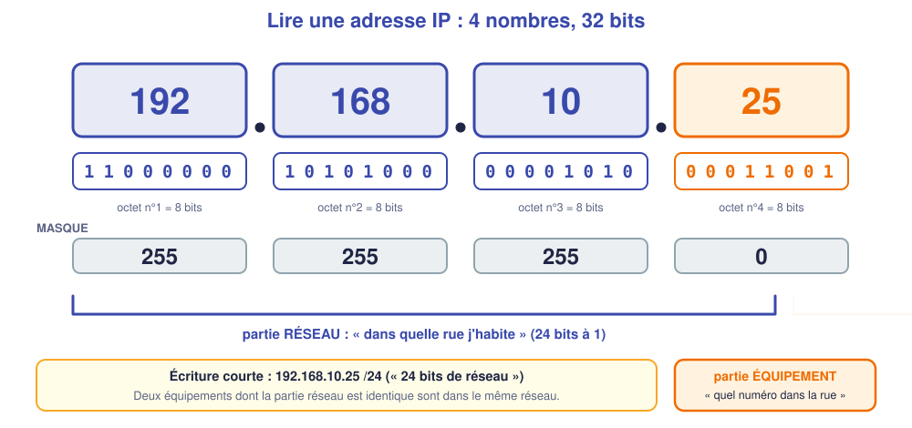
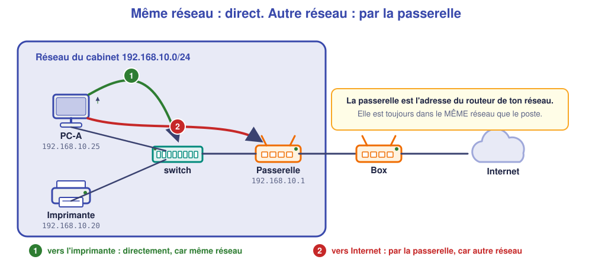
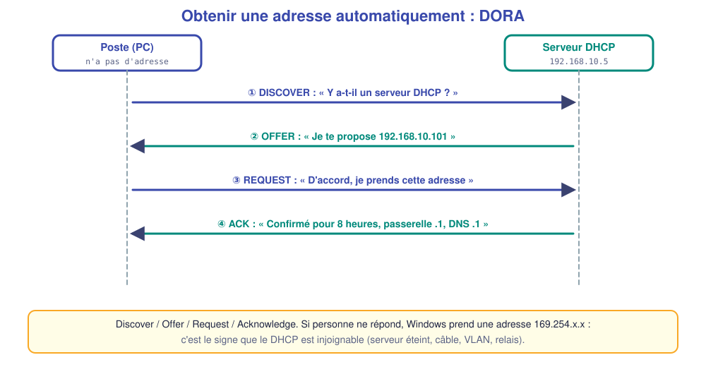
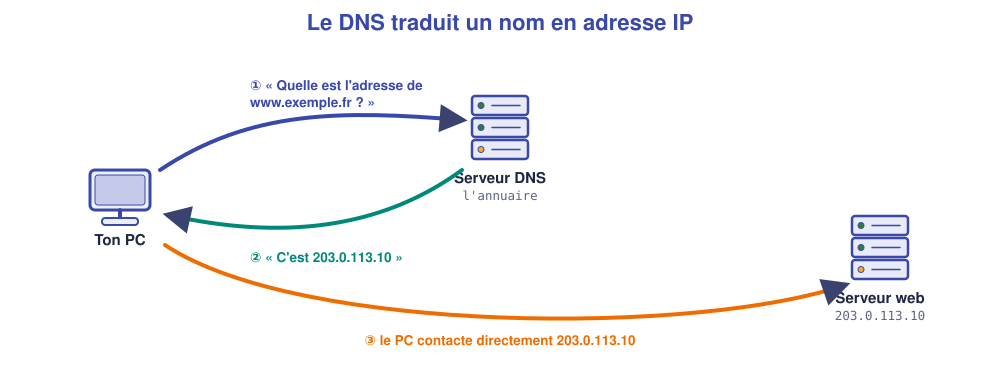
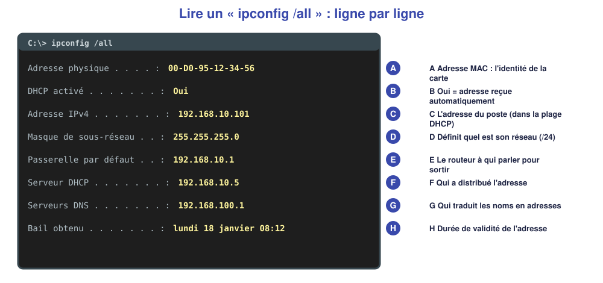

# M03 – Adresses IP, masque, passerelle, DHCP et DNS

*Bac Pro CIEL – Terminale – Mise à niveau E31 – semaine 3 sur 15 – 4 h*

> [!NOTE]
> **Mission.** Un poste du cabinet du Parc « n'a pas Internet ». Avant de toucher à quoi que ce soit, tu dois **lire sa configuration** et dire ce qui ne va pas. **Tâche d'épreuve visée :** lire un plan d'adressage et vérifier la configuration d'un poste. **Compétence :** C06.

## ✅ À la fin de la séance, je sais…

- ☐ dire à quoi servent **adresse IP, masque, passerelle, DHCP, DNS** ;
- ☐ utiliser `ipconfig /all`, `ping`, `tracert`, `nslookup` et interpréter le résultat ;
- ☐ reconnaître un poste mal configuré (adresse en 169.254, mauvaise passerelle).

## ⏱️ Déroulé (4 h)

| Durée | Activité |
|---|---|
| 0 h 00 – 0 h 30 | Reprise de M02 |
| 0 h 30 – 1 h 15 | Cours |
| 1 h 15 – 1 h 30 | Pause |
| 1 h 30 – 3 h 30 | TP (simulateur) |
| 3 h 30 – 4 h 00 | Bilan et passeport |

---

## 📖 Cours

> [!NOTE]
> **Pourquoi cette séance ?** Pour qu'un poste communique sur un réseau, il lui faut une **identité** (son adresse), un **périmètre** (son réseau) et un **chemin de sortie** (sa passerelle). La plupart des « je n'ai pas Internet » viennent d'un de ces réglages. Cette séance explique **chaque notion en partant de zéro**.

### 1. Pourquoi une adresse ?

Pour qu'une lettre arrive, il faut une **adresse** : une **rue** et un **numéro**. C'est exactement le même principe dans un réseau : chaque équipement reçoit une **adresse IP** (*Internet Protocol*) qui permet aux autres de le **retrouver**. Deux équipements ne peuvent pas avoir la même adresse dans le même réseau, comme deux maisons n'ont pas le même numéro dans la même rue.

### 2. Une adresse IP en détail

Une adresse **IPv4** s'écrit avec **quatre nombres de 0 à 255** séparés par des points : `192.168.10.25`. Ces quatre nombres s'appellent des **octets**, car chacun est codé sur **8 bits** (un **bit** vaut 0 ou 1) : en tout 32 bits.

> [!NOTE]
> **Pourquoi pas plus que 255 ?** Avec 8 bits, on peut écrire 2⁸ = 256 valeurs différentes, de 0 à 255. L'ordinateur travaille en binaire ; les points et les nombres décimaux sont là pour **nous**, humains. On étudie le binaire en détail en semaine 6.

#### Le masque : où passe la frontière ?

Une adresse IP contient **deux informations** : **à quel réseau** appartient l'équipement (la « rue »), et **quel équipement** il est dans ce réseau (le « numéro »). Un **masque de sous-réseau** dit **où passe la frontière** entre les deux.

| Écriture | Signification |
|---|---|
| `255.255.255.0` | Les **3 premiers octets** (24 bits) désignent le **réseau** ; le dernier octet désigne l'**équipement** |
| `/24` | **Écriture courte** du même masque : « 24 bits de réseau » |

Avec `192.168.10.25` et le masque `255.255.255.0` (`/24`) : le **réseau** est `192.168.10`, l'**équipement** est `25`.

> [!TIP]
> **Règle de comparaison.** Deux équipements sont **dans le même réseau** si leur **partie réseau est identique**. `192.168.10.25` et `192.168.10.40` : oui (même `192.168.10`). `192.168.10.25` et `192.168.20.40` : non (`10` ≠ `20`).

#### Les adresses réservées d'un réseau /24

Dans un réseau `192.168.10.0/24` :

| Adresse | Rôle |
|---|---|
| `192.168.10.0` | **Adresse du réseau** : désigne le réseau lui-même, **non utilisable** par un poste |
| `192.168.10.1` à `.254` | **254 adresses utilisables** pour les équipements |
| `192.168.10.255` | **Adresse de diffusion** (*broadcast*) : « à tous », **non utilisable** |

#### Les adresses privées

Certaines plages sont **réservées aux réseaux internes** et ne circulent jamais sur Internet : `10.0.0.0/8`, `172.16.0.0/12`, `192.168.0.0/16`. Tous les réseaux de cabinets ou de maisons les utilisent. C'est la **box** qui fait la traduction vers une adresse **publique** pour aller sur Internet.

### 3. La passerelle : la porte de sortie

Un poste sait joindre **directement** un équipement de son réseau. Pour tout le reste (un autre réseau, Internet), il confie ses messages à un **routeur**. L'adresse de ce routeur **dans le réseau du poste** s'appelle la **passerelle par défaut** (*default gateway*).

Le poste applique un raisonnement simple, **à chaque message** :

1. Je compare l'adresse du destinataire à mon réseau (grâce à mon **masque**).
2. **Même réseau** → j'envoie **directement**.
3. **Autre réseau** → j'envoie **à la passerelle**, qui se chargera du reste.

> [!WARNING]
> **La passerelle doit être dans le même réseau que le poste.** Un poste en `192.168.10.25/24` avec la passerelle `192.168.20.1` ne peut pas la joindre : il ne sortira pas du réseau. C'est une erreur de configuration très fréquente.

### 4. Le DHCP : des adresses automatiques

Régler à la main l'adresse, le masque, la passerelle et le DNS de **chaque** poste est long et source d'erreurs. Le **DHCP** (*Dynamic Host Configuration Protocol*) automatise tout : un **serveur DHCP** distribue à chaque équipement qui se connecte une configuration complète pour une **durée limitée** (le **bail**, par exemple 8 heures).

Le dialogue entre le poste et le serveur se fait en **quatre messages**, abrégés **DORA** :

1. **Discover** : le poste, qui n'a **pas encore d'adresse**, crie sur le réseau « y a-t-il un serveur DHCP ? ».
2. **Offer** : le serveur propose une adresse libre.
3. **Request** : le poste répond « je prends celle-là ».
4. **Acknowledge** : le serveur confirme et donne aussi la **passerelle**, le **DNS** et la **durée du bail**.

Le serveur DHCP ne distribue que dans une **plage** (ex. de `.100` à `.150`). Les équipements à **adresse fixe** (serveur, imprimante, borne Wi-Fi) reçoivent une adresse **hors plage**, pour qu'un poste n'obtienne pas la même par hasard (ce qui provoquerait un **conflit d'adresse**).

> [!WARNING]
> **L'adresse 169.254.x.x.** Si un poste en DHCP ne reçoit **aucune réponse**, Windows s'attribue lui-même une adresse **169.254.x.x** (dite **APIPA**). Elle ne permet de parler qu'aux machines voisines dans la même situation. **Quand tu vois 169.254, pense : « le DHCP est injoignable »** (câble, serveur arrêté, VLAN, relais).

### 5. Le DNS : un annuaire pour les noms

Les humains retiennent des **noms** (`www.exemple.fr`), les équipements travaillent avec des **adresses**. Le **DNS** (*Domain Name System*) est l'**annuaire** qui traduit l'un en l'autre.

Le serveur DNS à utiliser est communiqué par le DHCP, ou réglé à la main. **Symptôme typique d'un DNS en panne :** le **ping vers une adresse IP** (`8.8.8.8`) fonctionne, mais **pas** celui vers un nom (`www.exemple.fr`).

### 6. Lire la configuration d'un poste : `ipconfig /all`

Sous Windows, la commande **`ipconfig /all`** affiche toute la configuration réseau d'un poste. C'est **la première chose à regarder** quand un poste a un souci.

| Ligne | Ce qu'elle t'apprend |
|---|---|
| **Adresse physique** | L'adresse **MAC** de la carte (identité matérielle) |
| **DHCP activé** | Oui = adresse reçue automatiquement ; Non = réglée à la main |
| **Adresse IPv4** | L'adresse du poste |
| **Masque** | Son réseau (`/24`) |
| **Passerelle par défaut** | Le routeur pour sortir du réseau |
| **Serveur DHCP** | Qui a distribué l'adresse |
| **Serveurs DNS** | Qui traduit les noms |

### 7. Les commandes de diagnostic

| Commande | Ce qu'elle fait | Comment interpréter |
|---|---|---|
| `ipconfig /all` | Affiche la configuration | Voir ci-dessus |
| `ipconfig /release` puis `ipconfig /renew` | Rend puis redemande une adresse DHCP | Pour forcer un nouveau dialogue DORA |
| `ping <adresse>` | Envoie 4 petits messages et attend la réponse | **Réponse** = joignable ; « délai dépassé » = pas de réponse |
| `tracert <adresse>` | Liste les **routeurs traversés** | Le **premier saut** est la passerelle |
| `nslookup <nom>` | Interroge le DNS | Montre l'adresse correspondant au nom |

🤔 **Je comprends :** un poste a `192.168.10.25/24` et une passerelle `192.168.10.1`. Il veut joindre `192.168.10.40`, puis `192.168.20.40`. Par quel chemin passe chaque message ? ______________

💡 Réponse

`192.168.10.40` est dans le **même réseau** : envoi **direct**. `192.168.20.40` est dans un **autre réseau** : le poste l'envoie à sa **passerelle** `192.168.10.1`, qui fera suivre.

> [!TIP]
> **À retenir de la séance**
> - **Adresse IP** = identité dans un réseau ; **masque** = frontière réseau/équipement ; **passerelle** = porte de sortie.
> - Même réseau = envoi direct ; autre réseau = **par la passerelle**.
> - **DHCP** distribue tout (DORA) ; **169.254** = DHCP injoignable ; **DNS** traduit les noms.
> - `ipconfig /all` d'abord, puis `ping` du plus proche au plus lointain.

### 📖 Lexique de la séance

| Mot | Définition simple |
|---|---|
| **Adresse IP** | Identité d'un équipement dans un réseau |
| **Octet** | 8 bits ; une des quatre valeurs d'une adresse IPv4 |
| **Masque** | Indique la partie réseau d'une adresse |
| **Passerelle** | Adresse du routeur pour sortir du réseau |
| **DHCP** | Service qui distribue les adresses automatiquement |
| **Bail** | Durée de validité d'une adresse distribuée |
| **APIPA (169.254)** | Adresse que se donne un poste qui ne trouve pas de DHCP |
| **DNS** | Annuaire qui traduit un nom en adresse IP |
| **Adresse MAC** | Identité matérielle d'une carte réseau |

---

## 🛠️ TP (simulateur)

### Partie A – Construire (≈ 20 min)

Dans le simulateur, place : une **box** (accès Internet), un switch OmniSwitch, **deux PC** et un **serveur** (`SRV`). Relie tout au switch, la box aussi. Laisse les **PC en DHCP** (adresse automatique) ; donne au serveur l'adresse fixe `192.168.1.5/24`.

### Partie B – Lire la configuration (≈ 30 min)

Sur `PC-1`, tape `ipconfig /all`.

| Information | Valeur relevée |
|---|---|
| Adresse IP | |
| Masque | |
| Passerelle | |
| Serveur DNS | |
| Serveur DHCP | |

🤔 **J'anticipe :** `ping` vers la passerelle puis vers le serveur : résultat attendu ? ______________ **Résultat obtenu :** ______________

Fais aussi `tracert` vers une adresse d'Internet et note le premier saut : ______________ **Que représente-t-il ?** ______________

### Partie C – Trois postes en panne (≈ 1 h)

Ton binôme **modifie la configuration** d'un poste de ton réseau à ton insu, selon l'une de ces pannes. Tu dois **trouver laquelle** en lisant `ipconfig /all` et avec des `ping`, **sans la corriger au hasard**.

| Panne | Ce qu'elle provoque |
|---|---|
| A. Passerelle erronée | Le poste joint le switch et le serveur, pas Internet |
| B. DNS erroné | Le ping vers l'adresse marche, pas le ping vers un nom |
| C. DHCP inaccessible | Le poste prend une adresse `169.254.x.x` |

Pour chaque panne, remplis : 

| Panne n° | Symptôme observé | Test qui a permis de conclure | Cause | Correction |
|---|---|---|---|---|
| 1 | | | | |
| 2 | | | | |
| 3 | | | | |

❓ **Pourquoi une adresse en `169.254` est-elle un indice précieux ?** ______________

❓ **Pourquoi la passerelle doit-elle être dans le même réseau que le poste ?** ______________

### Partie D – Mini-plan d'adressage (≈ 20 min)

Complète le plan du cabinet à partir des indications : réseau `192.168.10.0/24`, passerelle `.1`, serveur `.5`, imprimante `.20`, borne `.30`, DHCP de `.100` à `.150`.

| Équipement | Adresse | Fixe ou DHCP ? |
|---|---|---|
| Passerelle (switch) | | |
| Serveur | | |
| Imprimante | | |
| Borne Wi-Fi | | |
| Postes | | |

❓ **Pourquoi l'imprimante a-t-elle une adresse fixe ?** ______________

---

## 📒 Mon bilan pour le passeport d'autonomie

| Question | Ma réponse |
|---|---|
| Une panne que j'ai trouvée et **comment j'ai raisonné** | |
| Ce qui m'a **surpris** | |
| Ce que je saurais **refaire seul(e)** | |
| Ma **preuve** (captures `ipconfig /all`, tableau des pannes) | |

## 🏁 Ce que je sais faire maintenant

| Je sais… | Pas encore | Avec aide | Seul(e) |
|---|---|---|---|
| expliquer adresse, masque, passerelle, DHCP, DNS | ☐ | ☐ | ☐ |
| lire `ipconfig /all` | ☐ | ☐ | ☐ |
| utiliser ping, tracert, nslookup | ☐ | ☐ | ☐ |
| reconnaître une adresse 169.254 | ☐ | ☐ | ☐ |

---

[← M02](M02.md) [M04 →](M04.md)
