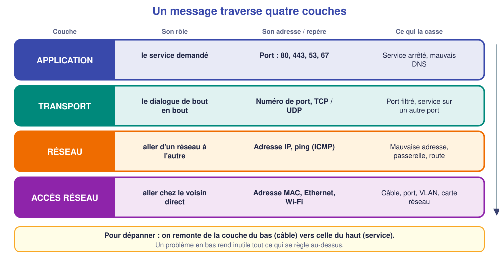
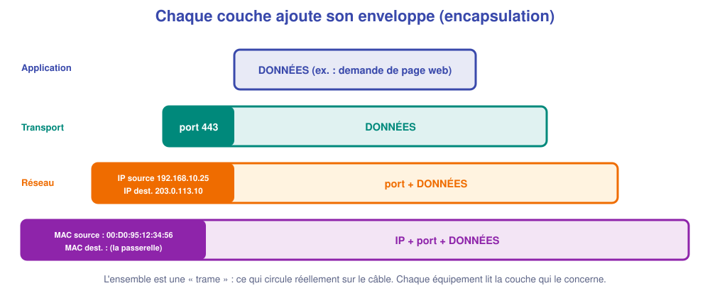
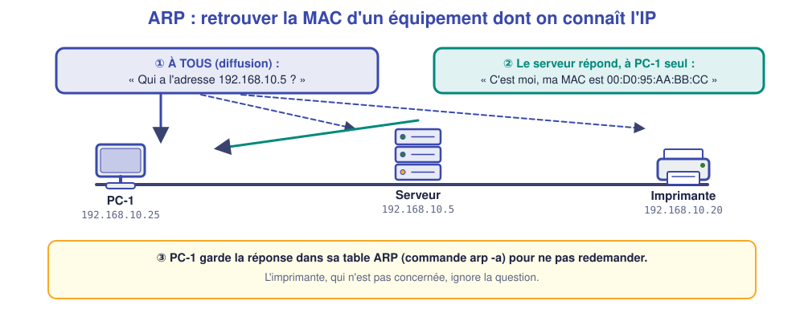
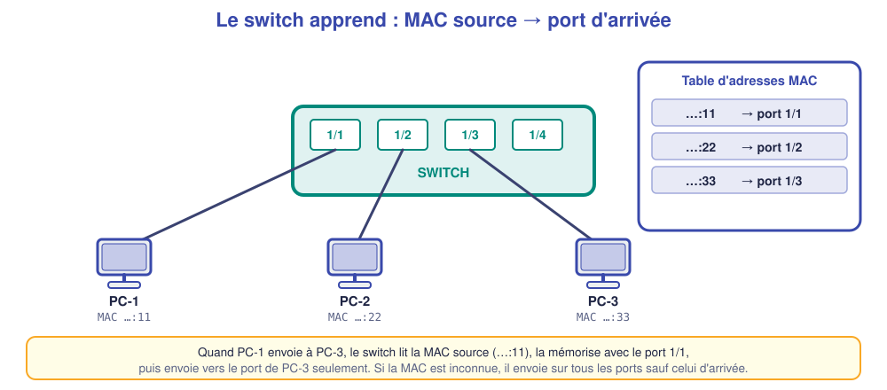
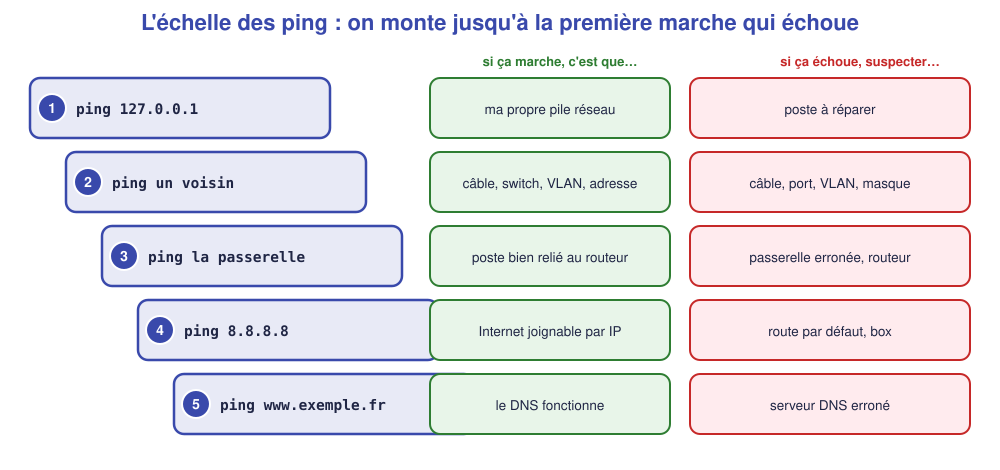

# M04 – Comprendre en couches et dépanner avec méthode

*Bac Pro CIEL – Terminale – Mise à niveau E31 – semaine 4 sur 15 – 4 h*

> [!NOTE]
> **Mission.** Au cabinet du Parc, « rien ne marche » est un symptôme, pas une cause. Tu apprends à **localiser** une panne en suivant le chemin des données, **couche par couche**. **Tâche d'épreuve visée :** appliquer la méthode constater → délimiter → tester. **Compétence :** C10.

## ✅ À la fin de la séance, je sais…

- ☐ placer un symptôme sur la bonne **couche** (câble, adresse, service) ;
- ☐ dérouler la **méthode de dépannage** en 6 étapes ;
- ☐ utiliser `ping`, `tracert`, `arp -a` pour **localiser** une panne ;
- ☐ expliquer ce qu'est une **adresse MAC**, un **port** et le **protocole ARP**.

## ⏱️ Déroulé (4 h)

| Durée | Activité |
|---|---|
| 0 h 00 – 0 h 30 | Reprise de M03 |
| 0 h 30 – 1 h 15 | Cours |
| 1 h 15 – 1 h 30 | Pause |
| 1 h 30 – 3 h 30 | TP : trois pannes à résoudre (simulateur) |
| 3 h 30 – 4 h 00 | Bilan et passeport |

---

## 📖 Cours

> [!NOTE]
> **Pourquoi cette séance ?** Dépanner ne consiste pas à « essayer des trucs ». Un bon technicien **sait par où passent les données** et **cherche au bon endroit**. Cette séance te donne une **carte mentale** (les couches) et une **méthode**.

### 1. Le voyage d'un message

Quand tu ouvres une page web, ta demande **ne part pas d'un seul coup**. Elle est préparée en **plusieurs étapes**, chacune ayant un rôle précis, comme l'envoi d'un colis : tu écris la lettre (contenu), tu la mets dans une enveloppe avec l'adresse (envoi), le facteur la prend en charge (transport local), un centre de tri l'aiguille (acheminement). Chaque étape s'appelle une **couche**.

Retiens ce modèle simplifié à **quatre couches** (le modèle officiel TCP/IP) :

| Couche | Son rôle | Son « adresse » |
|---|---|---|
| **Application** | Le **service** demandé : site web, courriel, noms, adresses automatiques | Un **port** (80 web, 443 web sécurisé, 53 DNS, 67/68 DHCP) |
| **Transport** | Le dialogue **de bout en bout** : à quel service de la machine est destiné le message ? | Le **numéro de port** |
| **Réseau** | **Aller d'un réseau à l'autre** | L'**adresse IP** |
| **Accès réseau** | **Aller chez le voisin direct** (câble, Wi-Fi) | L'**adresse MAC** |

Chaque couche **ne s'occupe que de son travail** et fait confiance à celle du dessous. C'est pourquoi on peut **dépanner couche par couche**.

### 2. L'enveloppe dans l'enveloppe

À l'envoi, chaque couche **ajoute son enveloppe** (appelée **en-tête**) autour de ce que lui a donné la couche du dessus : c'est l'**encapsulation**. À l'arrivée, chaque couche **ouvre son enveloppe** et transmet le contenu à celle du dessus.

Au final, ce qui circule sur le câble s'appelle une **trame**. Elle contient, de l'extérieur vers l'intérieur : les **adresses MAC** (pour le voisin), les **adresses IP** (pour le destinataire final), le **port** (pour le service) et les **données**.

### 3. L'adresse MAC : l'identité de la carte

Chaque carte réseau possède, **gravée en usine**, une **adresse MAC** (*Media Access Control*) unique au monde, écrite sur **48 bits**, par exemple `00:D0:95:12:34:56`. Sur un **même réseau**, les équipements s'envoient les trames **en utilisant les adresses MAC**. L'adresse IP, elle, est **configurable** (elle peut changer), alors que la MAC est **fixée au matériel**.

> [!NOTE]
> **IP ou MAC ?** L'adresse **IP** sert à **aller loin** (d'un réseau à l'autre) ; l'adresse **MAC** sert à **aller chez le voisin**. En allant sur Internet, l'adresse IP de destination **reste la même** pendant tout le trajet, alors que les adresses MAC **changent à chaque saut** de routeur.

### 4. ARP : retrouver une MAC à partir d'une IP

Un poste connaît l'**IP** de l'imprimante (`192.168.10.20`) mais pour lui parler **sur le réseau local** il lui faut sa **MAC**. Il utilise le protocole **ARP** (*Address Resolution Protocol*) :

1. Le poste envoie à **tout le réseau** : « Qui a l'adresse 192.168.10.20 ? » (une **diffusion**, ou *broadcast*).
2. **Seule l'imprimante** répond avec sa MAC.
3. Le poste mémorise la réponse dans sa **table ARP** (consultable avec `arp -a`) pour ne pas redemander.

### 5. Le switch apprend les adresses MAC

Un switch **observe chaque trame** qui passe : il lit l'**adresse MAC source** et la **mémorise avec le port d'arrivée**. Il construit ainsi sa **table d'adresses MAC** (commande OmniSwitch : `show mac-learning`).

Ensuite, quand une trame arrive pour cette MAC, il l'envoie **uniquement vers le bon port** (au lieu de l'envoyer à tous, comme le ferait un vieux hub). Si la MAC de destination est **inconnue**, il envoie la trame sur **tous les ports sauf celui d'arrivée**, puis apprend la réponse. Cette table est un **outil de dépannage** précieux : elle montre **où le switch voit réellement** chaque équipement.

### 6. La méthode de dépannage

Voici la méthode, qu'on applique **dans l'ordre** :

| # | Étape | Question | Piège à éviter |
|---|---|---|---|
| 1 | **Constater** | Quel est le symptôme **exact** ? Qui est touché ? Depuis quand ? | Accepter « ça ne marche pas » sans précision |
| 2 | **Délimiter** | Qu'est-ce qui **marche encore** ? Jusqu'où ? | Chercher partout au lieu de réduire la zone |
| 3 | **Hypothèses** | Quelles causes possibles, de la plus **simple** à la plus rare ? | Foncer sur la première idée |
| 4 | **Tester** | Quel test **confirme ou écarte** une hypothèse ? | Tester sans savoir ce qu'on attend |
| 5 | **Corriger** | **Une seule** modification à la fois | Changer plusieurs choses d'un coup |
| 6 | **Vérifier** | Le symptôme a-t-il disparu ? Rien d'autre n'est cassé ? | S'arrêter dès que « ça remarche » |

### 7. Délimiter avec l'échelle des ping

Le `ping` est l'outil de délimitation. On **monte une échelle** : on teste du plus **proche** au plus **lointain**, et la **première marche qui échoue** indique où chercher.

| Je pingue… | Si ça marche | Si ça échoue |
|---|---|---|
| **Moi-même** (`127.0.0.1`) | Le poste fonctionne | Problème du poste lui-même |
| Un **voisin** du même réseau | Câble, switch, VLAN, adresse OK | Câble, port, VLAN, masque, adresse |
| La **passerelle** | Le poste atteint son routeur | Passerelle erronée, routeur |
| Une **adresse Internet** (`8.8.8.8`) | La sortie fonctionne | Route par défaut, box |
| Un **nom** (`www.exemple.fr`) | Le DNS fonctionne | Serveur DNS erroné |

🤔 **Je comprends :** le ping vers la passerelle marche, celui vers `8.8.8.8` échoue. Dans quelle zone cherches-tu ? ______________

💡 Réponse

Le poste atteint son routeur (la passerelle) mais pas Internet : on cherche **du côté du routeur ou de la box** (route par défaut, liaison vers l'opérateur), pas dans le poste.

> [!TIP]
> **À retenir de la séance**
> - 4 couches : **application, transport, réseau, accès réseau** ; chacune a son adresse (port, IP, MAC).
> - **MAC** pour le voisin, **IP** pour aller loin, **ARP** pour passer de l'une à l'autre.
> - Le switch **apprend** les MAC et envoie au **bon port** ; `show mac-learning` montre qui est où.
> - **Méthode :** constater → délimiter → hypothèses → tester → **une** correction → vérifier. **Du bas vers le haut.**

### 📖 Lexique de la séance

| Mot | Définition simple |
|---|---|
| **Couche** | Étape du traitement d'un message, avec son propre rôle |
| **Encapsulation** | Ajout d'une enveloppe (en-tête) par chaque couche |
| **Trame** | Ce qui circule réellement sur le câble |
| **Adresse MAC** | Identité matérielle d'une carte, utilisée dans le réseau local |
| **ARP** | Protocole qui retrouve la MAC d'une IP |
| **Diffusion (broadcast)** | Message destiné à tous les équipements du réseau |
| **Port** | Numéro qui désigne un service (80 = web) |
| **Table MAC** | Liste « MAC → port » apprise par le switch |

---

## 🛠️ TP (simulateur)

### Partie A – Reconstituer la table MAC (≈ 30 min)

Construis un switch OmniSwitch avec trois PC (adresses fixes `192.168.1.11` à `.13`, `/24`).

1. Fais un `ping` entre les trois PC.
2. Sur le switch (terminal console, compte `admin`, mot de passe `switch`), tape : `show mac-learning`.

| Adresse MAC | Port | VLAN |
|---|---|---|
| | | |
| | | |
| | | |

❓ **Pourquoi la table était-elle vide avant les ping ?** ______________

Sur `PC-1` : `arp -a`. Que contient la table ? ______________

### Partie B – Trois pannes à résoudre (≈ 1 h 30)

Ton binôme introduit **successivement trois pannes** dans ton réseau, parmi : câble débranché, mauvaise adresse IP, mauvais masque, passerelle erronée, DNS erroné. Pour **chaque panne**, remplis la fiche **avant de corriger**.

| Étape | Panne 1 | Panne 2 | Panne 3 |
|---|---|---|---|
| **1. Constater** (symptôme exact) | | | |
| **2. Délimiter** (ce qui marche encore) | | | |
| **3. Hypothèses** (au moins 2) | | | |
| **4. Tester** (commande et résultat) | | | |
| **5. Corriger** (une seule action) | | | |
| **6. Vérifier** | | | |

### Partie C – Je prévois (≈ 20 min)

Un PC du cabinet n'arrive pas à imprimer. Quel est **ton premier test** ? Quel est le **deuxième** si le premier réussit ? ______________

---

## 📒 Mon bilan pour le passeport d'autonomie

| Question | Ma réponse |
|---|---|
| Une fois où j'ai voulu **corriger trop vite**, et ce qui m'a retenu | |
| Ce qui m'a **surpris** | |
| Ce que je saurais **refaire seul(e)** | |
| Ma **preuve** (3 fiches de dépannage) | |

## 🏁 Ce que je sais faire maintenant

| Je sais… | Pas encore | Avec aide | Seul(e) |
|---|---|---|---|
| distinguer MAC, IP, port | ☐ | ☐ | ☐ |
| dérouler la méthode en 6 étapes | ☐ | ☐ | ☐ |
| délimiter avec une série de ping | ☐ | ☐ | ☐ |
| lire la table MAC d'un switch | ☐ | ☐ | ☐ |

---

[← M03](M03.md) [M05 →](M05.md)
