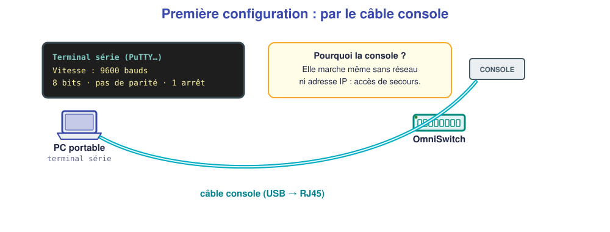
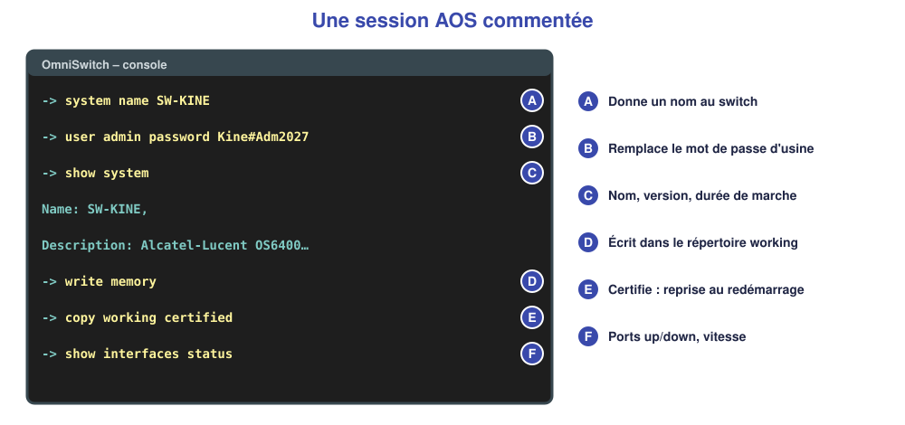
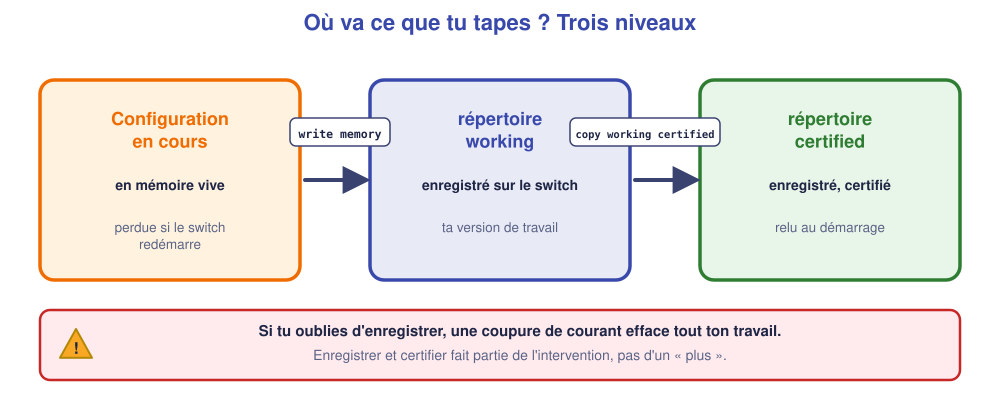

# M05 – Prendre en main un switch administrable (OmniSwitch)

*Bac Pro CIEL – Terminale – Mise à niveau E31 – semaine 5 sur 15 – 4 h*

> [!NOTE]
> **Mission.** Le switch du cabinet du Parc est livré avec ses réglages d'usine : mot de passe connu de tous, pas de nom, rien d'enregistré. Tu le **prends en main** et tu le **sécurises**. **Tâche d'épreuve visée :** console, nom, mot de passe, sauvegarde. **Compétence :** C09.

> [!IMPORTANT]
> **Jalon 1 (fin de séance).** Câblage (M02) et réseau de base (M03, M04) maîtrisés. Si ce n'est pas le cas, la semaine 6 sert de rattrapage avant de continuer.

## ✅ À la fin de la séance, je sais…

- ☐ me connecter en **console** à un OmniSwitch (9600 bauds) et me repérer dans l'invite `->` ;
- ☐ **nommer** le switch, **changer le mot de passe** administrateur ;
- ☐ **enregistrer** la configuration et dire pourquoi c'est indispensable ;
- ☐ lire `show system`, `show interfaces status`, `show mac-learning`.

## ⏱️ Déroulé (4 h)

| Durée | Activité |
|---|---|
| 0 h 00 – 0 h 30 | Reprise de M04 |
| 0 h 30 – 1 h 15 | Cours |
| 1 h 15 – 1 h 30 | Pause |
| 1 h 30 – 3 h 30 | TP (simulateur, puis plateau réel) |
| 3 h 30 – 4 h 00 | Bilan et passeport |

---

## 📖 Cours

> [!NOTE]
> **Pourquoi cette séance ?** Un switch « bête » marche sans réglage. Mais un cabinet de santé a besoin de **séparer des réseaux**, de **protéger l'accès** et de **tracer** ce qui est fait : il faut un switch **administrable**. Dans cette séance, tu apprends à **lui parler** pour la première fois.

### 1. Administrable, ça veut dire quoi ?

Un switch **non administrable** relie des machines sans qu'on puisse rien régler. Un switch **administrable** possède un **petit ordinateur interne** (un système d'exploitation) sur lequel on peut :

- lui donner un **nom** et une **adresse IP** ;
- créer des **réseaux virtuels** (VLAN) ;
- **sécuriser** l'accès par un mot de passe ;
- **surveiller** son état et lire des **journaux**.

On l'administre par **une interface de commandes**, appelée **CLI** (*Command Line Interface*) : on tape des lignes de texte, il répond. C'est moins joli qu'une interface graphique, mais **identique d'un équipement à l'autre**, **rapide** et **automatisable**.

### 2. Se connecter : la console

Un switch neuf n'a **pas d'adresse IP** : on ne peut donc pas l'atteindre par le réseau. On se branche **directement** avec un **câble console** (un câble USB d'un côté, RJ45 de l'autre) sur le port **CONSOLE** du switch, et on ouvre un **programme de terminal** (PuTTY par exemple) sur le PC.



Les réglages sont **normalisés** : **9600 bauds** (vitesse), **8 bits** de données, **pas de parité**, **1 bit d'arrêt** (« 8N1 »). Si l'un est faux, l'écran affiche des caractères illisibles.

| Accès | Quand l'utiliser |
|---|---|
| **Console** | Première configuration ; secours quand le réseau est coupé |
| **SSH** | Administration à distance **chiffrée** (nécessite une adresse IP et un réseau qui marche) |
| **Telnet** | **À éviter** : les mots de passe circulent en clair |

### 3. L'OmniSwitch et son système AOS

Les switchs **Alcatel-Lucent OmniSwitch** fonctionnent sous **AOS**. Particularités :

- l'**invite** (le texte qui t'attend) est `->` ;
- il n'y a **pas de mode « enable / configure terminal »** comme chez d'autres constructeurs : on **tape directement** la configuration ;
- les **ports** se notent **`1/n`** (module 1, port *n*) : `1/9` est le port 9 ;
- un **compte d'usine** existe : **`admin`**, mot de passe **`switch`**.

> [!WARNING]
> **Le mot de passe d'usine est public** : il est dans la notice, sur Internet, partout. Un switch laissé avec `admin / switch` est **ouvert à n'importe qui** ayant accès au réseau. **Le changer est la première chose à faire.**

### 4. Une session commentée



| Commande | Effet |
|---|---|
| `system name SW-KINE` | Donne un **nom** au switch (utile dans les journaux et les schémas) |
| `user admin password <nouveau>` | **Remplace** le mot de passe de `admin` |
| `show system` | Affiche nom, version du logiciel, durée de fonctionnement |
| `show interfaces status` | Montre chaque **port** : **up** (câble branché et actif) ou **down**, vitesse |
| `show mac-learning` | Affiche la **table MAC** (cf. M04) |
| `show configuration snapshot` | Affiche **toute la configuration** en cours |

Le mot **`show`** est **toujours sans danger** : il ne fait que **lire**. Les commandes sans `show` **modifient** quelque chose.

### 5. Les trois niveaux de la configuration

Quand tu tapes une commande de configuration, **elle s'applique immédiatement mais elle n'est pas enregistrée** : elle vit **dans la mémoire vive**, qui s'efface à chaque coupure de courant.



| Niveau | Contenu | Quand il est utilisé |
|---|---|---|
| **Configuration en cours** | Ce que tu viens de taper, en mémoire vive | Tant que le switch est allumé |
| **Répertoire `working`** | Ta version de travail, **enregistrée** | Quand tu l'enregistres |
| **Répertoire `certified`** | La version **de référence**, **relue au démarrage** | À chaque redémarrage |

Deux commandes pour tout enregistrer, **dans cet ordre** :

```text
write memory
copy working certified
```

`write memory` écrit la configuration en cours dans `working` ; `copy working certified` la **certifie** : c'est **elle** que le switch relira au prochain démarrage.

> [!WARNING]
> **Le piège numéro 1 des débutants.** Tu configures pendant une heure, tu oublies d'enregistrer, une coupure de courant arrive : **tout est perdu**. Enregistrer **n'est pas facultatif**, c'est la **dernière étape** de toute intervention.

### 6. Les ports et le PoE

`show interfaces status` indique pour chaque port s'il est **up** ou **down**. Un port **down** signifie qu'**aucun équipement actif n'est branché** (câble débranché, équipement éteint, câble défectueux). C'est le **premier réflexe** du dépannage.

Certains ports fournissent aussi du courant : le **PoE** (*Power over Ethernet*), qui alimente par le câble réseau une borne Wi-Fi ou un téléphone. Un seul câble suffit alors.

🤔 **Je comprends :** pourquoi un switch neuf ne peut-il pas être configuré par le réseau, et que fait-on ? ______________

<details markdown="1"><summary>💡 Réponse</summary>
Il **n'a pas d'adresse IP** : personne ne peut l'atteindre par le réseau. On utilise le **câble console**, qui ne dépend d'aucune adresse.
</details>

> [!TIP]
> **À retenir de la séance**
> - Switch administrable = **CLI** ; première configuration par la **console (9600, 8N1)**.
> - OmniSwitch : invite `->`, compte `admin` / `switch` **à changer**, ports `1/n`.
> - `show` = lire ; autre commande = **modifier**.
> - **`write memory` + `copy working certified`** : sans cela, tout est perdu au redémarrage.

### 📖 Lexique de la séance

| Mot | Définition simple |
|---|---|
| **CLI** | Interface où l'on tape des commandes |
| **Console** | Accès direct au switch par câble série |
| **AOS** | Système d'exploitation des OmniSwitch |
| **working / certified** | Configuration de travail / de référence relue au démarrage |
| **PoE** | Alimentation électrique par le câble réseau |
| **Port up / down** | Port actif / sans liaison |

---

## 🛠️ TP

### Partie A – Prise en main dans le simulateur (≈ 1 h)

1. Place un **OmniSwitch 6400-P48**, un `PC-1` (192.168.1.11/24) et un `PC-2` (192.168.1.12/24) reliés au switch.
2. Ouvre la **console** du switch (compte `admin`, mot de passe `switch`).
3. Tape `show system`. Relève : nom : ______________ version : ______________
4. Tape `show interfaces status` : quels ports sont **up** ? ______________
5. Fais un `ping` entre PC, puis `show mac-learning` : ______________

### Partie B – Configurer et sécuriser (≈ 40 min)

Applique, **dans l'ordre**, puis vérifie :

```text
system name SW-KINE
user admin password Kine#Adm2027
write memory
copy working certified
```

| Contrôle | Commande | Résultat constaté |
|---|---|---|
| Nom changé | `show system` | |
| Nouveau mot de passe (ferme la console, reconnecte-toi) | – | |

❓ **Que se passerait-il si l'on avait redémarré après `user admin password…` mais avant `copy working certified` ?** ______________

### Partie C – Sur le plateau réel (≈ 1 h)

Reprends les mêmes étapes sur le **vrai switch** :

1. Branche le **câble console** ; ouvre un terminal série (**9600 bauds, 8N1**).
2. Connecte-toi avec `admin` / `switch`, puis exécute la partie B.
3. Branche un PC sur un port et vérifie `show interfaces status` et `show mac-learning`.

| Ce que j'ai observé de **différent** du simulateur | |
|---|---|
| | |

> [!TIP]
> Les syntaxes affichées peuvent différer d'une **version d'AOS** à l'autre. En cas de doute sur une commande, utilise l'**aide en ligne** (`?`) ou la **notice**.

### Partie D – Je vérifie ma compréhension (≈ 20 min)

| Question | Ma réponse |
|---|---|
| À quoi sert la table MAC du switch ? | |
| Que donne `copy working certified` ? | |
| Pourquoi garder le câble console même quand le réseau marche ? | |

---

## 📒 Mon bilan pour le passeport d'autonomie

| Question | Ma réponse |
|---|---|
| Une **décision** prise (ex. : nom du switch, mot de passe) et pourquoi | |
| Ce qui m'a **surpris** | |
| Ce que je saurais **refaire seul(e)**, sans fiche | |
| Ma **preuve** (`show system`, `show mac-learning`) | |

## 🏁 Ce que je sais faire maintenant

| Je sais… | Pas encore | Avec aide | Seul(e) |
|---|---|---|---|
| me connecter en console | ☐ | ☐ | ☐ |
| nommer le switch et changer le mot de passe | ☐ | ☐ | ☐ |
| enregistrer et certifier la configuration | ☐ | ☐ | ☐ |
| lire `show system` et `show interfaces status` | ☐ | ☐ | ☐ |

---

[← M04](M04.md) [M06 →](M06.md)
