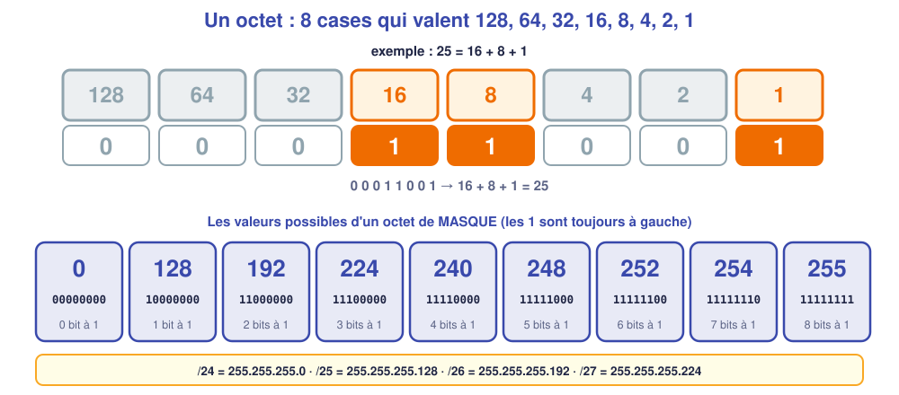
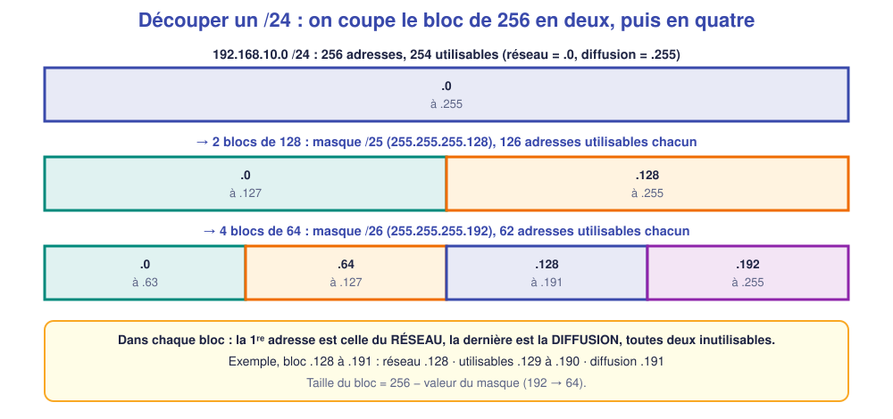
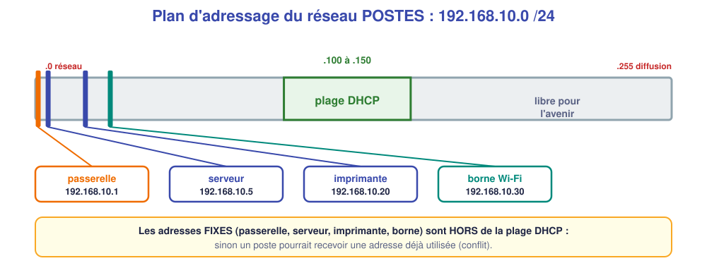

# M06 – Sous-réseaux et plan d'adressage

*Bac Pro CIEL – Terminale – Mise à niveau E31 – semaine 6 sur 15 – 4 h*

> [!NOTE]
> **Mission.** Le cabinet du Parc veut **deux réseaux** : un pour les postes, un pour le Wi-Fi des patients. Il faut les **découper**, choisir leurs **adresses** et construire le **plan d'adressage**. **Tâche d'épreuve visée :** remplir un plan d'adressage cohérent. **Compétences :** C06, C09.

> [!NOTE]
> **Semaine de rattrapage du jalon 1.** Si M01 à M05 ne sont pas acquis, reprends ici ce qui manque avant le nouveau contenu.

## ✅ À la fin de la séance, je sais…

- ☐ écrire un masque en **notation `/n`** et en **décimal** ;
- ☐ calculer **adresse du réseau, diffusion, plage utilisable** d'un sous-réseau simple ;
- ☐ découper un `/24` en **deux** ou **quatre** sous-réseaux ;
- ☐ construire un **plan d'adressage** (fixes, plage DHCP, passerelle).

## ⏱️ Déroulé (4 h)

| Durée | Activité |
|---|---|
| 0 h 00 – 0 h 30 | Reprise de M05 (ou rattrapage jalon 1) |
| 0 h 30 – 1 h 15 | Cours |
| 1 h 15 – 1 h 30 | Pause |
| 1 h 30 – 3 h 30 | TP : calculs puis vérification dans le simulateur |
| 3 h 30 – 4 h 00 | Bilan et passeport |

---

## 📖 Cours

> [!NOTE]
> **Pourquoi cette séance ?** Le cabinet du Parc veut **deux réseaux** : un pour les postes, un pour les patients. Il faut les **découper** proprement. Pour cela, il faut comprendre **comment un ordinateur lit un masque**, ce qui demande un peu de **binaire**. Rien de difficile : on le fait **pas à pas**.

### 1. Le binaire en deux minutes

Un ordinateur ne connaît que **deux valeurs** : 0 et 1. Un **bit** vaut 0 ou 1. Un **octet** est un groupe de **8 bits**. Chaque bit, **de gauche à droite**, **vaut le double** du suivant :

| Bit n° | 1 | 2 | 3 | 4 | 5 | 6 | 7 | 8 |
|---|---|---|---|---|---|---|---|---|
| **Valeur** | 128 | 64 | 32 | 16 | 8 | 4 | 2 | 1 |

Pour **lire** un octet : on **additionne les valeurs** des bits à 1. Exemple : `00011001` → 16 + 8 + 1 = **25**. C'est le dernier octet de l'adresse `192.168.10.25`.

**Pour convertir 25 en binaire** (méthode des soustractions) : 128 ? non (0). 64 ? non (0). 32 ? non (0). 16 ? oui (1), reste 9. 8 ? oui (1), reste 1. 4 ? non (0). 2 ? non (0). 1 ? oui (1). On obtient `00011001`.

### 2. Le masque en binaire

Un masque est **une suite de 1 suivie d'une suite de 0**. Les **1** désignent la **partie réseau**, les **0** la **partie équipement**. Dans un octet de masque, **les 1 sont toujours à gauche**, ce qui limite les valeurs possibles :

| Bits à 1 | 0 | 1 | 2 | 3 | 4 | 5 | 6 | 7 | 8 |
|---|---|---|---|---|---|---|---|---|---|
| **Valeur** | 0 | 128 | 192 | 224 | 240 | 248 | 252 | 254 | 255 |

(Exemple : 2 bits à 1 → 128 + 64 = **192**.) Un masque complet compte **32 bits** : la notation **`/n`** donne **le nombre de 1**.

| Notation | Masque décimal | Bits à 1 | Bits à 0 (équipement) |
|---|---|---|---|
| `/24` | 255.255.255.0 | 24 | 8 |
| `/25` | 255.255.255.128 | 25 | 7 |
| `/26` | 255.255.255.192 | 26 | 6 |
| `/27` | 255.255.255.224 | 27 | 5 |

### 3. Combien d'adresses dans un sous-réseau ?

Avec **h bits** pour la partie équipement, on peut écrire **2ʰ adresses**. Parmi elles, **2 sont réservées** : la **première** (adresse du **réseau**) et la **dernière** (adresse de **diffusion**). Il reste **2ʰ − 2 adresses utilisables**.

| Masque | h | 2ʰ | Utilisables (2ʰ − 2) |
|---|---|---|---|
| `/24` | 8 | 256 | **254** |
| `/25` | 7 | 128 | **126** |
| `/26` | 6 | 64 | **62** |
| `/27` | 5 | 32 | **30** |

### 4. Découper un réseau

**Pourquoi découper ?** Pour **séparer** des usages (postes / patients), limiter les diffusions, et appliquer des **règles différentes** à chaque groupe.

**Principe :** on **emprunte des bits** à la partie équipement pour allonger la partie réseau. Chaque bit emprunté **double le nombre de sous-réseaux** et **divise leur taille par deux**.

**Exemple détaillé : couper `192.168.10.0/24` en deux.**

1. On passe de `/24` à **`/25`** (1 bit emprunté → 2 sous-réseaux).
2. Taille d'un bloc : 256 ÷ 2 = **128 adresses**. Les blocs commencent à **0** et **128**.
3. Pour chaque bloc :

| Sous-réseau | Adresse du réseau | Première utilisable | Dernière utilisable | Diffusion |
|---|---|---|---|---|
| **A** `192.168.10.0/25` | `.0` | `.1` | `.126` | `.127` |
| **B** `192.168.10.128/25` | `.128` | `.129` | `.254` | `.255` |

> [!TIP]
> **Méthode rapide.** Taille du bloc = 256 − valeur de l'octet du masque (ex. 256 − 128 = 128). Les réseaux commencent aux multiples de cette taille. Dans chaque bloc : **premier = réseau**, **dernier = diffusion**, **entre les deux = utilisables**.

**Comment trouver le réseau d'une adresse ?** Exemple : `192.168.20.77/26`. Bloc de 64 : les réseaux sont `.0`, `.64`, `.128`, `.192`. 77 est entre 64 et 127 → le réseau est **`.64`**, la diffusion **`.127`**, les utilisables vont de **`.65`** à **`.126`**.

**Combien de bits emprunter ?** On choisit le **plus petit masque** qui offre **assez d'adresses** (n'oublie pas le « − 2 »). Pour 40 équipements, un `/26` (62) suffit ; un `/27` (30) serait trop juste.

### 5. Le plan d'adressage

Un **plan d'adressage** est un **tableau** qui décrit, pour chaque réseau : l'**adresse du réseau**, le **masque**, la **passerelle**, les **adresses fixes** et la **plage DHCP**. Il sert de **référence** à tous les techniciens qui interviendront ensuite.

**Règles de bon sens :**

- la **passerelle** prend en général la **première** (`.1`) ou la **dernière** adresse utilisable ;
- les équipements **à adresse fixe** (serveur, imprimante, borne, switch) sont **en dehors de la plage DHCP** ;
- on laisse de la **marge** pour l'avenir.

🤔 **Je comprends :** pourquoi l'adresse `192.168.10.255` ne peut-elle pas être donnée à un poste ? ______________

💡 Réponse

C'est l'adresse de **diffusion** du réseau `192.168.10.0/24` : un message envoyé à cette adresse est reçu par **tous** les équipements. Un poste ne peut pas la porter.

> [!TIP]
> **À retenir de la séance**
> - Un octet = 8 bits qui valent 128, 64, 32, 16, 8, 4, 2, 1.
> - Masque : les 1 à gauche ; `/n` = nombre de 1 ; `/24` = 255.255.255.0 ; `/25` = …128 ; `/26` = …192.
> - Utilisables = **2ʰ − 2** ; premier = **réseau**, dernier = **diffusion**.
> - Pour découper : emprunter des bits ; taille du bloc = 256 − masque.
> - Un plan d'adressage place passerelle et adresses fixes **hors** plage DHCP.

### 📖 Lexique de la séance

| Mot | Définition simple |
|---|---|
| **Bit / octet** | 0 ou 1 / groupe de 8 bits |
| **Sous-réseau** | Partie d'un réseau découpé |
| **Notation /n** | Nombre de bits de réseau dans le masque |
| **Adresse de diffusion** | Dernière adresse : « à tous » |
| **Plage DHCP** | Adresses que le serveur peut distribuer |
| **Plan d'adressage** | Tableau de référence des adresses d'un réseau |

---

## 🛠️ TP

### Partie A – Je calcule (≈ 40 min, sans calculatrice)

| Adresse / masque | Adresse du réseau | Diffusion | Première utilisable | Dernière utilisable | Nombre d'hôtes |
|---|---|---|---|---|---|
| `192.168.20.77/24` | | | | | |
| `192.168.20.77/25` | | | | | |
| `192.168.20.77/26` | | | | | |
| `172.16.5.200/27` | | | | | |

### Partie B – Je découpe (≈ 30 min)

Le cabinet du Parc veut deux réseaux dans `192.168.50.0/24` : **POSTES** (≈ 40 équipements) et **PATIENTS** (≈ 100 équipements).

| Question | Ma réponse |
|---|---|
| Quel masque pour POSTES ? Pourquoi ? | |
| Quel masque pour PATIENTS ? Pourquoi ? | |
| Est-ce possible avec **deux sous-réseaux de même taille** ? Lesquels ? | |

### Partie C – Vérification dans le simulateur (≈ 1 h)

Construis : un switch, `PC-1`, `PC-2`, `PC-3`, `PC-4`.

| Poste | Adresse | Masque |
|---|---|---|
| `PC-1` | 192.168.10.10 | 255.255.255.128 |
| `PC-2` | 192.168.10.20 | 255.255.255.128 |
| `PC-3` | 192.168.10.130 | 255.255.255.128 |
| `PC-4` | 192.168.10.140 | 255.255.255.128 |

🤔 **J'anticipe :** quels ping réussiront ? ______________

🔍 **Je vérifie** : `PC-1` → `PC-2` : ______ ; `PC-1` → `PC-3` : ______ ; `PC-3` → `PC-4` : ______

❓ **Pourquoi `PC-1` ne joint-il pas `PC-3` alors qu'ils sont sur le même switch ?** ______________

### Partie D – Mon plan d'adressage (≈ 30 min)

Dans `192.168.20.0/24`, établis le plan du réseau **PATIENTS** du cabinet : passerelle `.1`, DHCP de `.100` à `.150`, aucune adresse fixe.

| Élément | Valeur |
|---|---|
| Adresse du réseau | |
| Masque | |
| Passerelle | |
| Plage DHCP | |
| Adresse de diffusion | |

---

## 📒 Mon bilan pour le passeport d'autonomie

| Question | Ma réponse |
|---|---|
| Une **erreur de calcul** que j'ai faite et comment je l'ai repérée | |
| Ce qui m'a **surpris** | |
| Ce que je saurais **refaire seul(e)** | |
| Ma **preuve** (tableaux A à D) | |

## 🏁 Ce que je sais faire maintenant

| Je sais… | Pas encore | Avec aide | Seul(e) |
|---|---|---|---|
| convertir `/n` en masque décimal | ☐ | ☐ | ☐ |
| trouver réseau, diffusion et plage d'un sous-réseau | ☐ | ☐ | ☐ |
| découper un /24 en deux ou quatre | ☐ | ☐ | ☐ |
| compléter un plan d'adressage | ☐ | ☐ | ☐ |

---

[← M05](M05.md) [M07 →](M07.md)
