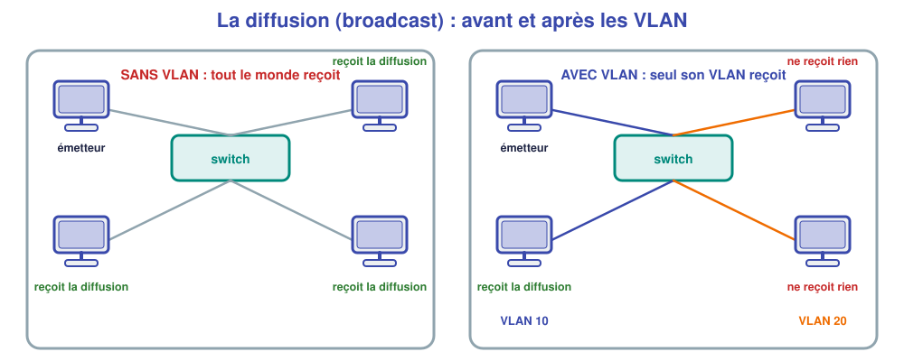
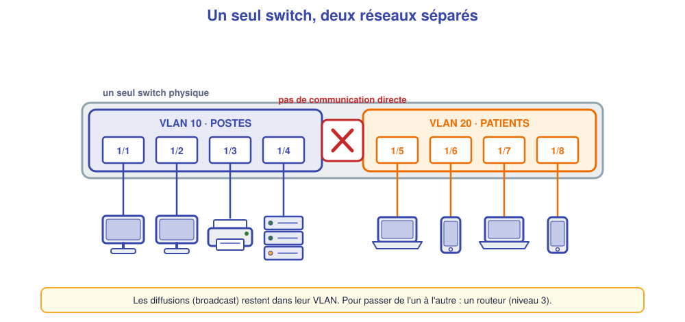

# M07 – Les VLAN (1) : séparer des réseaux sur un même switch

*Bac Pro CIEL – Terminale – Mise à niveau E31 – semaine 7 sur 15 – 4 h*

> [!NOTE]
> **Mission.** Au cabinet du Parc, les postes, l'imprimante et le serveur doivent être **séparés** des appareils des patients, **sur le même switch** : pas question d'acheter un switch par réseau. C'est le rôle des **VLAN**. **Tâche d'épreuve visée :** créer des VLAN et affecter des ports. **Compétence :** C09.

## ✅ À la fin de la séance, je sais…

- ☐ expliquer **pourquoi** et **comment** un VLAN sépare des équipements ;
- ☐ créer un VLAN, le nommer, y affecter des ports (`vlan 10 port default 1/2`) ;
- ☐ **vérifier** avec `show vlan` et `show vlan port` ;
- ☐ **démontrer** par un test que deux VLAN sont bien séparés.

## ⏱️ Déroulé (4 h)

| Durée | Activité |
|---|---|
| 0 h 00 – 0 h 30 | Reprise de M06 (sous-réseaux) |
| 0 h 30 – 1 h 15 | Cours |
| 1 h 15 – 1 h 30 | Pause |
| 1 h 30 – 3 h 30 | TP (simulateur) |
| 3 h 30 – 4 h 00 | Bilan et passeport |

---

## 📖 Cours

> [!NOTE]
> **Pourquoi cette séance ?** Dans le cabinet du Parc, le portable d'un patient ne doit **jamais** voir le serveur qui contient les dossiers de santé. On ne va pas acheter un switch par réseau : on **découpe virtuellement** un même switch en plusieurs réseaux. C'est le rôle des **VLAN**.

### 1. Le problème : tout le monde se voit

Sur un switch ordinaire, **tous les ports appartiennent au même réseau local**. Deux conséquences :

1. **Tout équipement peut parler à tout autre** : un patient branché dans la salle d'attente pourrait atteindre le serveur.
2. **Les diffusions** (*broadcast*, messages « à tous » comme ARP ou DHCP) atteignent **tous les ports**. Plus il y a d'équipements, plus il y a de bruit.



### 2. La solution : le VLAN

Un **VLAN** (*Virtual Local Area Network*, réseau local virtuel) découpe **logiquement** un switch physique en **plusieurs switchs indépendants**. Chaque port est **affecté à un VLAN** :

- deux ports du **même VLAN** communiquent normalement ;
- deux ports de **VLAN différents** **ne se voient pas**, même sur le même appareil ;
- les **diffusions** restent **dans leur VLAN**.



**Analogie :** un immeuble de bureaux (le switch) dont les **étages** (les VLAN) sont isolés par des portes à badge : les occupants d'un étage se parlent librement, mais ne vont pas à un autre sans autorisation.

| Avantage | Pourquoi |
|---|---|
| **Sécurité** | Les patients n'atteignent pas les postes ni le serveur |
| **Performance** | Moins de diffusions inutiles |
| **Souplesse** | Pour changer un équipement de réseau, on change **un réglage**, pas un câble |
| **Économie** | Un seul switch pour plusieurs réseaux |

### 3. Numéros, noms, VLAN 1

Chaque VLAN a un **numéro** (de 1 à 4094) et un **nom** libre (`POSTES`, `PATIENTS`). Le **VLAN 1** existe **d'usine** : tous les ports y sont au départ. C'est le **VLAN par défaut**. On évite de s'en servir pour les équipements de production et on crée **ses propres VLAN**.

> [!NOTE]
> **Un VLAN = un réseau IP.** On associe en général **un VLAN à un sous-réseau** (cf. M06) : VLAN 10 ↔ `192.168.10.0/24`, VLAN 20 ↔ `192.168.20.0/24`. Un VLAN sépare au niveau des **trames** (couche accès réseau) ; l'**adresse IP** doit aussi correspondre au bon réseau.

### 4. Port d'accès : un port, un VLAN

Un **port d'accès** (*access*) appartient à **un seul VLAN**. L'équipement branché (PC, imprimante, serveur) **ne sait même pas** qu'il y a des VLAN : le switch s'en occupe. Sur OmniSwitch, le VLAN d'un port d'accès est son **VLAN par défaut** (*default VLAN*).

### 5. Les commandes (OmniSwitch AOS 6)

| Pour… | Commande | Remarque |
|---|---|---|
| Créer un VLAN et le nommer | `vlan 10 name "POSTES"` | Les guillemets servent pour un nom |
| Mettre un port dans un VLAN | `vlan 10 port default 1/2` | Le port `1/2` passe en VLAN 10 |
| Mettre plusieurs ports | `vlan 10 port default 1/2-5` | Les ports 2 à 5 |
| Lister les VLAN | `show vlan` | Numéro, nom, état |
| Voir le VLAN de chaque port | `show vlan port` | Vérification clé |
| Supprimer un VLAN | `no vlan 10` | Ses ports retombent en VLAN 1 |
| Enregistrer | `write memory` puis `copy working certified` | Ne pas oublier ! |

**Comprendre la commande :** `vlan 10 port default 1/2` se lit « **dans le VLAN 10, le port 1/2 est un port par défaut** » c'est-à-dire un port d'accès non étiqueté du VLAN 10.

### 6. Vérifier et démontrer

Un VLAN se **vérifie** à deux niveaux :

1. **La configuration** : `show vlan port` doit montrer les bons ports dans les bons VLAN ;
2. **Le comportement** : un **ping** entre deux équipements du même VLAN doit réussir, un ping entre deux VLAN doit **échouer** (pas de routeur).

C'est le **test négatif** : il prouve que la séparation existe.

🤔 **Je comprends :** deux PC sont dans le même sous-réseau `192.168.10.0/24` mais dans **deux VLAN différents**. Peuvent-ils se joindre ? ______________

<details markdown="1"><summary>💡 Réponse</summary>
**Non.** Leurs ports sont séparés au niveau des trames : la requête ARP du premier n'arrive jamais au second. La bonne adresse IP **ne suffit pas** : il faut aussi **le même VLAN**.
</details>

> [!TIP]
> **À retenir de la séance**
> - Un **VLAN** découpe un switch en réseaux virtuels **isolés** ; diffusions confinées.
> - Un port **d'accès** = **un** VLAN ; le VLAN 1 est celui d'usine.
> - `vlan 10 name "POSTES"` · `vlan 10 port default 1/2` · `show vlan` · `show vlan port`.
> - Pour passer d'un VLAN à l'autre, il faudra un **routeur** (semaine 8).

### 📖 Lexique de la séance

| Mot | Définition simple |
|---|---|
| **VLAN** | Réseau local virtuel : groupe de ports isolés des autres |
| **Port d'accès** | Port appartenant à un seul VLAN |
| **VLAN par défaut** | VLAN d'un port d'accès (VLAN 1 à l'origine) |
| **Diffusion** | Message envoyé à tous les équipements d'un réseau |
| **Test négatif** | Test qui prouve qu'une chose est interdite |

---

## 🛠️ TP (simulateur)

### Partie A – Sans VLAN (≈ 15 min)

Construis : un OmniSwitch `SW-KINE`, **quatre PC** reliés aux ports `1/1`, `1/2`, `1/3`, `1/4`.

| PC | Port | Adresse | Masque |
|---|---|---|---|
| `PC-1` | `1/1` | 192.168.10.11 | 255.255.255.0 |
| `PC-2` | `1/2` | 192.168.10.12 | 255.255.255.0 |
| `PC-3` | `1/3` | 192.168.10.13 | 255.255.255.0 |
| `PC-4` | `1/4` | 192.168.10.14 | 255.255.255.0 |

Vérifie que **tous se pinguent**. Résultat : ______________

### Partie B – Créer deux VLAN (≈ 45 min)

**But :** `PC-1` et `PC-2` dans le VLAN **10 POSTES** ; `PC-3` et `PC-4` dans le VLAN **20 PATIENTS**.

🤔 **J'anticipe (avant de taper) :** après configuration, quels ping réussiront ? ______________

Sur le switch, **écris toi-même** les commandes à partir du cours, puis note-les : 

```text
______________________________________________
______________________________________________
______________________________________________
```

✅ **Points de contrôle :** `show vlan` (les deux VLAN) ; `show vlan port` (les ports dans le bon VLAN).

### Partie C – Démontrer la séparation (≈ 30 min)

| Test | Attendu | Obtenu |
|---|---|---|
| `PC-1` → `PC-2` (même VLAN) | | |
| `PC-3` → `PC-4` (même VLAN) | | |
| `PC-1` → `PC-3` (VLAN différents) | | |

❓ **Les adresses IP sont toutes dans le même `/24`. Pourquoi les VLAN séparent-ils malgré tout ?** ______________

### Partie D – Déplacer un poste (≈ 30 min)

Le praticien déplace son poste de la salle de soins 1 à la salle 2 : il faut passer `PC-3` du VLAN 20 au VLAN 10 **sans toucher au câble**. Écris la commande : ______________ Vérifie avec `show vlan port` et un ping : ______________

### Partie E – Enregistrer et expliquer (≈ 20 min)

Enregistre (`write memory`, `copy working certified`) puis **explique** à voix haute à ton voisin ce qu'est un VLAN, avec un exemple du cabinet.

---

## 📒 Mon bilan pour le passeport d'autonomie

| Question | Ma réponse |
|---|---|
| Une **décision** (numéros, noms de VLAN) et pourquoi | |
| Ce qui m'a **surpris** | |
| Ce que je saurais **refaire seul(e)**, sans fiche | |
| Ma **preuve** (`show vlan`, `show vlan port`, tests) | |

## 🏁 Ce que je sais faire maintenant

| Je sais… | Pas encore | Avec aide | Seul(e) |
|---|---|---|---|
| expliquer à quoi sert un VLAN | ☐ | ☐ | ☐ |
| créer un VLAN et y mettre des ports | ☐ | ☐ | ☐ |
| vérifier avec `show vlan` et `show vlan port` | ☐ | ☐ | ☐ |
| démontrer la séparation par des tests | ☐ | ☐ | ☐ |

---

[← M06](M06.md) [M08 →](M08.md)
