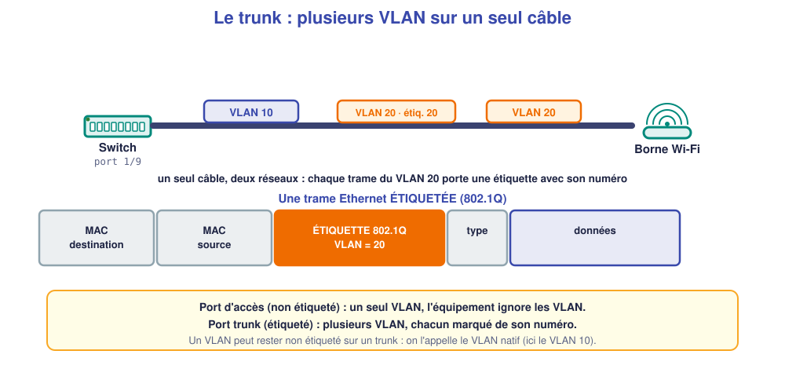
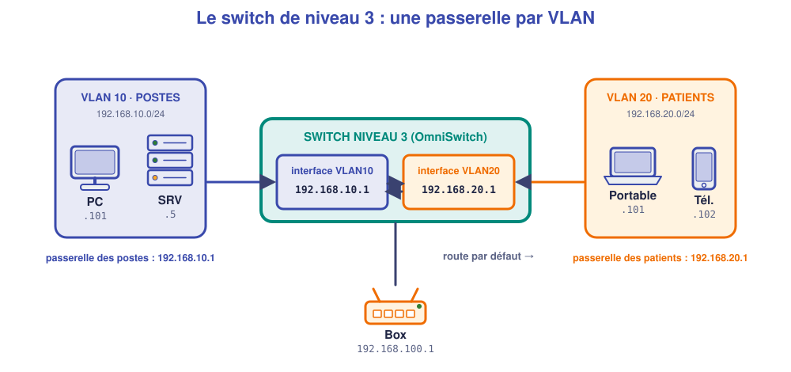
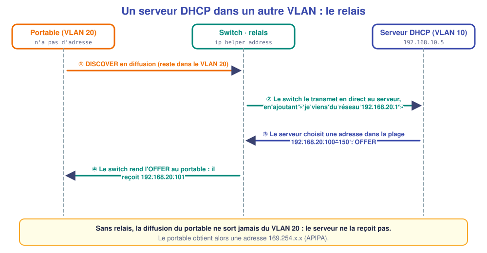

# M08 – Les VLAN (2) : trunk, passerelle et relais DHCP

*Bac Pro CIEL – Terminale – Mise à niveau E31 – semaine 8 sur 15 – 4 h*

> [!NOTE]
> **Mission.** Le switch du cabinet du Parc porte maintenant deux réseaux (postes et patients). Il faut : relier la **borne Wi-Fi** avec les **deux VLAN** sur un seul câble, donner à chaque VLAN une **passerelle**, et faire que les patients reçoivent leur **adresse** d'un serveur qui est dans un autre VLAN. **Tâche d'épreuve visée :** configurer trunk, passerelle et relais DHCP. **Compétence :** C09.

## ✅ À la fin de la séance, je sais…

- ☐ expliquer le **trunk** et l'**étiquette 802.1Q** ;
- ☐ configurer un port **étiqueté** (`vlan 20 802.1q 1/9`) ;
- ☐ créer l'**interface IP d'un VLAN** (passerelle) et la **route par défaut** ;
- ☐ configurer le **relais DHCP** et vérifier qu'un poste d'un autre VLAN reçoit une adresse.

## ⏱️ Déroulé (4 h)

| Durée | Activité |
|---|---|
| 0 h 00 – 0 h 30 | Reprise de M07 |
| 0 h 30 – 1 h 15 | Cours |
| 1 h 15 – 1 h 30 | Pause |
| 1 h 30 – 3 h 30 | TP (simulateur) |
| 3 h 30 – 4 h 00 | Bilan et passeport |

---

## 📖 Cours

> [!NOTE]
> **Pourquoi cette séance ?** Le switch du cabinet porte maintenant **deux réseaux** (postes et patients). Trois problèmes se posent : comment relier la **borne Wi-Fi** aux deux sur **un seul câble** ? Comment les réseaux **communiquent-ils quand c'est voulu** (par exemple vers Internet) ? Comment les patients reçoivent-ils leur **adresse** d'un serveur situé dans l'autre VLAN ?

### 1. Le trunk : plusieurs VLAN sur un seul câble

Un **port d'accès** ne porte qu'**un** VLAN. Mais entre un **switch** et une **borne Wi-Fi** qui diffuse deux réseaux, on ne va pas tirer deux câbles. On utilise **un seul câble** appelé **trunk** (« tronc ») qui transporte **plusieurs VLAN**. Comment le switch sait-il **à quel VLAN appartient chaque trame** ? Grâce à une **étiquette** ajoutée à la trame, définie par la norme **802.1Q**.



L'**étiquette 802.1Q** contient notamment le **numéro du VLAN**. À l'arrivée, le switch (ou la borne) lit l'étiquette et range la trame dans le **bon VLAN**, puis la retire.

| Type de port | Trames | À utiliser pour |
|---|---|---|
| **Accès** (non étiqueté) | Sans étiquette, **un seul VLAN** | PC, imprimante, serveur |
| **Trunk** (étiqueté) | Avec étiquette, **plusieurs VLAN** | Liaison switch ↔ switch, switch ↔ borne |

Un port peut **mélanger** : **un VLAN sans étiquette** (le VLAN « natif », ici le 10 qui sert à gérer la borne) et **d'autres VLAN étiquetés** (le 20 pour les patients).

**Commande OmniSwitch :** `vlan 20 802.1q 1/9` signifie « le VLAN 20 est transporté **étiqueté 802.1Q** sur le port 1/9 ». Vérification : `show 802.1q 1/9`.

### 2. Faire communiquer deux VLAN : le routage

**Deux VLAN sont deux réseaux IP différents.** Pour passer de l'un à l'autre, il faut un **routeur** (cf. M01 et M03). Le switch **de niveau 3** (comme l'OmniSwitch 6400) **intègre** cette fonction : on lui donne, pour chaque VLAN, une **interface IP**, qui sert de **passerelle** aux machines de ce VLAN.



| Pour… | Commande |
|---|---|
| Passerelle du VLAN 10 | `ip interface "VLAN10" address 192.168.10.1 mask 255.255.255.0 vlan 10` |
| Passerelle du VLAN 20 | `ip interface "VLAN20" address 192.168.20.1 mask 255.255.255.0 vlan 20` |
| Voir les interfaces | `show ip interface` |

**Comprendre la commande :** « crée une interface IP nommée `VLAN10`, d'adresse `192.168.10.1`, de masque `255.255.255.0`, **rattachée au VLAN 10** ». Cette adresse est celle que les postes du VLAN 10 doivent indiquer comme **passerelle**.

### 3. La route par défaut : sortir vers Internet

Le switch connaît ses VLAN (réseaux « directement connectés »). Pour tout le reste (Internet), il lui faut une **route par défaut** : « tout ce que je ne connais pas, envoie-le à la **box** ».

```text
ip static-route 0.0.0.0 mask 0.0.0.0 gateway 192.168.100.1
```

L'adresse `0.0.0.0` avec le masque `0.0.0.0` signifie « **n'importe quelle destination** ». La **box** doit se trouver dans un réseau que le switch connaît : on crée pour cela un **VLAN de transit** (VLAN 100, `192.168.100.0/24`) avec **deux adresses** : la box en `.1`, le switch en `.2`. Commandes de vérification : `show ip routes`.

### 4. Le relais DHCP

Rappel (M03) : un poste en DHCP envoie un **Discover en diffusion**. Or **une diffusion ne sort pas de son VLAN**. Si le **serveur DHCP** est dans un **autre VLAN**, il ne reçoit jamais la demande.

Solution : le switch devient **relais DHCP** (*DHCP relay*). Il **capte** la diffusion du VLAN 20 et la **retransmet directement** au serveur, en précisant **de quel réseau elle vient**. Le serveur peut ainsi choisir une adresse **dans la bonne plage**.



| Pour… | Commande |
|---|---|
| Indiquer le serveur DHCP à relayer | `ip helper address 192.168.10.5` |
| Voir la configuration | `show ip helper` |

Le serveur DHCP doit avoir **une plage par réseau** : `192.168.10.100–150` pour les postes, `192.168.20.100–150` pour les patients.

> [!WARNING]
> **Sans relais**, le portable du patient n'obtient **aucune adresse** et se retrouve en **169.254.x.x**. C'est un symptôme classique après la création d'un nouveau VLAN.

🤔 **Je comprends :** pourquoi la **passerelle** du VLAN 20 est-elle `192.168.20.1` et non `192.168.10.1` ? ______________

<details markdown="1"><summary>💡 Réponse</summary>
La passerelle d'un poste doit être **dans son propre réseau**. Un patient du VLAN 20 (`192.168.20.0/24`) ne peut joindre que `192.168.20.x` directement : sa passerelle est donc l'interface `192.168.20.1`.
</details>

> [!TIP]
> **À retenir de la séance**
> - **Trunk** = plusieurs VLAN sur un câble grâce à l'**étiquette 802.1Q** ; `vlan 20 802.1q 1/9`.
> - Un VLAN = un réseau IP ; le **switch niveau 3** route entre eux avec une **interface IP par VLAN** (= passerelle).
> - **Route par défaut** `0.0.0.0/0` vers la box pour sortir.
> - **Relais DHCP** (`ip helper address`) quand le serveur est dans un autre VLAN.

### 📖 Lexique de la séance

| Mot | Définition simple |
|---|---|
| **Trunk** | Lien qui porte plusieurs VLAN |
| **802.1Q** | Norme de l'étiquette de VLAN |
| **VLAN natif** | VLAN non étiqueté d'un trunk |
| **Switch niveau 3** | Switch capable de router |
| **Interface IP de VLAN** | Adresse du switch dans un VLAN, utilisée comme passerelle |
| **Route par défaut** | Chemin pour toutes les destinations inconnues |
| **Relais DHCP** | Transmet les demandes DHCP à un serveur d'un autre réseau |

---

## 🛠️ TP (simulateur)

### Le réseau à construire

| Élément | VLAN | Port du switch | Adresse |
|---|---|---|---|
| `SRV` (serveur DHCP) | 10 | `1/1` | 192.168.10.5 fixe |
| `PC-SOINS2` | 10 | `1/10` | DHCP |
| Borne Wi-Fi `AP1` | 10 non étiqueté + 20 étiqueté (trunk) | `1/9` | DHCP (plage 10) |
| `Portable patient` (Wi-Fi) | 20 | via `AP1` | DHCP (plage 20) |
| `BOX` | 100 | `1/24` | 192.168.100.1 |

Réseaux : **VLAN 10** `192.168.10.0/24` (passerelle `.1`), **VLAN 20** `192.168.20.0/24` (passerelle `.1`), **VLAN 100** `192.168.100.0/24` (box `.1`, switch `.2`).

### Partie A – Les VLAN et les ports (≈ 30 min)

Crée les VLAN 10, 20, 100 et affecte les ports `1/1`, `1/9`, `1/10` au VLAN 10 et `1/24` au VLAN 100. Ajoute le VLAN 20 **étiqueté** sur le port `1/9` :

```text
vlan 20 802.1q 1/9
```

✅ **Contrôle :** `show vlan port` et `show 802.1q 1/9`.

❓ **Que signifie `802.1q` dans cette commande ?** ______________

### Partie B – Passerelles et route (≈ 30 min)

Écris toi-même les trois commandes (`ip interface` pour les VLAN 10, 20 et 100 ; passerelle du VLAN 100 : `192.168.100.2`, puis la route par défaut vers `192.168.100.1`) :

```text
______________________________________________
______________________________________________
______________________________________________
______________________________________________
```

✅ **Contrôle :** `show ip interface`, `show ip routes`. Que signifie la ligne `0.0.0.0` dans la table ? ______________

### Partie C – Le DHCP et le relais (≈ 45 min)

1. Dans `SRV`, **active le service DHCP** et crée **deux plages** : `192.168.10.100–150` (passerelle `192.168.10.1`) et `192.168.20.100–150` (passerelle `192.168.20.1`) ; DNS : `192.168.100.1`.
2. Mets `PC-SOINS2` en DHCP : adresse obtenue : ______________
3. Connecte le `Portable patient` à `AP1` (SSID réglé en **VLAN 20**) : adresse obtenue : ______________ → **sans relais**, la plage 20 est-elle atteinte ? ______________
4. Sur le switch : `ip helper address 192.168.10.5`. Puis `ipconfig /renew` sur le portable : adresse obtenue : ______________

### Partie D – Tester (≈ 30 min)

| Test | Résultat attendu | Obtenu |
|---|---|---|
| `PC-SOINS2` → passerelle `192.168.10.1` | | |
| `Portable patient` → passerelle `192.168.20.1` | | |
| `PC-SOINS2` → `192.168.100.1` (box) | | |
| `Portable patient` → `192.168.10.5` (serveur) | | |

❓ **Le portable patient atteint le serveur : est-ce voulu ? Qu'est-il censé se passer pour un cabinet de santé ?** ______________ *(Réponse en M09.)*

### Partie E – Enregistrer et noter (≈ 15 min)

`write memory`, `copy working certified`, puis recopie la configuration (`show configuration snapshot`) dans ton dossier.

---

## 📒 Mon bilan pour le passeport d'autonomie

| Question | Ma réponse |
|---|---|
| Une **décision** (adresses, VLAN natif…) et pourquoi | |
| Ce qui m'a **surpris** | |
| Ce que je saurais **refaire seul(e)** | |
| Ma **preuve** (`show ip interface`, adresse du portable, tests) | |

## 🏁 Ce que je sais faire maintenant

| Je sais… | Pas encore | Avec aide | Seul(e) |
|---|---|---|---|
| expliquer trunk et étiquette 802.1Q | ☐ | ☐ | ☐ |
| configurer un port étiqueté | ☐ | ☐ | ☐ |
| créer les passerelles et la route par défaut | ☐ | ☐ | ☐ |
| configurer le relais DHCP | ☐ | ☐ | ☐ |

---

[← M07](M07.md) [M09 →](M09.md)
