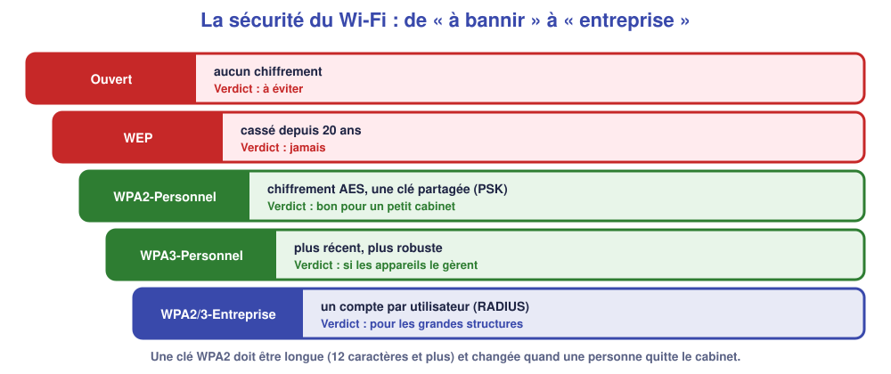
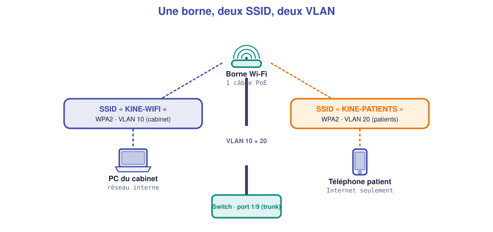
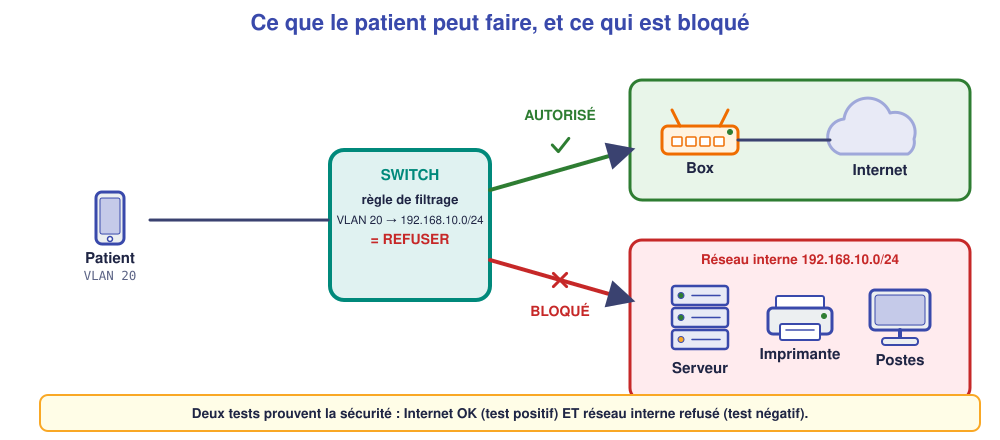

# M09 – Le Wi-Fi d'entreprise et l'isolement des patients

*Bac Pro CIEL – Terminale – Mise à niveau E31 – semaine 9 sur 15 – 4 h*

> [!NOTE]
> **Mission.** Les patients du cabinet du Parc doivent pouvoir se connecter en Wi-Fi à Internet, **sans jamais atteindre** les postes, l'imprimante ni le serveur. Tu règles la borne, tu bloques l'accès au réseau interne, et tu le **démontres**. **Tâche d'épreuve visée :** rattacher un SSID à un VLAN et isoler les patients. **Compétences :** C09, C06.

> [!IMPORTANT]
> **Jalon 2 (fin de séance).** Tu configures seul(e), avec la fiche, un switch avec VLAN, trunk, passerelles, relais DHCP et un Wi-Fi en VLAN séparé. Sinon, la semaine 10 sert de rattrapage.

## ✅ À la fin de la séance, je sais…

- ☐ régler **SSID, sécurité WPA2, clé et VLAN** d'une borne ;
- ☐ dire pourquoi on **sépare** le Wi-Fi des visiteurs du réseau interne ;
- ☐ écrire la **règle de filtrage** qui interdit le VLAN 20 vers le réseau interne ;
- ☐ **démontrer** par un test négatif que l'isolement fonctionne.

## ⏱️ Déroulé (4 h)

| Durée | Activité |
|---|---|
| 0 h 00 – 0 h 30 | Reprise de M08 |
| 0 h 30 – 1 h 15 | Cours |
| 1 h 15 – 1 h 30 | Pause |
| 1 h 30 – 3 h 30 | TP (simulateur, puis plateau réel pour l'isolement) |
| 3 h 30 – 4 h 00 | Bilan et passeport |

---

## 📖 Cours

> [!NOTE]
> **Pourquoi cette séance ?** Les patients veulent le Wi-Fi, c'est un service attendu. Mais le même cabinet **protège des données de santé** : le Wi-Fi des patients doit donner **Internet et rien d'autre**. Il faut donc **régler la borne**, la **rattacher à un VLAN** et **bloquer** l'accès au réseau interne.

### 1. Le Wi-Fi : les notions de base

Une **borne Wi-Fi** (ou point d'accès) relie sans fil les portables et téléphones au réseau câblé.

| Notion | À retenir |
|---|---|
| **SSID** | Le **nom** du réseau Wi-Fi que l'utilisateur voit dans la liste |
| **Bandes** | **2,4 GHz** : porte plus loin mais encombrée ; **5 GHz** : plus rapide, portée plus courte |
| **PoE** | Alimentation de la borne **par le câble réseau** (802.3af : jusqu'à 15 W) |
| **Contrôleur** | Dans un parc de bornes, logiciel qui les règle **toutes à la fois** |

Une borne peut diffuser **plusieurs SSID** à la fois : par exemple un pour le cabinet, un pour les patients.

### 2. La sécurité du Wi-Fi

Dans un réseau câblé, il faut **brancher un câble** pour écouter. Dans un réseau Wi-Fi, les données voyagent **dans l'air**, à portée de **tous**. Il est donc **indispensable de les chiffrer**.



| Mode | Verdict |
|---|---|
| **Ouvert** | Aucun chiffrement : tout le monde peut écouter |
| **WEP** | Cassé depuis plus de 20 ans : **à proscrire** |
| **WPA2-Personnel (PSK)** | Chiffrement **AES**, **une clé partagée** (le « mot de passe du Wi-Fi ») : **bon niveau** pour un petit cabinet |
| **WPA3** | Plus récent, plus robuste, si les appareils le gèrent |
| **WPA2/3-Entreprise** | **Un compte par utilisateur** (serveur RADIUS) : pour les grandes structures |

La **clé** doit être **longue** (12 caractères et plus, avec lettres, chiffres, symboles) et **changée** quand une personne quitte l'organisation.

### 3. Un SSID, un VLAN

On rattache **chaque SSID à un VLAN**. Ainsi, les appareils qui se connectent au SSID `KINE-PATIENTS` **atterrissent dans le VLAN 20**, ceux de `KINE-WIFI` dans le VLAN 10.



Les trames des deux réseaux voyagent sur **le même câble** jusqu'au switch : c'est un **trunk** (cf. M08). Côté borne, on indique **le VLAN de chaque SSID** ; côté switch, le port est configuré en trunk.

### 4. Pourquoi isoler ?

Un switch de niveau 3 **route entre ses VLAN** dès qu'ils ont chacun une interface IP : sans précaution, un patient en VLAN 20 pourrait **joindre le serveur** du VLAN 10. La séparation par VLAN **ne suffit donc pas** : il faut y ajouter un **filtrage**.



### 5. Écrire une règle de filtrage

Sur l'OmniSwitch, le filtrage s'écrit avec des **règles de politique** (*policy*). Une règle comprend **trois éléments** : **quel trafic** (la condition), **que faire** (l'action), et le **lien** entre les deux (la règle).

```text
policy network group NET-INTERNE 192.168.10.0 mask 255.255.255.0
policy condition COND-WIFI-VERS-INTERNE source vlan 20 destination network group NET-INTERNE
policy action ACT-BLOQUER disposition deny
policy rule REGLE-ISOLEMENT-WIFI precedence 100 condition COND-WIFI-VERS-INTERNE action ACT-BLOQUER
qos apply
```

| Ligne | Ce qu'elle fait |
|---|---|
| `policy network group` | Donne un **nom** (`NET-INTERNE`) à l'ensemble des adresses du réseau interne |
| `policy condition` | Décrit le trafic visé : **venant du VLAN 20** et **à destination du réseau interne** |
| `policy action … deny` | Définit l'action : **refuser** (*deny*) |
| `policy rule … precedence 100` | **Relie** condition et action ; la **priorité** (*precedence*) départage les règles |
| `qos apply` | **Active** les règles : sans cette ligne, rien ne change |

> [!WARNING]
> **Limite du simulateur.** Le simulateur **accepte** ces commandes mais **ne bloque rien**. Le test négatif ne se valide donc que sur le **vrai switch**. Dans le simulateur, tu apprends la règle et tu constates que, sans filtrage, le patient joint le serveur.

### 6. Les tests positifs et négatifs

Une **exigence de sécurité** s'exprime en **négatif** : « le patient **ne peut pas** joindre le serveur ». On la prouve par un **test négatif**. Il faut **toujours** les deux :

| Test | Type | Résultat attendu |
|---|---|---|
| Portable patient → Internet | **positif** | accès autorisé |
| Portable patient → serveur `192.168.10.5` | **négatif** | **aucune réponse** |
| Portable patient → imprimante `192.168.10.20` | **négatif** | **aucune réponse** |

🤔 **Je comprends :** pourquoi un test « Internet fonctionne » ne suffit-il pas à valider le Wi-Fi des patients ? ______________

<details markdown="1"><summary>💡 Réponse</summary>
Parce que l'exigence principale est **négative** : **ne pas** atteindre le réseau interne. Un Wi-Fi qui donne Internet **et** l'accès au serveur passerait le test positif tout en étant **dangereux**.
</details>

> [!TIP]
> **À retenir de la séance**
> - **SSID** = nom du Wi-Fi ; **WPA2-PSK** avec clé longue ; un **SSID par VLAN**.
> - La borne est en **trunk** vers le switch (VLAN 10 natif, VLAN 20 étiqueté).
> - Le VLAN seul **ne suffit pas** à isoler : on ajoute une **règle de filtrage** (`policy …`, **`qos apply`**).
> - On prouve la sécurité par un **test négatif**.

### 📖 Lexique de la séance

| Mot | Définition simple |
|---|---|
| **SSID** | Nom d'un réseau Wi-Fi |
| **WPA2-PSK** | Sécurité Wi-Fi par clé partagée, chiffrement AES |
| **Contrôleur Wi-Fi** | Logiciel qui règle plusieurs bornes |
| **Filtrage** | Règle qui autorise ou refuse un trafic |
| **Test négatif** | Test qui démontre qu'un accès est bloqué |

---

## 🛠️ TP

### Partie A – Régler le Wi-Fi (simulateur, ≈ 40 min)

Reprends le réseau de M08. Sur `AP1`, règle :

| Paramètre | Valeur |
|---|---|
| SSID | `KINE-PATIENTS` |
| Sécurité | WPA2-Personnel (PSK) |
| Clé | `Patients#Kine27` |
| VLAN du SSID | 20 |

Connecte le `Portable patient` : adresse obtenue : ______________ passerelle : ______________

### Partie B – Sans isolement (≈ 20 min)

Sur le portable, teste :

| Test | Résultat |
|---|---|
| `ping 192.168.20.1` (sa passerelle) | |
| `ping 192.168.100.1` / Internet | |
| `ping 192.168.10.5` (serveur) | |
| `ping 192.168.10.1` (passerelle des postes) | |

❓ **Que constates-tu pour le serveur ? Est-ce acceptable dans un cabinet de santé ?** ______________

### Partie C – Écrire la règle (≈ 30 min)

Sans regarder le cours, **explique avec tes mots** ce que fait chacune des cinq lignes de la règle et écris-les dans le simulateur. Que se passe-t-il au ping de la partie B ? ______________ **Pourquoi ?** ______________

### Partie D – Sur le matériel réel (≈ 1 h)

Reprends la configuration sur le **vrai switch** (VLAN, trunk 1/9, passerelles, relais). Applique la règle d'isolement, puis :

| Test | Attendu | Obtenu | Type |
|---|---|---|---|
| Portable patient reçoit une adresse `192.168.20.x` | | | positif |
| Portable patient → Internet | | | positif |
| Portable patient → serveur `192.168.10.5` | | | **négatif** |
| Portable patient → imprimante `192.168.10.20` | | | **négatif** |
| `PC-SOINS2` → Internet | | | positif |

**Conclusion :** ☐ conforme ☐ conforme avec réserves ☐ non conforme. Justification : ______________

### Partie E – Je vérifie ma compréhension (≈ 20 min)

| Question | Ma réponse |
|---|---|
| Pourquoi un SSID par VLAN plutôt qu'un seul pour tout ? | |
| Que se passerait-il si l'on oubliait `qos apply` ? | |
| Pourquoi la clé WPA2 doit-elle être longue ? | |

---

## 📒 Mon bilan pour le passeport d'autonomie

| Question | Ma réponse |
|---|---|
| Une **décision** (clé, SSID, VLAN) et pourquoi | |
| Ce qui m'a **surpris** (ex. : le patient qui joint le serveur) | |
| Ce que je saurais **refaire seul(e)** | |
| Ma **preuve** (tableau de tests, positifs et négatifs) | |

## 🏁 Ce que je sais faire maintenant

| Je sais… | Pas encore | Avec aide | Seul(e) |
|---|---|---|---|
| régler SSID, WPA2, clé, VLAN d'une borne | ☐ | ☐ | ☐ |
| expliquer pourquoi séparer le Wi-Fi des patients | ☐ | ☐ | ☐ |
| écrire une règle d'isolement | ☐ | ☐ | ☐ |
| démontrer par un test négatif | ☐ | ☐ | ☐ |

---

[← M08](M08.md) [M10 →](M10.md)
