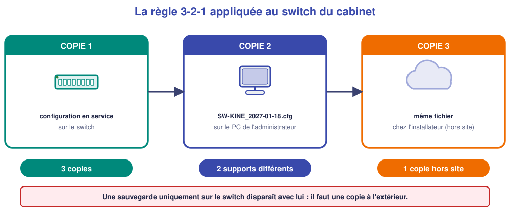
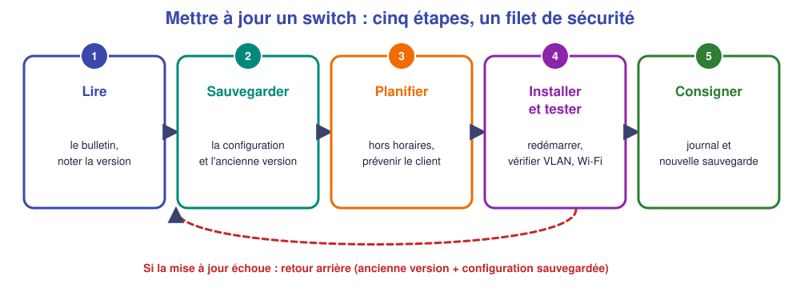

# M10 – Sauvegarder, mettre à jour, tenir le journal d'intervention

*Bac Pro CIEL – Terminale – Mise à niveau E31 – semaine 10 sur 15 – 4 h*

> [!NOTE]
> **Mission.** Le switch du cabinet du Parc est configuré. S'il tombe en panne demain, **qui sait le remettre comme avant** ? Tu sauvegardes, tu prépares une **mise à jour de sécurité** et tu laisses une **trace écrite** de ton intervention. **Tâche d'épreuve visée :** sauvegarder, planifier une mise à jour, tenir le journal. **Compétence :** C10.

> [!NOTE]
> **Semaine de rattrapage du jalon 2.** Si M07 à M09 ne sont pas acquis, reprends d'abord ce qui manque : la configuration d'un switch avec VLAN, trunk et relais, seul(e) avec la fiche.

## ✅ À la fin de la séance, je sais…

- ☐ créer un **fichier de sauvegarde** nommé et le copier **hors** du switch ;
- ☐ expliquer la règle **3-2-1** ;
- ☐ lire un **bulletin de sécurité** et écrire un **plan de mise à jour** avec retour arrière ;
- ☐ renseigner un **journal d'intervention**.

## ⏱️ Déroulé (4 h)

| Durée | Activité |
|---|---|
| 0 h 00 – 0 h 30 | Reprise de M09 (ou rattrapage jalon 2) |
| 0 h 30 – 1 h 15 | Cours |
| 1 h 15 – 1 h 30 | Pause |
| 1 h 30 – 3 h 30 | TP |
| 3 h 30 – 4 h 00 | Bilan et passeport |

---

## 📖 Cours

> [!NOTE]
> **Pourquoi cette séance ?** Imagine que le switch du cabinet tombe en panne demain, ou qu'une manipulation efface sa configuration. **Qui sait le remettre comme avant ?** Sans sauvegarde, il faut tout refaire de mémoire. Un technicien professionnel **sauvegarde**, **met à jour** et **laisse une trace**.

### 1. Pourquoi sauvegarder la configuration

La **configuration** d'un switch (VLAN, adresses, règles, mot de passe) représente **des heures de travail** : elle est **unique** à chaque client. Elle peut être perdue par : une **panne matérielle**, une **erreur de manipulation**, une **mise à jour ratée**, un **remplacement**. Avec une sauvegarde, on remet un équipement neuf **comme l'ancien en quelques minutes**.

### 2. La règle 3-2-1

C'est la règle de base de la sauvegarde, applicable à **tout type de données** :

| Chiffre | Règle | Pour le switch du cabinet |
|---|---|---|
| **3** | **Trois copies** des données | La configuration en service + 2 sauvegardes |
| **2** | Sur **deux supports différents** | Le switch + le PC de l'administrateur |
| **1** | Dont **une copie hors site** | Chez l'installateur (ou un stockage externe) |

> [!WARNING]
> **Une sauvegarde qui reste dans l'équipement qu'elle protège ne protège rien** : si le switch brûle, elle brûle avec lui. La copie doit **sortir** de l'équipement.

### 3. Sauvegarder un OmniSwitch

| Action | Commande | Remarque |
|---|---|---|
| Enregistrer la configuration en cours | `write memory` | Dans `working` |
| La certifier | `copy working certified` | Relue au démarrage |
| Créer un **fichier de configuration** | `configuration snapshot all SW-KINE_2027-01-18.cfg` | Fichier **texte lisible** |
| Lister les fichiers | `ls` | Pour vérifier que le fichier existe |

Le fichier `.cfg` est un simple **texte** : on peut l'ouvrir pour **le lire** et le contrôler. Pour le **sortir du switch**, on le **télécharge** depuis un PC par **FTP** ou **SFTP** (version chiffrée), avec le compte `admin`.

**Nommer le fichier** : *équipement + date*, par exemple `SW-KINE_2027-01-18.cfg`. Quand on a plusieurs sauvegardes, on sait **laquelle est la bonne**.

> [!TIP]
> **Une sauvegarde jamais relue n'est pas une sauvegarde.** Ouvre le fichier et vérifie qu'on y retrouve **tes réglages** (nom du switch, VLAN, adresses). Idéalement, on teste aussi la **restauration** sur un équipement de test.

### 4. Pourquoi mettre à jour

Le **logiciel** d'un équipement (appelé **firmware** ou *microcode*) contient des **erreurs** que le constructeur corrige. Certaines sont des **failles de sécurité** : n'importe quel attaquant qui les connaît peut s'en servir. Un équipement **jamais mis à jour** reste vulnérable, parfois **pendant des années**.

Le constructeur publie un **bulletin de sécurité** (ou une note de version) qui décrit :

- **la faille** et sa **gravité** ;
- **la version qui la corrige** ;
- le **délai** recommandé pour installer ;
- les **précautions** (sauvegarde, redémarrage…).

### 5. Le plan de mise à jour

Une mise à jour **interrompt le réseau** (le switch redémarre, environ 5 minutes) et **peut échouer**. On ne la fait donc **jamais à l'improviste**. On suit un **plan** :

| # | Étape | Pourquoi |
|---|---|---|
| 1 | **Lire** le bulletin ; noter la **version actuelle** (`show microcode`) | Savoir d'où l'on part et où l'on va |
| 2 | **Sauvegarder** la configuration et **conserver l'ancienne version** | Pouvoir **revenir en arrière** |
| 3 | **Planifier** une fenêtre **hors horaires** et **prévenir** le client | Le réseau sera coupé quelques minutes |
| 4 | **Installer**, **redémarrer**, puis **tester** (VLAN, Wi-Fi, Internet) | Vérifier que tout fonctionne comme avant |
| 5 | **Consigner** dans le journal | Laisser une trace pour la suite |

**Le retour arrière** (ou *rollback*) est le **filet de sécurité** : si la mise à jour échoue ou casse quelque chose, on redémarre sur l'**ancienne version** conservée et on **restaure la configuration** sauvegardée. Un plan sans retour arrière est un plan **incomplet**.

### 6. Le journal d'intervention

Un **journal** est le **carnet de bord** du réseau. À chaque intervention, on note :

| Rubrique | Exemple |
|---|---|
| **Date** | 18/01/2027 |
| **Équipement** | SW-KINE |
| **Modification** | Création du VLAN 20 et du relais DHCP |
| **Pourquoi** | Wi-Fi des patients demandé par Mme Duprat |
| **Par qui** | A. Dupont |
| **Sauvegarde** | SW-KINE_2027-01-18.cfg |

Quand une panne survient trois mois plus tard, le journal permet de savoir **ce qui a changé et quand**. C'est aussi une **preuve** de ton travail.

🤔 **Je comprends :** pourquoi sauvegarde-t-on **avant** une mise à jour et non après ? ______________

💡 Réponse

Parce que la mise à jour **peut échouer** et abîmer la configuration. La sauvegarde faite **avant** permet de **revenir à l'état précédent**. Faite après, elle ne protège de rien.

> [!TIP]
> **À retenir de la séance**
> - **3-2-1** : 3 copies, 2 supports, 1 hors site. Une sauvegarde **dans** l'équipement ne suffit pas.
> - `configuration snapshot all <nom>.cfg`, nommer **équipement_date**, **relire** le fichier.
> - Une MAJ corrige des **failles** ; plan en 5 étapes avec **retour arrière**.
> - Le **journal** garde la trace : date, équipement, modification, pourquoi, qui, sauvegarde.

### 📖 Lexique de la séance

| Mot | Définition simple |
|---|---|
| **Sauvegarde** | Copie des données permettant de les retrouver |
| **3-2-1** | 3 copies, 2 supports, 1 hors site |
| **Firmware** | Logiciel interne d'un équipement |
| **Bulletin de sécurité** | Annonce d'une faille et de sa correction |
| **Retour arrière (rollback)** | Retour à la version précédente |
| **Journal d'intervention** | Carnet de bord des modifications |

---

## 🛠️ TP

### Partie A – Sauvegarder (simulateur, ≈ 40 min)

Repars de ta configuration de M08. 

1. Enregistre : `write memory`, `copy working certified`.
2. Crée un fichier : `configuration snapshot all SW-KINE_<date>.cfg`, puis `ls`.
3. Affiche la configuration (`show configuration snapshot`) et **retrouve** : le nom du switch ______ ; un VLAN ______ ; une adresse IP ______ .

❓ **Où sont stockés ces fichiers ? Cela suffit-il pour la règle 3-2-1 ?** ______________

### Partie B – Sauvegarder sur le plateau réel (≈ 40 min)

1. Crée la sauvegarde sur le **vrai switch**.
2. **Récupère** le fichier sur le PC par FTP/SFTP (dossier `Sauvegardes`).
3. **Ouvre-le** et vérifie son contenu.

| Contrôle | Résultat |
|---|---|
| Nom du fichier | |
| Copie hors du switch (où ?) | |
| Contenu vérifié (comment ?) | |

### Partie C – Plan de mise à jour (≈ 40 min)

**Bulletin du constructeur (fictif, à but pédagogique) :** *« La version 6.4.6.R02 corrige une faille permettant un accès non autorisé à l'interface d'administration web. Installer dans un délai de 30 jours. Sauvegarder la configuration avant. Prévoir un redémarrage du switch (environ 5 minutes, réseau indisponible). Contrôler le fonctionnement après la mise à jour. Conserver l'ancienne version pour pouvoir revenir en arrière. »*

| Étape | Ce que je fais | Pourquoi ou quand |
|---|---|---|
| 1 | | |
| 2 | | |
| 3 | | |
| 4 | | |
| 5 | | |

**Si la mise à jour échoue, comment revenir en arrière ?** ______________

### Partie D – Le journal (≈ 20 min)

Renseigne le journal pour **ton intervention du jour** (une ligne par modification importante).

| Date | Équipement | Modification | Pourquoi | Par qui | Sauvegarde (fichier) |
|---|---|---|---|---|---|
| | | | | | |
| | | | | | |

---

## 📒 Mon bilan pour le passeport d'autonomie

| Question | Ma réponse |
|---|---|
| Une **décision** (nom du fichier, lieu de la copie) et pourquoi | |
| Ce qui m'a **surpris** | |
| Ce que je saurais **refaire seul(e)** | |
| Ma **preuve** (fichier relu, plan de mise à jour, journal) | |

## 🏁 Ce que je sais faire maintenant

| Je sais… | Pas encore | Avec aide | Seul(e) |
|---|---|---|---|
| sauvegarder et nommer un fichier de configuration | ☐ | ☐ | ☐ |
| expliquer la règle 3-2-1 | ☐ | ☐ | ☐ |
| écrire un plan de mise à jour avec retour arrière | ☐ | ☐ | ☐ |
| tenir un journal d'intervention | ☐ | ☐ | ☐ |

---

[← M09](M09.md) [M11 →](M11.md)
