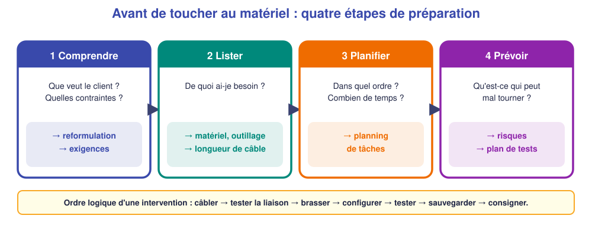
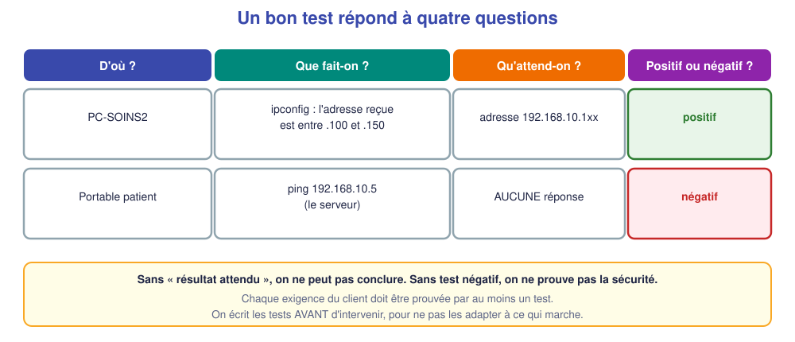

# M11 – Lire un dossier, préparer l'intervention, valider par la recette

*Bac Pro CIEL – Terminale – Mise à niveau E31 – semaine 11 sur 15 – 4 h*

> [!NOTE]
> **Mission.** À l'examen, tu reçois un **dossier technique** : tu dois le **lire**, **préparer** ton intervention **avant** de toucher au matériel, puis **prouver** que l'installation est conforme. **Tâche d'épreuve visée :** lire un dossier, planifier, écrire un plan de tests et un compte rendu. **Compétence :** C06.

## ✅ À la fin de la séance, je sais…

- ☐ **reformuler** la demande du client et repérer **exigences et contraintes** ;
- ☐ établir **matériel, planning, risques** ;
- ☐ écrire un **plan de tests** (positifs et négatifs) **avant** d'intervenir ;
- ☐ rédiger un **compte rendu** compréhensible par le client.

## ⏱️ Déroulé (4 h)

| Durée | Activité |
|---|---|
| 0 h 00 – 0 h 30 | Reprise de M10 |
| 0 h 30 – 1 h 15 | Cours |
| 1 h 15 – 1 h 30 | Pause |
| 1 h 30 – 3 h 30 | TP : un dossier à préparer (papier) |
| 3 h 30 – 4 h 00 | Bilan et passeport |

---

## 📖 Cours

> [!NOTE]
> **Pourquoi cette séance ?** À l'examen, tu reçois un **dossier technique** d'une dizaine de pages. Le candidat qui **lit bien** et **prépare avant d'agir** gagne du temps et évite les erreurs. Un technicien qui se jette sur le matériel sans comprendre la demande se perd.

### 1. Les documents d'un dossier

Un dossier d'intervention est rédigé en **trois blocs** :

| Document | Contenu | Ce que tu en fais |
|---|---|---|
| **Fiche client et exigences** | Qui est le client, ce qu'il demande, ses contraintes | Tu la **lis d'abord** et la **reformules** |
| **Dossier technique (DT)** | Plans, schémas, adresses, inventaire, notices | Tu y **cherches** les informations |
| **Dossier réponse (DR)** | Tableaux et questions | Tu le **remplis** et tu le **remets** |

> [!TIP]
> **Astuce de lecture.** Lis **toute** la fiche client avant de chercher dans le DT. Surligne **les chiffres** (adresses, numéros de VLAN, ports) et **les contraintes** (« sans couper le réseau », « avant 8 h »).

### 2. Exigences et contraintes

- Une **exigence** dit **ce que le client veut obtenir** : « les patients ont un Wi-Fi sécurisé », « la nouvelle salle a une prise réseau ».
- Une **contrainte** dit **comment ou quand** : « sans interrompre les postes en service », « hors horaires d'ouverture ».

À l'épreuve, chaque exigence doit être **prouvée** par au moins un **test**. Les **numéroter** (E1, E2…) aide à ne rien oublier.

### 3. Préparer avant d'intervenir

Un technicien prépare **quatre choses** avant de toucher au matériel :

| Étape | Produit | Détail |
|---|---|---|
| **1. Comprendre** | Reformulation + exigences | « Le client ouvre une deuxième salle de soins : prise, Wi-Fi patients séparé, sauvegarde » |
| **2. Lister** | Matériel et outillage | Câble, keystone, cordon, testeur, outil de pose, étiquettes… et la **longueur de câble** |
| **3. Planifier** | Planning | Tâches dans l'ordre, avec une **durée** chacune |
| **4. Prévoir** | Risques et plan de tests | Qu'est-ce qui peut mal tourner ? Comment saura-t-on que c'est réussi ? |

**L'ordre logique d'une intervention réseau :** câbler la prise → **tester la liaison** → brasser et étiqueter → configurer le switch → régler la borne → **tester l'ensemble** → sauvegarder → consigner. On **teste le bas avant de configurer le haut** : inutile de configurer un port si le câble est défectueux.

**Les risques** : pour chaque tâche, on se demande quel **danger** elle présente (coupure, chute, électrique, interruption de service, données) et quelle **mesure** l'évite (cf. M01).

### 4. Le plan de tests

Le **plan de tests** s'écrit **avant** l'intervention, à partir des **exigences**. Chaque test doit préciser **quatre choses** :

| Question | Exemple |
|---|---|
| **D'où ?** | depuis `PC-SOINS2` |
| **Que fait-on ?** | `ipconfig`, `ping 192.168.10.1` |
| **Qu'attend-on ?** | adresse entre `.100` et `.150`, réponse au ping |
| **Positif ou négatif ?** | positif (« ça marche ») ou négatif (« c'est interdit ») |

Pourquoi **avant** ? Pour **ne pas adapter les tests à ce qui marche**. Écrits après coup, on est tenté de ne tester que ce qu'on sait réussi.

### 5. La recette et le compte rendu

La **recette** est le moment où l'on **déroule les tests** et où l'on **conclut** devant le client :

- **Conforme** : toutes les exigences sont prouvées ;
- **Conforme avec réserves** : un point reste à traiter (on dit lequel) ;
- **Non conforme** : on indique **l'écart** et ce qu'il **reste à faire**.

Le **compte rendu** s'adresse au **client**, pas à un technicien. On évite le jargon (« j'ai créé un VLAN ») au profit de phrases claires (« j'ai séparé le Wi-Fi des patients de votre réseau interne »). Il contient **ce qui a été fait**, **l'état final** et des **recommandations** (mise à jour, sauvegardes).

🤔 **Je comprends :** différence entre une **exigence** et une **contrainte** ? ______________

💡 Réponse

**Exigence** : ce que le client veut obtenir (le Wi-Fi des patients sécurisé). **Contrainte** : la condition à respecter pendant l'intervention (ne pas couper les postes en service).

> [!TIP]
> **À retenir de la séance**
> - Lire **toute** la fiche client, repérer **exigences** (à prouver) et **contraintes** (à respecter).
> - Préparer : **comprendre → lister → planifier → prévoir** (risques, tests).
> - **Tester le bas avant le haut.**
> - **Plan de tests écrit avant** : d'où, quoi, attendu, positif/négatif ; avec **au moins un test négatif**.
> - Conclure : conforme / avec réserves / non conforme ; compte rendu **clair pour le client**.

### 📖 Lexique de la séance

| Mot | Définition simple |
|---|---|
| **Exigence** | Ce que le client veut obtenir |
| **Contrainte** | Condition à respecter pendant l'intervention |
| **Dossier technique** | Informations de référence du chantier |
| **Recette** | Validation de l'installation par des tests |
| **Test positif / négatif** | Prouve que ça marche / que c'est interdit |
| **Compte rendu** | Document clair remis au client en fin d'intervention |

---

## 🛠️ TP – Dossier « Boulangerie Moreau » (papier)

### Le dossier

**Fiche client.** La boulangerie Moreau (1 gérante, 1 vendeuse, 1 caisse) fait installer un **deuxième poste de caisse** et un **Wi-Fi pour les clients**. Le réseau actuel fonctionne ; il **ne doit pas être interrompu** pendant les heures d'ouverture (6 h – 19 h). Un **serveur** (192.168.1.5) héberge la comptabilité : les clients ne doivent **pas** y accéder.

**Exigences :** E1 la nouvelle caisse a une prise RJ45 reliée au switch et reçoit son adresse **automatiquement** ; E2 les clients ont un Wi-Fi `MOREAU-CLIENTS` (WPA2) avec **Internet seulement** ; E3 les clients **n'atteignent pas** le serveur ni les caisses ; E4 la configuration du switch est **sauvegardée** ; E5 prise et cordon sont **étiquetés**.

**Plan simplifié :** la baie est dans l'arrière-boutique ; la nouvelle caisse est à **9 m** à l'horizontale (le long des murs) de la baie ; le plafond est à 2,60 m, la prise à 0,30 m du sol. Le switch est à 24 ports Gigabit.

### Partie A – Reformuler et lister (≈ 40 min)

| Question | Réponse |
|---|---|
| Que demande le client ? (une phrase) | |
| Contraintes ? | |
| Réseaux (VLAN) à prévoir et à quoi sert chacun ? | |
| Matériel et outillage à prévoir ? | |
| Longueur de câble à commander (montée + descente + marge 10 %) ? | |

### Partie B – Planning et risques (≈ 40 min)

1. Numérote l'**ordre logique** : ☐ configurer le switch ☐ câbler la prise et le panneau ☐ sauvegarder ☐ tester la liaison ☐ régler la borne Wi-Fi ☐ brasser et étiqueter ☐ dérouler les tests ☐ compléter le journal.
2. Quand intervenir, vu la contrainte du client ? ______________
3. Trois risques et leur prévention :

| Risque | Prévention |
|---|---|
| | |
| | |
| | |

### Partie C – Plan de tests (≈ 40 min)

Écris **au moins six tests**, dont **deux négatifs**.

| N° | Test | Depuis | Résultat attendu | Positif / négatif | Exigence |
|---|---|---|---|---|---|
| T1 | | | | | |
| T2 | | | | | |
| T3 | | | | | |
| T4 | | | | | |
| T5 | | | | | |
| T6 | | | | | |

### Partie D – Compte rendu (≈ 30 min)

Rédige, comme si tu l'envoyais à la gérante : **ce qui a été fait** (3 lignes), **l'état final**, **une recommandation** : 

______________________________________________

---

## 📒 Mon bilan pour le passeport d'autonomie

| Question | Ma réponse |
|---|---|
| Une **décision** de planning et pourquoi | |
| Ce qui m'a **surpris** dans le dossier | |
| Ce que je saurais **refaire seul(e)** | |
| Ma **preuve** (plan de tests, compte rendu) | |

## 🏁 Ce que je sais faire maintenant

| Je sais… | Pas encore | Avec aide | Seul(e) |
|---|---|---|---|
| reformuler une demande et lister les exigences | ☐ | ☐ | ☐ |
| établir matériel, planning, risques | ☐ | ☐ | ☐ |
| écrire un plan de tests avec tests négatifs | ☐ | ☐ | ☐ |
| rédiger un compte rendu clair pour le client | ☐ | ☐ | ☐ |

---

[← M10](M10.md) [M12 →](M12.md)
