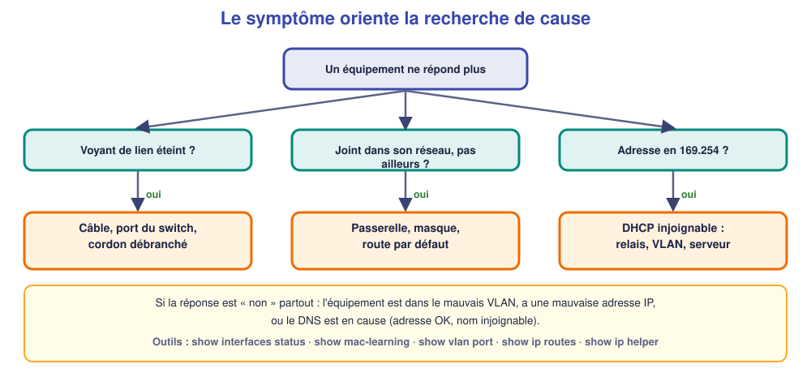

# M12 – Dépanner de bout en bout et rendre compte

*Bac Pro CIEL – Terminale – Mise à niveau E31 – semaine 12 sur 15 – 4 h*

> [!NOTE]
> **Mission.** Le client appelle : « **L'imprimante ne répond plus.** » Tu n'as pas de piste, seulement un symptôme. Tu **trouves la cause**, tu **corriges**, tu **vérifies**, tu **expliques**. **Tâche d'épreuve visée :** traiter une panne injectée. **Compétence :** C10.

> [!IMPORTANT]
> **Jalon 3 (fin de séance).** Tu appliques la **méthode** sans qu'on te la rappelle et tu **n'essaies pas au hasard**. Sinon, la semaine 13 sert de rattrapage.

## ✅ À la fin de la séance, je sais…

- ☐ constater et **délimiter** sans modifier la configuration au hasard ;
- ☐ poser des **hypothèses ordonnées** et les **tester** avec `show` et `ping` ;
- ☐ **corriger**, **vérifier**, **prévenir** et **consigner** ;
- ☐ rendre compte au client en langage clair.

## ⏱️ Déroulé (4 h)

| Durée | Activité |
|---|---|
| 0 h 00 – 0 h 30 | Reprise de M11 |
| 0 h 30 – 1 h 15 | Cours : catalogue de pannes |
| 1 h 15 – 1 h 30 | Pause |
| 1 h 30 – 3 h 30 | TP : trois pannes (simulateur, puis plateau réel) |
| 3 h 30 – 4 h 00 | Bilan et passeport |

---

## 📖 Cours

> [!NOTE]
> **Pourquoi cette séance ?** Le client appelle : « **L'imprimante ne répond plus.** » Tu n'as qu'un symptôme. Un technicien qui essaie au hasard perd du temps et peut aggraver la situation. Un technicien **méthodique** trouve la cause, **prouve** qu'il l'a trouvée, **corrige** et **empêche le retour** de la panne.

### 1. La méthode en huit étapes

Tu connais déjà la méthode en six étapes (M04). On y ajoute deux étapes **qui distinguent un bon technicien** : **prévenir** et **consigner**.

| # | Étape | Ce que tu fais concrètement |
|---|---|---|
| 1 | **Constater** | Note le symptôme **exact** : message d'erreur, qui est touché, depuis quand, ce qui a changé récemment |
| 2 | **Délimiter** | Cherche ce qui **fonctionne encore** pour réduire la zone de recherche |
| 3 | **Hypothèses** | Liste les causes possibles, **de la plus simple à la plus rare** |
| 4 | **Tester** | Un test **par hypothèse**, en sachant **ce que tu attends** |
| 5 | **Corriger** | **Une seule modification** à la fois |
| 6 | **Vérifier** | Prouve que le symptôme a **disparu** et que **rien d'autre** n'est cassé |
| 7 | **Prévenir** | Évite le retour : étiquetage, plan à jour, sauvegarde, consigne au client |
| 8 | **Consigner** | Écris ce qui s'est passé (fiche, journal, compte rendu) |

> [!WARNING]
> **Une seule modification à la fois.** Si tu changes trois choses et que « ça remarche », tu ne sais pas **laquelle** était la cause, et tu ne peux pas garantir que ça ne reviendra pas.

### 2. Les causes fréquentes, par symptôme

| Symptôme | Causes à examiner, dans l'ordre | Test |
|---|---|---|
| **Un seul équipement** injoignable | Câble, port du switch, **mauvais port**, **mauvais VLAN**, adresse IP | Voyant, `show interfaces status`, `show mac-learning` |
| Joignable **dans son réseau**, pas ailleurs | **Passerelle**, masque, route | `ping` de la passerelle, `show ip routes` |
| **Pas d'adresse automatique** (169.254) | **DHCP injoignable**, **relais**, mauvais VLAN | `show ip helper`, `show vlan port` |
| Adresse OK, **nom** injoignable | **DNS** | `nslookup`, ping d'une adresse IP |
| **Wi-Fi** sans adresse | **Trunk**, VLAN du SSID, relais DHCP | `show 802.1q`, `show vlan port` |
| **Plus d'Internet** pour tous | Route par défaut, box | `show ip routes`, ping de la box |

### 3. Les commandes du switch qui parlent

| Pour savoir… | Commande | Ce qu'on lit |
|---|---|---|
| Quels ports sont **up** | `show interfaces status` | Un port **down** = rien de branché ou câble coupé |
| **Où** est un équipement | `show mac-learning` | **Port** et **VLAN** où le switch voit la MAC |
| **Dans quel VLAN** est chaque port | `show vlan port` | Un équipement dans le **mauvais VLAN** apparaît ici |
| Les **interfaces IP** | `show ip interface` | Les passerelles de chaque VLAN |
| Les **routes** | `show ip routes` | La route par défaut y est-elle ? |
| Le **relais DHCP** | `show ip helper` | Le serveur est-il indiqué ? |

### 4. Un exemple traité de bout en bout

*Appel du client :* « L'imprimante ne répond plus. »

1. **Constater :** `ping 192.168.10.20` échoue depuis tous les postes. L'imprimante est allumée.
2. **Délimiter :** les postes joignent le serveur et Internet. **Seule** l'imprimante est muette.
3. **Hypothèses :** a) cordon débranché ou déplacé ; b) port du switch en défaut ; c) imprimante dans le mauvais VLAN ; d) adresse IP modifiée.
4. **Tester :** `show mac-learning` montre la MAC de l'imprimante sur le **port 1/20, VLAN 1**, alors qu'elle devrait être sur `1/3`, VLAN 10. → hypothèse (c) confirmée : le cordon a été rebranché sur un **mauvais port**.
5. **Corriger :** remettre le cordon sur `1/3`. **Une seule** action.
6. **Vérifier :** `ping` OK ; impression de test OK ; les autres postes toujours OK.
7. **Prévenir :** étiqueter le port `1/3` « Imprimante » sur le panneau ; mettre le plan à jour.
8. **Consigner :** fiche de dépannage + ligne dans le journal.

🤔 **Je comprends :** pourquoi `show mac-learning` est-il un outil si précieux ? ______________

💡 Réponse

Il montre **où le switch voit réellement** chaque équipement (port **et** VLAN). En le comparant au plan, tout **écart** désigne directement la panne.

### 5. Rendre compte au client

Une fois la panne réglée, tu **expliques** en langage simple : ce qui s'est passé (« le câble de l'imprimante avait été rebranché sur un autre port »), ce que tu as fait, et **comment éviter que cela se reproduise**. Un dépannage **sans explication** laisse le client dans l'inquiétude.

> [!TIP]
> **À retenir de la séance**
> - 8 étapes : constater, délimiter, hypothèses, tester, corriger, vérifier, **prévenir**, **consigner**.
> - **Une seule modification à la fois** ; ne corrige pas **sans cause prouvée**.
> - `show interfaces status` · `show mac-learning` · `show vlan port` · `show ip routes` · `show ip helper`.
> - Terminer par une **explication claire** au client.

### 📖 Lexique de la séance

| Mot | Définition simple |
|---|---|
| **Symptôme** | Ce qu'on observe (l'imprimante ne répond plus) |
| **Cause** | La vraie raison du symptôme (cordon sur le mauvais port) |
| **Hypothèse** | Cause supposée, à vérifier par un test |
| **Prévention** | Action pour éviter le retour de la panne |
| **Fiche de dépannage** | Trace écrite de la démarche |

---

## 🛠️ TP

### Partie A – Trois pannes dans le simulateur (≈ 1 h 15)

Reprends le réseau de M08. Ton binôme **injecte successivement** les trois pannes (à ton insu) ; à chaque fois, tu remplis la fiche **avant** de corriger.

| Panne à injecter |
|---|
| 1. Un PC déplacé sur un **autre port** (VLAN différent) |
| 2. La **passerelle** d'un VLAN supprimée (`no ip interface "VLAN20"`) |
| 3. Le **relais DHCP** supprimé (`no ip helper address`) |

**Fiche de dépannage** (une par panne) :

| Étape | Ma réponse |
|---|---|
| 1. **Constater** (symptôme exact) | |
| 2. **Délimiter** (ce qui marche encore) | |
| 3. **Hypothèses** (au moins 2, ordonnées) | |
| 4. **Tests** réalisés et résultats | |
| 5. **Cause** | |
| 6. **Correction** (une seule action) | |
| 7. **Vérification** | |
| 8. **Prévention** | |

### Partie B – Une panne sur le matériel réel (≈ 1 h)

Sur le **plateau**, l'enseignant introduit **une panne physique** (par exemple un cordon déplacé). Tu reçois uniquement l'appel du client : « L'imprimante ne répond plus. » Remplis une fiche complète. Temps limité : **30 minutes**.

### Partie C – Rendre compte (≈ 30 min)

Rédige **un message au client** (cinq lignes, sans jargon) : ce qui s'est passé, ce que tu as fait, ce que tu recommandes.

______________________________________________

### Partie D – Pour t'évaluer (≈ 15 min)

| Critère | Oui | Non |
|---|---|---|
| J'ai **délimité** avant de toucher à quoi que ce soit | ☐ | ☐ |
| J'ai testé **une hypothèse à la fois** | ☐ | ☐ |
| Ma **vérification** prouve que la panne est réglée | ☐ | ☐ |
| J'ai écrit une **prévention** | ☐ | ☐ |

---

## 📒 Mon bilan pour le passeport d'autonomie

| Question | Ma réponse |
|---|---|
| Un moment où j'ai **résisté à l'envie de corriger tout de suite** | |
| Ce qui m'a **surpris** | |
| Ce que je saurais **refaire seul(e)** | |
| Ma **preuve** (fiches de dépannage) | |

## 🏁 Ce que je sais faire maintenant

| Je sais… | Pas encore | Avec aide | Seul(e) |
|---|---|---|---|
| délimiter une panne par des tests ordonnés | ☐ | ☐ | ☐ |
| utiliser `show mac-learning`, `show vlan port`, `show ip routes` | ☐ | ☐ | ☐ |
| corriger avec une seule modification à la fois | ☐ | ☐ | ☐ |
| rédiger fiche et message au client | ☐ | ☐ | ☐ |

---

[← M11](M11.md) [M13 →](M13.md)
